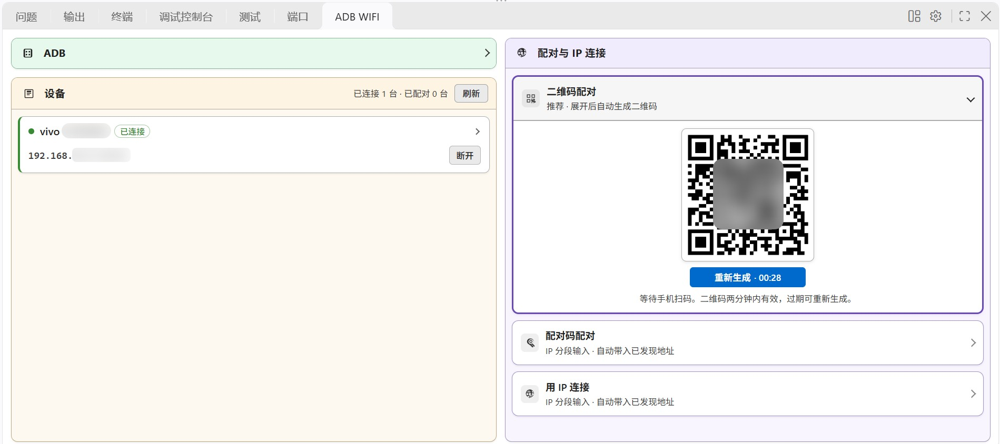

# ADB WIFI 无线调试

在 VS Code 里完成 Android 无线调试：手机扫码或输入配对码配对，然后在编辑器内连接、断开和管理设备，无需数据线。

## 功能

- 二维码配对 / 配对码配对
- 自动发现同一局域网内开启无线调试的手机
- 连接、断开、解除配对，复制 ADB 地址
- 记住上次设备，VS Code 重启后可重新连接
- 显示 ADB、mDNS 与配对记录状态，并提供诊断

## 使用

1. 手机开启「开发者选项 → 无线调试」，并与电脑连接同一局域网。
2. 点击活动栏的 **ADB WIFI** 图标，打开侧边栏控制台。
3. 在「配对与 IP 连接」中选择「二维码配对」，用手机「使用二维码配对设备」扫码；或选择「配对码配对」，填写手机弹窗中的地址和 6 位配对码。
4. 配对成功后，在设备列表点击「连接」。

已知手机无线调试地址时，也可以直接在「用 IP 连接」中填写 IP 和端口连接。

## 命令

命令面板（`Ctrl+Shift+P`）搜索 `ADB-WIFI`：

| 命令 | 作用 |
| --- | --- |
| `ADB-WIFI: 1. 显示页面` | 打开侧边栏控制台 |
| `ADB-WIFI: 2. 配对` | 展开二维码配对 |
| `ADB-WIFI: 3. 连接` | 展开「用 IP 连接」 |
| `ADB-WIFI: 4. 重连` | 自动重连上次设备 |

## 环境要求

Windows 10 / 11、VS Code 1.100 及以上、Android 11 及以上手机，以及本机可用的 ADB（未加入 PATH 时可在设置中指定路径）。

## 设置

| 设置项 | 说明 |
| --- | --- |
| `adbWifi.adbPath` | ADB 可执行文件或目录，留空时自动查找 |
| `adbWifi.serverPort` | ADB 服务端口，默认 5038 |
| `adbWifi.refreshInterval` | 状态刷新间隔，默认 2000 毫秒 |
