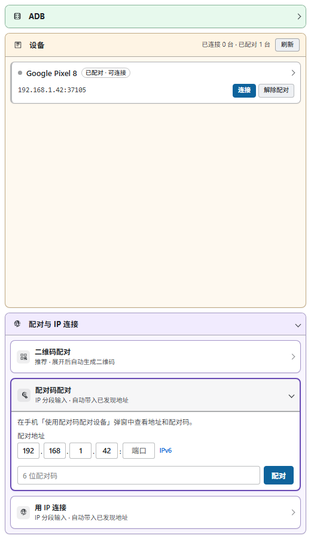
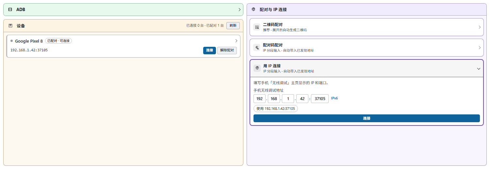

# ADB WIFI 无线调试

在 VS Code 中完成 Android 11+ 无线调试：二维码 / 配对码配对、设备发现、无线连接、历史配对管理与 ADB 诊断。

## 功能

- **二维码配对**：生成 Android 无线调试二维码，手机扫码完成配对。
- **配对码配对**：输入手机弹窗中的 IP:端口与 6 位配对码。
- **IP 分段输入**：IPv4 四段 + 端口，可切换 IPv6，已发现地址自动带入。
- **设备管理**：连接、断开、解除配对、复制 ADB 标识与地址；设备资料断开后仍保留。
- **自动重连**：重连上次使用的设备，失败时打开连接页面。
- **状态通知**：连接成功后显示 VS Code 通知。
- **宽屏适配**：侧边栏与底部面板中自动切换单列 / 左右双栏布局。

## 安装

在 VS Code 扩展视图中搜索 **ADB WIFI 无线调试**，或打开本扩展的 Marketplace 页面点击 **Install**。

安装或更新后重新加载 VS Code 窗口。

## 快速开始

1. 在手机「开发者选项 → 无线调试」中启用无线调试；
2. 打开命令面板，执行 `ADB-WIFI: 2. 配对`，用二维码或配对码完成配对；
3. 在侧边栏「设备」区域点击「连接」；或执行 `ADB-WIFI: 3. 连接` 手动填写地址。

## 命令

命令面板搜索 `ADB-WIFI`：

| 中文环境 | 英文环境 | 作用 |
| --- | --- | --- |
| `ADB-WIFI: 1. 显示页面` | `ADB-WIFI: 1. show` | 打开侧边栏控制台 |
| `ADB-WIFI: 2. 配对` | `ADB-WIFI: 2. pair` | 展开二维码配对 |
| `ADB-WIFI: 3. 连接` | `ADB-WIFI: 3. connect` | 展开「用 IP 连接」 |
| `ADB-WIFI: 4. 重连` | `ADB-WIFI: 4. reconnect` | 自动重连上次设备 |

界面、命令与设置说明会根据 VS Code 显示语言自动切换中文 / 英文。

## 设置

| 设置项 | 默认值 | 说明 |
| --- | --- | --- |
| `adbWifi.adbPath` | 空 | adb 可执行文件或所在目录；留空时自动查找 |
| `adbWifi.serverPort` | `5038` | ADB 服务端口，避开其它工具常用的 5037 |
| `adbWifi.refreshInterval` | `2000` | 设备与 mDNS 状态刷新间隔（毫秒） |

## 环境要求

- VS Code 1.100 及以上；
- Windows 10 / 11；
- Android 11+ 手机，电脑与手机处于同一局域网；
- 已安装 ADB，或通过 `adbWifi.adbPath` 指定 adb 路径。

## 隐私

设备资料仅保存在 VS Code 本地，不上传网络；历史配对只读取本机 ADB 已有记录；扩展不包含遥测或第三方上传逻辑。

## 文档与反馈

- [使用说明](https://github.com/allnan/tinderbox/blob/main/ADB-WIFI-VSCode-Extension/docs/使用说明.md)
- [开发说明](https://github.com/allnan/tinderbox/blob/main/ADB-WIFI-VSCode-Extension/docs/开发说明.md)
- [问题反馈](https://github.com/allnan/tinderbox/issues)

MIT License
