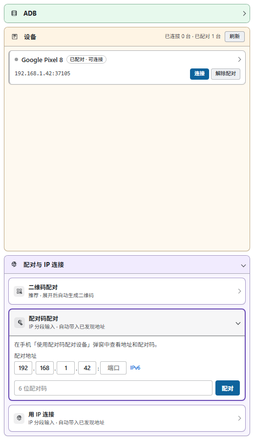
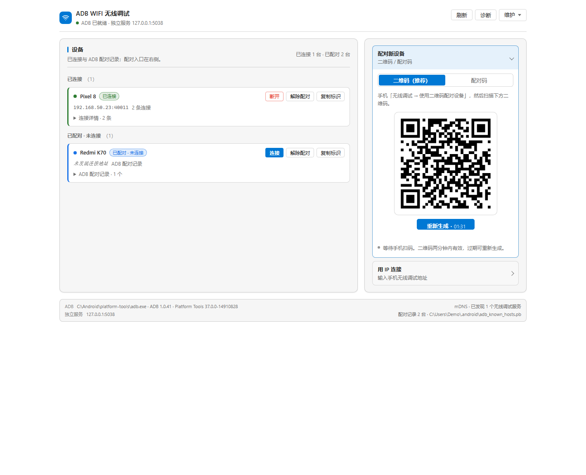
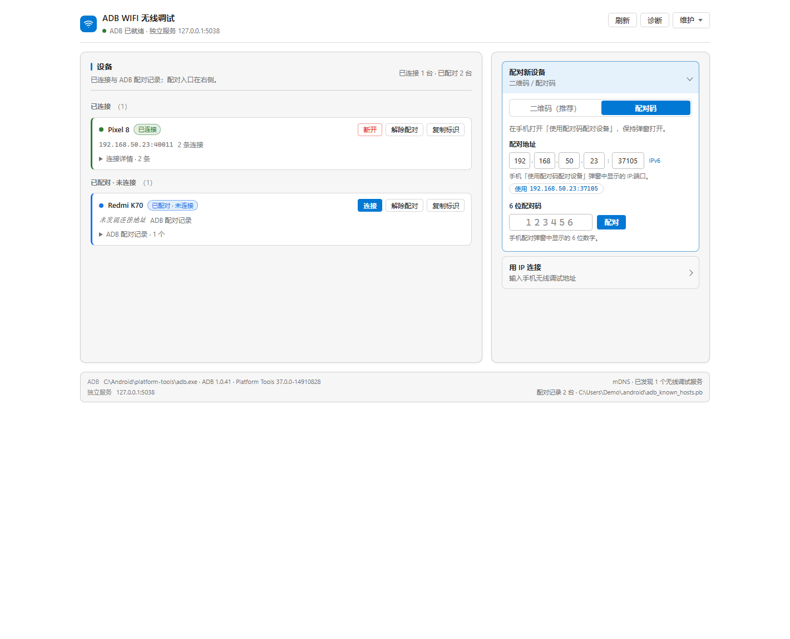
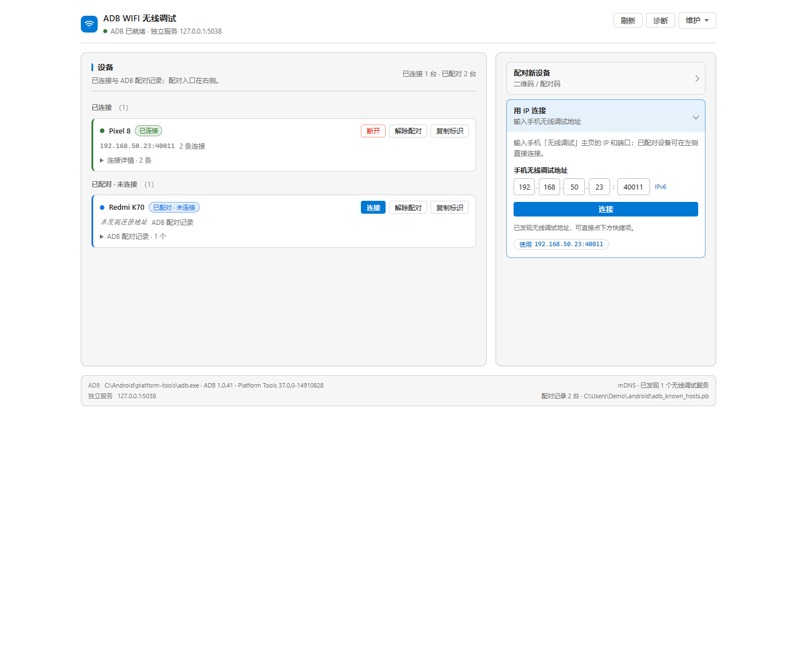
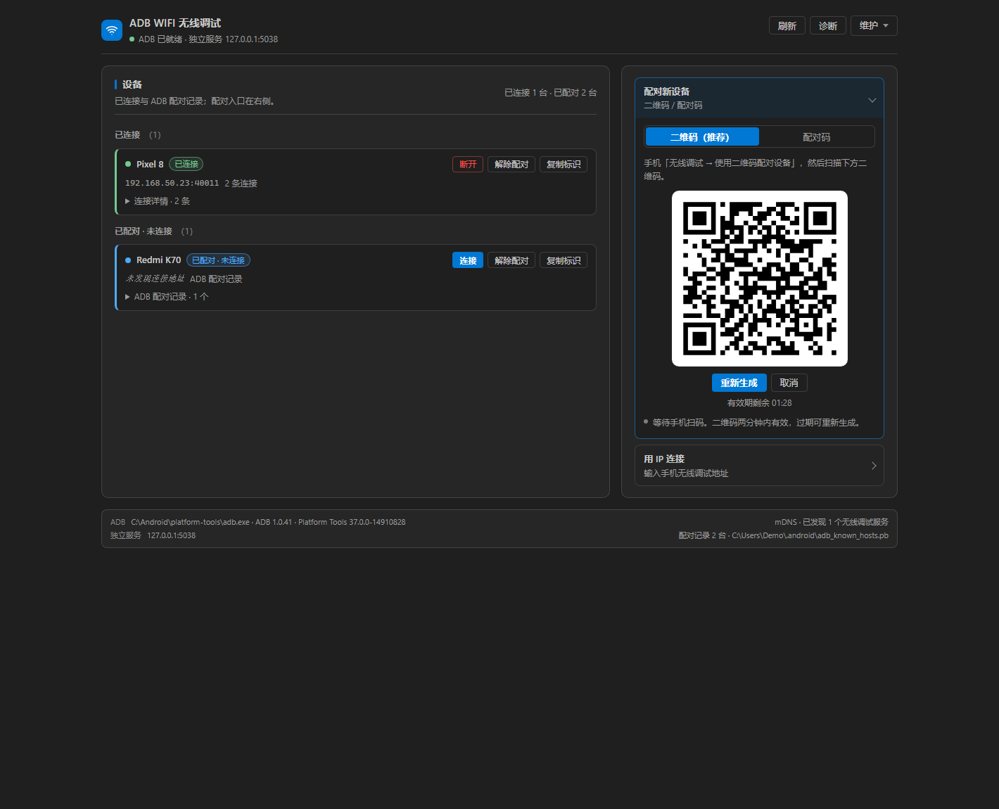

# 使用说明

本文中的相对路径均以项目根目录为基准。扩展需要 Windows 10/11、VS Code 1.100+、Android 11+ 手机，并且电脑 `PATH` 中能找到 `adb.exe`（Android SDK Platform Tools）。

## 1. 安装

### 方式一：VSIX

```powershell
npm install
npm run package
code --install-extension .\dist\adb-wifi-wireless-0.1.0.vsix --force
```

VSIX 生成在 `dist/` 目录，不提交到仓库。安装后重启 VS Code（或执行「开发人员: 重新加载窗口」）。首次使用可执行「ADB WIFI: 重新检测 ADB」确认路径与版本。

### 方式二：开发调试

```powershell
npm install
npm run compile
```

用 VS Code 打开本项目，按 F5 启动「Extension Development Host」窗口；在该窗口里使用扩展。修改代码后执行「开发人员: 重新加载窗口」。

## 2. 入口

- 命令面板（Ctrl+Shift+P）搜索 `ADB WIFI`。
- 活动栏图标「ADB WIFI」：侧边栏是单视图「控制台」，自上而下分三块，并控制高度占比：
  - **ADB**（可折叠，默认展开）：状态、版本、路径、服务、发现、配对记录、设备状态，以及文字按钮；
  - **设备**（不可折叠，撑满剩余高度，列表内部滚动）：折叠时两行——设备名 + 状态、IP；折叠状态直接显示连接 / 断开与解除配对；展开后显示资料，操作按钮放在最底部；
  - **配对与 IP 连接**（可折叠，默认展开）：二维码 / 配对码 / 用 IP 连接三个互斥折叠模块，IP 分段输入并自动带入已发现地址。


- 状态栏「ADB WIFI」：显示已连接 / 已配对数量；ADB 检测失败时显示警告图标。点击打开主面板。

主面板采用左右分栏（与桌面原工具一致）：

- **左侧「设备」**：按「已连接」「已配对 · 未连接」「其他设备」分组显示设备列表；每行提供连接 / 断开 / 解除配对 / 复制标识。展开「连接详情」可查看清洗后的连接记录，自动刷新时不会自动收起。
- **右侧「配对与连接」**：两个**同级操作 TitleBar**——「配对新设备」和「用 IP 连接」，样式、配色一致，当前项用蓝色高亮。选中的 TitleBar 与它自己的内容在同一个卡片里，另一个 TitleBar 收在下面；点击另一个 TitleBar 时，当前卡片收起、目标卡片展开，内容上下挤压切换，不会左右滑动。
- **配对新设备**：二维码（推荐）与配对码两种方式；只有面板可见且停留在二维码页时才会自动生成（切到配对码、切到「用 IP 连接」或面板不可见时暂停），无需点击按钮。隐藏时只暂停生成，已经生成的二维码继续有效；重新可见时若还没过期就继续展示，过期则重新生成。二维码两分钟内有效，剩余时间显示在「重新生成」按钮内，过期后自动续期。配对码地址恢复 IPv4 分段输入，并优先自动带入已发现的配对地址。
- **用 IP 连接**：点击其 TitleBar 后，在它下方填写手机「无线调试」主页的 IP 和端口即可连接，同样支持分段输入与自动带入已发现地址。
- **底部状态栏**：显示 ADB 路径 / 版本、ADB 服务地址、mDNS 与配对记录状态。

界面示意（模拟数据，实际颜色随 VS Code 主题变化）：









## 3. 配对

先让电脑和手机连接同一局域网，在手机开发者选项中打开「无线调试」。

### 二维码配对

1. 打开主面板，右侧「配对新设备」默认显示「二维码」；如果不是，先切到「二维码」。
2. 二维码区域保持可见时会自动生成，无需手动点击。侧边栏和主面板两个二维码位置共用同一张二维码：只要任意一处可见就继续自动生成 / 续期，两处都不可见时才暂停生成。暂停时已生成的二维码不会失效，重新可见后若未过期就继续展示，过期则重新生成。二维码两分钟内有效，剩余时间显示在「重新生成」按钮内，过期会自动续期，失败时点该按钮重试。
3. 在手机上点「使用二维码配对设备」扫描屏幕上的二维码。
4. 扩展发现手机广播的配对服务后自动执行配对；设备会出现在左侧「设备」列表。

二维码服务名与配对密码由扩展本地随机生成，只通过二维码展示，不会写入任何文件。

### 配对码配对

1. 在手机上点「使用配对码配对设备」，保持弹窗打开。
2. 在右侧切到「配对新设备」，再切「配对码」。配对地址是 IPv4 四段 + 端口输入（IPv6 可点「IPv6」切换）；扩展发现唯一配对地址时会自动带入，无需手抄。也可以在地址下方的「使用 …」快捷项填入，或把完整地址粘贴到任一段，自动拆分。
3. 输入手机显示的 **6 位配对码**，点「配对」。

配对成功后，如果手机无线调试仍开启，扩展会短暂等待 ADB 确认连接；未连接时按下一节手动连接。

## 4. 用 IP 连接

这是独立于配对的功能，适合已知手机无线调试地址、或已配对但未连接的情况。

方式一：在右侧点击「用 IP 连接」标题展开该折叠区；填写手机「无线调试」**主页**上显示的 IP 和端口（注意：不是配对弹窗的端口），点「连接」。IPv4 分段输入，已发现地址时会自动带入；也可以直接使用下方快捷项。

方式二：如果 mDNS 已发现无线调试服务，「用 IP 连接」展开区里会出现「使用 <地址>」快捷项，点一下即可连接；也可以在左侧设备行点「连接」，扩展会主动查询 ADB 配对记录和 mDNS 地址，最多等待 5 轮发现，同一地址失败只尝试一次，并继续等待手机当前端口。

已配对但未连接的设备行只显示「连接」；已连接的无线设备行显示「断开」。连接成功后，设备会出现在左侧「设备」列表与活动栏「设备」视图；同一部手机的 mDNS 与 IP 连接合并成一行。

## 5. 设备与历史配对

- **左侧设备区**：按「已连接」「已配对 · 未连接」「其他设备」分组；每台设备显示名称、品牌、型号、状态、地址与连接摘要，展开「连接详情」可查看清洗后的连接记录（类型、状态、ADB 标识、地址），自动刷新时展开状态会保留。该列表同时包含当前连接和 ADB 自己的配对记录。
- **品牌 / 型号**：设备连接时通过 `getprop` 读取品牌、型号、厂商，并保存到 VS Code 的 `globalState`（仅本机）；设备断开后，即使只剩 ADB 配对记录，也会继续显示上次读到的品牌和型号。
- **配对记录**：读取 ADB 自己的 `.android\adb_known_hosts.pb`。扩展不另存私有历史，只显示 ADB 已配对设备。ADB 配对记录只有设备 GUID，不保存上次连接的 IP 和端口；本次运行中读到的地址只在内存中暂存，重启 VS Code 后丢弃。设备品牌 / 型号是为了断开后展示而单独缓存的资料，不包含连接地址。
- **复制标识**：设备行「复制标识」复制首选连接的 ADB 标识，可用于命令行：

```powershell
adb -P 5038 -s <serial> shell getprop ro.serialno
adb -P 5038 devices -l
```

`-P 5038` 是本扩展默认端口（ADB 自身默认端口为 5037）；如果修改了 `adbWifi.serverPort`，请换成对应端口。不带 `-P` 的 `adb devices` 查看的是系统默认 5037 服务。

## 6. 断开与解除配对

- **断开**：设备行「断开」会断开该设备在本扩展 ADB 服务中的全部无线连接（USB 连接不会断开），已配对记录保留。断开后可再次点「连接」。
- **解除配对**：已配对设备行「解除配对」（或命令面板同名命令）。确认框会说明：只移除本机 ADB 的配对记录，手机端可能仍保留授权；要彻底撤销授权，请在手机「无线调试 → 已配对设备」中忘记此电脑。扩展会在确认后重新检查设备尚未连接，才修改 ADB 配对文件，并保留其它记录。

解除配对会直接修改 ADB 的 `adb_known_hosts.pb`，与同一 Windows 用户下的其它 ADB 客户端共享；操作前请确认没有其它 ADB 工具正在配对。

## 7. ADB 服务与诊断

- 扩展默认使用 `127.0.0.1:5038`（避开 ADB 默认 5037，减少与其它 ADB 工具的冲突），可在设置 `adbWifi.serverPort` 中修改；使用同一端口的其它 ADB 程序会共享该服务。
- 「维护 → 重启 ADB 服务」：执行 `kill-server` / `start-server` 重启当前端口的 ADB 服务；本扩展和其它使用该端口的程序的无线连接会短暂中断，手机授权与 ADB 配对记录保留。
- 「诊断」：在只读文本文档中输出 ADB 路径、ADB 服务、server-status、`mdns check`、`mdns services`、`mdns list-known-hosts`、`devices -l` 与 ADB 进程信息；同时写入「ADB WIFI」输出面板。

## 8. 配置

在 VS Code 设置中搜索 `ADB WIFI`：

| 配置项 | 默认值 | 说明 |
| --- | --- | --- |
| `adbWifi.adbPath` | 空 | adb 可执行文件或其所在目录。留空时优先读取 `ADB` 环境变量，其次 `ANDROID_HOME` / `ANDROID_SDK_ROOT` 下的 `platform-tools`，最后从 `PATH` 查找。支持 `%VAR%` 环境变量展开。设置页描述中提供「选择 adb 文件」命令链接，也可在命令面板执行「ADB WIFI: 选择 ADB 可执行文件」或使用「维护 → 选择 ADB 文件」通过文件选择器指定。 |
| `adbWifi.serverPort` | 5038 | ADB 服务端口。默认 5038（避开 ADB 默认 5037）；修改后会自动重新检测 ADB。 |
| `adbWifi.refreshInterval` | 2000 | 正常状态下刷新设备 / mDNS 的间隔（毫秒）。二维码配对时自动加快，发现失败时自动放慢。 |

## 9. 常见问题

- **提示「未找到 adb」**：安装 Android SDK Platform Tools，并任选一种方式：把所在目录加入 `PATH`、设置 `ADB` 环境变量、设置 `ANDROID_HOME` / `ANDROID_SDK_ROOT`，或直接配置 `adbWifi.adbPath`（可用「ADB WIFI: 选择 ADB 可执行文件」或「维护 → 选择 ADB 文件」打开文件选择器）；然后执行「维护 → 重新检测 ADB」或重启 VS Code。
- **二维码一直停在「等待手机扫码」**：确认手机与电脑同一局域网、手机弹出扫码配对页；二维码过期后会自动重新生成，若一直未刷新可点「重新生成」。若仍不行，改用配对码配对。
- **配对失败**：确认手机配对弹窗仍未关闭；配对码为 6 位数字；配对地址取自「使用配对码配对设备」弹窗，而不是无线调试主页。
- **连接失败**：确认填写的是无线调试**主页**的 IP 和端口；关闭再开启手机无线调试后端口会变化，请重新填写或从历史设备点「连接」让扩展重新发现。
- **mDNS 状态异常 / 发现不到服务**：点「诊断」查看 `mdns check` 结果；可尝试「维护 → 重启 ADB 服务」；确认手机无线调试处于开启状态。
- **历史配对显示读取失败**：检查 `%USERPROFILE%\.android\adb_known_hosts.pb` 是否存在、是否被其它 ADB 进程占用；扩展会尝试回退到 `adb mdns list-known-hosts --proto-text`。
- **解除配对后手机仍显示已配对**：这是预期行为——手机端授权需在手机「无线调试 → 已配对设备」中移除。

## 10. 相关文档

- [项目首页](../README.md)
- [开发说明](./开发说明.md)
- [移植说明](./移植说明.md)
- [调研：VS Code 扩展开发](./调研-VSCode扩展开发.md)


