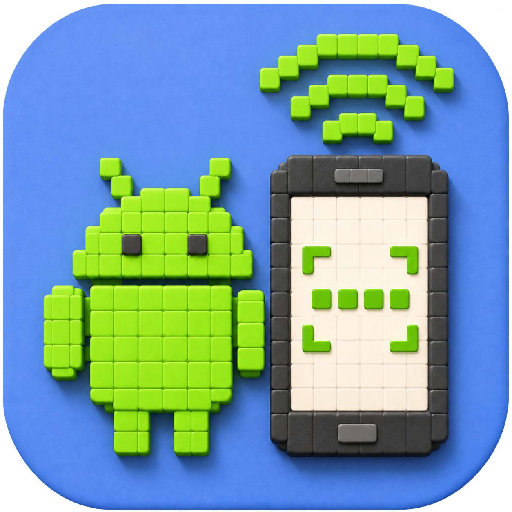
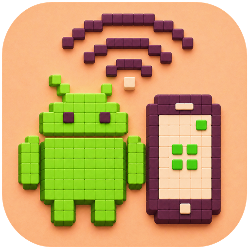
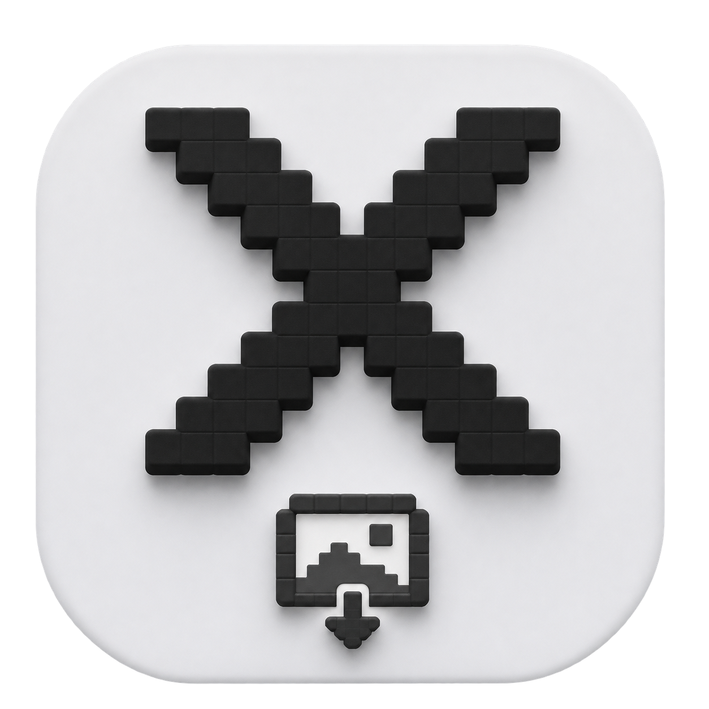
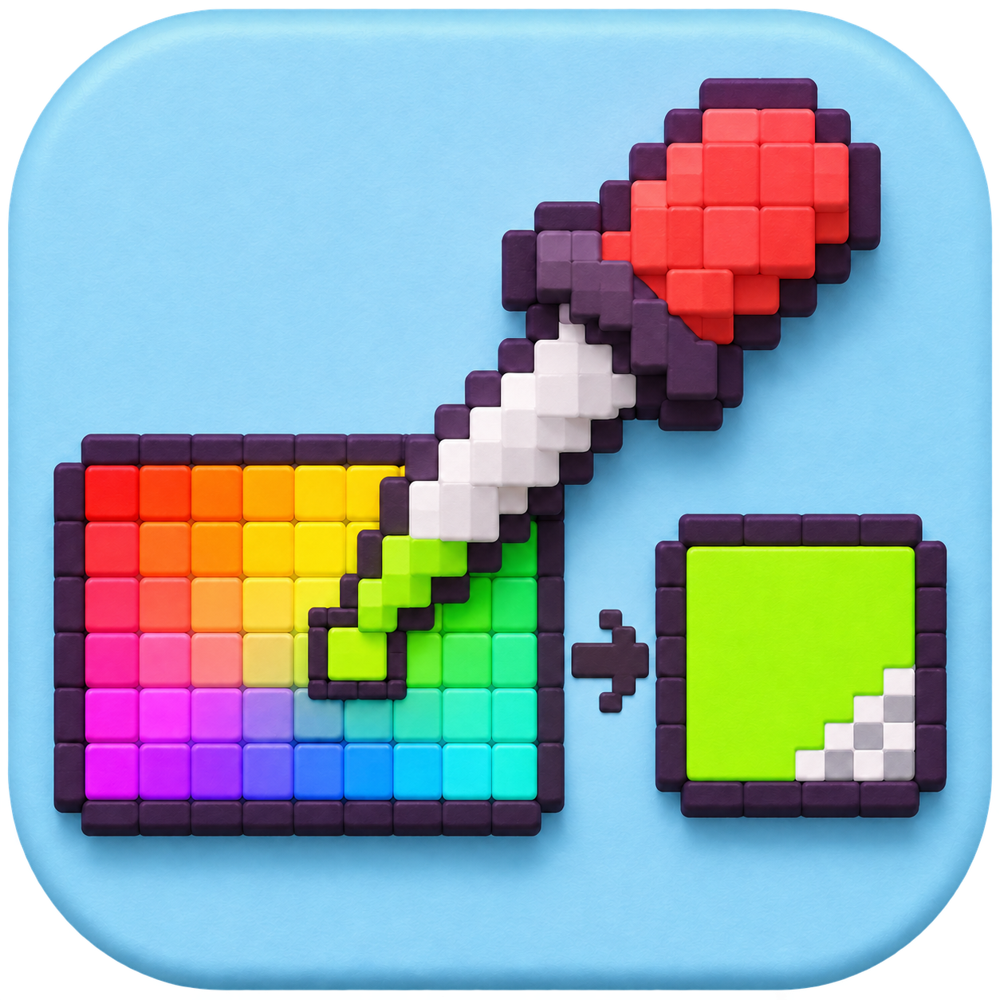

  

# Tinderbox

这里存放我借助 AI 开发的一些小工具、小项目和可复用组件库。每个项目使用独立文件夹，分别维护源码、依赖和使用说明。

## 项目目录

项目按用途分为两类：**小工具与应用**（可直接运行、解决具体问题的桌面端、移动端或插件）和 **组件与依赖库**（供其他项目引用的代码库）。

### 小工具与应用

| 图标 | 项目 | 简介 | 开发状态 | 项目目录 | 安装/部署目录 | 测试目录 |
| --- | --- | --- | --- | --- | --- | --- |
|  | ADB 无线调试 | Windows 桌面工具，提供 Android 无线调试的二维码与配对码配对、设备发现、连接及历史配对管理。 | v1.3.7.0；mDNS 发现异常待复现；已安装。 | [ADB-connect-tool](./ADB-connect-tool/) | `D:\1-Tools\[TinderBox]-ADB-connect-tool` | — |
|  | ADB 无线调试（VS Code 扩展） | 从桌面版 ADB 无线调试工具移植的 VS Code 扩展，在编辑器内完成 Android 无线调试的二维码 / 配对码配对、设备发现、连接、历史配对管理与诊断。 | v0.1.0；编译、12 项单测、VSIX 打包与隔离安装通过；主面板双 TitleBar、侧边栏富 Webview 卡片、IPv4 分段输入、二维码自动生成、ADB 路径（支持文件选择）/ 端口可配置、设备品牌型号持久化；已修复状态闪烁与详情自动收起；真实 VS Code 激活与手机实机流程待验证。 | [ADB-WIFI-VSCode-Extension](./ADB-WIFI-VSCode-Extension/) | VSIX（`dist/` 构建产物，不提交；扩展 ID `tinderbox.adb-wifi-wireless`） | — |
|  | Clash 订阅与流量管理 | Tauri Windows 便携桌面工具，合并订阅、管理可视化策略组，并通过 Mihomo 核对实际规则与节点，查看流量历史。 | Windows 启动增加单实例锁，重复启动唤起现有窗口；托盘图标双击打开主界面；策略组顺序弹窗铺满窗口可用高度，紧凑卡片沿竖向分布；流量趋势使用 Recharts 并列显示上传/下载，悬停提示即时定位且点击不留黑框；模板导入限于已支持的常见格式。 | [clash-flow-manager](./clash-flow-manager/) | 用户选择的便携目录 | 用户桌面下的临时测试目录 |
|  | Codex 用量预测 | Codex 桌面侧边栏插件，显示 5 小时与周额度、重置时间、历史用量曲线和用量预测。 | v0.1.30；真实使用窗口的预测校准待评估。 | [codex-usage-panel](./codex-usage-panel/) | — | — |
|  | 配色工坊 | Windows 桌面工具，为前端项目生成、管理、检查并导出配色方案。 | 功能已实现；验收基线通过。 | [palette-studio](./palette-studio/) | — | — |
|  | 表情包仓库 | Windows 相册式表情包工具：全局热键快速呼出、点一下即复制，主界面按相册拖动整理，并提供可撤回的本地规则整理。 | 恢复开发（2026-11-24）；v0.1.0；原生下拉已全部替换为自绘下拉；AI 整理已移出并归档到 `archive/ai/`；构建、16 项单测、25 项主界面与 7 项快捷窗口冒烟、release 自检通过；开发阶段构建后已强制覆盖桌面版本（SHA256 一致）；真实 WebView2 窗口已复验 AI 移除与下拉；第三方应用粘贴场景待复验。 | [meme-vault](./meme-vault/) | — | `F:\桌面\meme` |
|  | 晚安定时关机 | Windows 桌面工具，按倒计时或指定时刻安排强制关机，并提供取消与分区时间预览。 | 逻辑测试通过；界面与真实关机结果待验证；已安装。 | [goodnight-shutdown-tool](./goodnight-shutdown-tool/) | `D:\1-Tools\[TinderBox]-goodnight-shutdown-tool` | `F:\桌面` |
|  | 终末地资源账本 | Windows x64 与 Android 资源记录工具，提供抽数换算、游戏日趋势和局域网同步。 | v2.7.3+28；真实设备间局域网同步待验证；已安装。 | [endfield-resources-tools](./endfield-resources-tools/) | 当前：`D:\1-Tools\[TinderBox]-endfield-resources-tools` 原程序及数据来源：`F:\游戏工具\终末地\终末地资源账本` | — |
|  | X 媒体工坊 | Windows 桌面工具，用于解析 X（Twitter）推文、保存原始媒体并导出 GIF/WebP。 | 真实功能版；自动验证 15/15 项通过；已安装。 | [x-gif-studio-tauri](./x-gif-studio-tauri/) | `D:\1-Tools\[TinderBox]-xMedia` | `F:\桌面\xMedia` |
|  | 阿咬宠物机 | 手机优先的像素风虚拟宠物，支持部位触摸、场景移动、追叶子、躲猫猫、喂食护理和日常陪伴记录。 | v1.7；新增交互与新版真机画面待验证。 | [yao-pocket-pet](./yao-pocket-pet/) | — | — |
|  | TinderKit 工具集 | 待开发的 Windows 小工具集：常驻宿主 + 插件式工具，技术栈 C# + .NET 10 + WPF；当前只保留软件方案。 | 方案阶段，未开始编码；仅有架构与开发约定文档。 | [tinderkit](./tinderkit/) | — | — |
|  | 拼好猫（待做） | 待做的猫主题项目，当前仅保存原始想法。 | 尚未开发；仅保存原始想法。 | [pin-hao-mao](./pin-hao-mao/) | — | — |

`—` 表示目前没有确认的安装/部署目录或测试目录。

### 组件与依赖库

| 图标 | 项目 | 简介 | 开发状态 | 目录 |
| --- | --- | --- | --- | --- |
|  | 取色器（独立库） | 从配色工坊独立出来的取色器设计存档与 React 参考实现，含 OKLCH 全彩色域图、三种取色方式与演示页。 | v0.1.0；构建、12 项测试与演示冒烟通过，浏览器截图待完整桌面环境验证。 | [color-picker](./color-picker/) |

新增项目后，必须在此登记项目名称、一句话简介、所属分类和对应文件夹的相对链接。

## 项目文档

### 小工具与应用

- ADB 无线调试：[使用说明](./ADB-connect-tool/docs/使用说明.md) · [开发说明](./ADB-connect-tool/docs/开发说明.md)。
- ADB 无线调试（VS Code 扩展）：[使用说明](./ADB-WIFI-VSCode-Extension/docs/使用说明.md) · [开发说明](./ADB-WIFI-VSCode-Extension/docs/开发说明.md) · [移植说明](./ADB-WIFI-VSCode-Extension/docs/移植说明.md) · [调研：VS Code 扩展开发](./ADB-WIFI-VSCode-Extension/docs/调研-VSCode扩展开发.md)。
- Clash 订阅与流量管理：[使用说明](./clash-flow-manager/docs/使用说明.md) · [开发说明](./clash-flow-manager/docs/开发说明.md)。
- Codex 用量预测：[使用说明](./codex-usage-panel/docs/使用说明.md) · [开发说明](./codex-usage-panel/docs/开发说明.md) · [额度预算算法](./codex-usage-panel/docs/额度预算算法.md)。
- 配色工坊：[使用说明](./palette-studio/docs/使用说明.md) · [开发说明](./palette-studio/docs/开发说明.md) · [取色器说明](./palette-studio/docs/取色器说明.md) · [项目交接](./palette-studio/docs/项目交接.md) · [更新日志](./palette-studio/docs/更新日志.md)。
- 表情包仓库：[使用说明](./meme-vault/docs/使用说明.md) · [开发说明](./meme-vault/docs/开发说明.md)。
- 晚安定时关机：[使用说明](./goodnight-shutdown-tool/docs/使用说明.md) · [开发说明](./goodnight-shutdown-tool/docs/开发说明.md)。
- 终末地资源账本：[使用说明](./endfield-resources-tools/docs/使用说明.md) · [开发说明](./endfield-resources-tools/docs/开发说明.md) · [换算与记录规则](./endfield-resources-tools/docs/换算与记录规则.md) · [验证记录](./endfield-resources-tools/docs/验证记录.md)。
- X 媒体工坊：[使用说明](./x-gif-studio-tauri/docs/使用说明.md) · [开发说明](./x-gif-studio-tauri/docs/开发说明.md) · [推文解析移植说明](./x-gif-studio-tauri/docs/PORT-tweet.md) · [转换移植说明](./x-gif-studio-tauri/docs/PORT-convert.md)。
- 阿咬宠物机：[使用说明](./yao-pocket-pet/docs/使用说明.md) · [开发说明](./yao-pocket-pet/docs/开发说明.md) · [资料来源与角色设定](./yao-pocket-pet/docs/资料来源与角色设定.md) · [设计核对](./yao-pocket-pet/docs/设计核对.md)。
- TinderKit 工具集：[使用说明](./tinderkit/docs/使用说明.md) · [开发说明](./tinderkit/docs/开发说明.md) · [架构说明](./tinderkit/docs/架构说明.md)。
- 拼好猫（待做）：[想法记录](./pin-hao-mao/docs/想法记录.md) · [开发说明](./pin-hao-mao/docs/开发说明.md)。

### 组件与依赖库

- 取色器（独立库）：[设计方案](./color-picker/docs/设计方案.md) · [全彩取色算法](./color-picker/docs/全彩取色算法.md) · [使用说明](./color-picker/docs/使用说明.md) · [开发说明](./color-picker/docs/开发说明.md)。

## 存放方式

- 每个工具或小项目必须放在仓库根目录下的独立文件夹中，目录名必须便于识别用途。
- 项目目录按「小工具与应用」「组件与依赖库」两类分组维护；新增项目必须归入对应分组。
- 每个项目必须提供自己的 `README.md`，说明用途、运行或使用方法及必要依赖。
- 每个项目必须使用 `docs/` 存放详细文档：`开发说明.md` 记录技术与验证要求，`使用说明.md` 记录详细操作，算法等专题按实际内容单独编写。
- 项目的源码、依赖声明、构建配置和专属资料必须放在对应项目文件夹内。
- 新增、迁移、删除项目，或调整项目用途时，必须同步更新本页的项目目录、简介和分组。

## 使用方式

从上方目录进入具体项目，先阅读该项目的 `README.md`，再按其中的说明安装依赖、运行或使用。

## 视觉规范

Tinderbox 内部项目图标遵循[图标风格规范](./docs/图标风格.md)。

仓库自身使用根目录 [icon.png](./icon.png) 作为 Tinderbox 的标志，显示在本页顶部；它不属于任何子项目，也不随子项目图标变化，不得删除。

## AI 协作

AI 开发与维护必须遵守仓库根目录的 [AGENTS.md](./AGENTS.md)。项目专属技术约束统一记录在各项目的 `docs/开发说明.md`。
