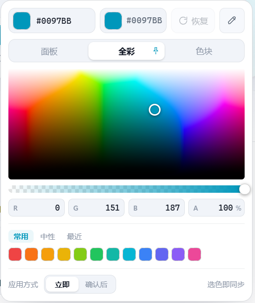

# 取色器（Color Picker）

从 [配色工坊](../palette-studio/) 独立出来的取色器设计存档 + React 参考实现：面板 / OKLCH 全彩 / 色块三种取色方式合在同一个浮层里，支持透明度、中文色名、常用与最近颜色、立即/确认后两种应用方式。



<sub>图为配色工坊原界面截图；独立库保持同一视觉。</sub>

## 为什么保留它

这只取色器有三处值得长期保留的设计：

1. **全彩模式 = OKLCH 最大色度色域图**：横向色相、纵向感知明度，每个像素都是该明度下 sRGB 能显示的最鲜艳颜色；不是常见的 HSV 色带。
2. **三种方式合一面板**：面板（精细微调）、全彩（大范围）、色块（快速标准色）在同一个弹窗里切换，另有 tab 图钉记忆默认方式。
3. **一整套交互细节**：打开时锁定强调色、恢复初始颜色、颜色小窗中文色名、透明度 8 位 HEX、确认模式先预览后写回。

独立成库时保持了与配色工坊一致的视觉与交互，并把颜色数学、中文色名、全彩算法拆成可单独使用的纯函数。

## 主要能力

- **三种取色方式**：HSV 面板 + 色相条 / OKLCH 全彩色域图 / 12×5 + 12 灰阶色块网格。
- **透明度**：0–100% 滑条、A 数值、棋盘格预览，输出 `#RRGGBBAA`。
- **应用方式**：立即同步 / 确认后同步，按 localStorage 记忆。
- **颜色小窗**：点击当前颜色块，显示 132×132 色块、中文色名与 HEX，不改变面板尺寸。
- **主题**：`auto` / `light` / `dark`；优先复用宿主设计变量，没有时使用内置主题。
- **纯函数工具**：颜色解析/转换、OKLCH、对比度、混合、中文色名、色域图计算，可从 `./core` 单独引入。
- **零第三方色彩依赖**：颜色数学与色域图全部自研。

## 运行环境

- Node.js 22+、npm 11+：构建、测试与演示页打包；
- 现代 Chromium 内核（Chrome / Edge / Electron / WebView2）：取色器使用 Pointer Events、Canvas 与 `color-mix`；
- 作为组件使用时：React 18+ 或 19，`react-dom` 由宿主项目提供。

## 快速开始

在 `color-picker/` 目录执行：

```powershell
# 1. 安装依赖（受限环境必须带 --ignore-scripts --cache .npm-cache）
npm install --ignore-scripts --cache .npm-cache

# 2. 类型检查 + 构建 + 12 项测试 + 演示页构建与冒烟
npm run check

# 3. 预览演示页
npm run serve
```

打开 <http://127.0.0.1:4173/>；深色并直接展开全彩取色器：<http://127.0.0.1:4173/?theme=dark&open=full>。

也可以直接双击 `demo/index.html`（单文件 IIFE，不需要构建服务）。

## 在其他项目中使用

```tsx
import { ColorPicker } from '@tinderbox/color-picker'
import '@tinderbox/color-picker/styles.css'

<ColorPicker value={color} onChange={setColor} storagePrefix="my-app" />
```

包未发布到 npm，当前用本地路径或 `npm pack` 引用；详见 [使用说明](./docs/使用说明.md) 第 2 节。

## 目录

```text
color-picker/
├─ src/
│  ├─ core/            纯函数：色彩数学、中文色名、OKLCH 全彩色域图
│  ├─ components/      ColorPicker 组件与样式
│  ├─ spectrum-image.ts 全彩图 canvas 封装与缓存
│  └─ index.ts         库入口
├─ demo/               演示页（原生 HTML + 打包后的 React）
├─ tests/              纯函数测试 + jsdom 组件测试
├─ scripts/            构建 / 测试 / 演示 / 色域图生成
└─ docs/               设计方案、全彩算法、使用与开发文档、资产
```

## 文档

- [设计方案](./docs/设计方案.md)：设计目标、界面与交互、状态与数据流、视觉规范、决策日志、已知限制、验收要点。
- [全彩取色算法](./docs/全彩取色算法.md)：OKLCH 色域切片、最大色度二分、平滑/抖动/端点、光标与性能、验证方式。
- [使用说明](./docs/使用说明.md)：演示页、安装与接入、Props、主题令牌、Electron/Tauri、常见问题。
- [开发说明](./docs/开发说明.md)：技术栈、目录入口、构建与测试、库化差异、已验证结果与后续计划。

## 状态

- 版本：0.1.0（2026-11，从配色工坊独立）。
- 已验证：类型检查 0 错误；12/12 测试通过；演示页冒烟通过；`dist/` 与演示页构建成功；色域图 PNG 由真实算法生成。
- 未验证：真实浏览器 / Electron 中的视觉截图（当前受限会话无法启动 Chromium），需要完整桌面环境确认。
- 当前形态：React 组件；`./core` 纯函数与框架无关。配色工坊目前仍保留自身实现，尚未切到本库（接入步骤见 [开发说明](./docs/开发说明.md) 第 7 节）。Web Component / Vue 适配为计划项，见第 9 节。

## 许可

内部工具，UNLICENSED；包标记为 `private`，未经许可请勿外传。
