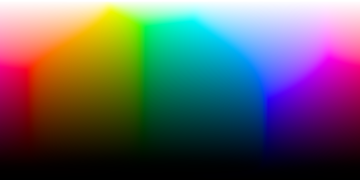

# 全彩取色算法（OKLCH 最大色度色域图）

> 本文记录「全彩」模式从数学定义到像素渲染、再到指针取色的完整实现。
> 设计背景与交互见 [设计方案](./设计方案.md) 第 5 节；源码：[core/spectrum.ts](../src/core/spectrum.ts)、[spectrum-image.ts](../src/spectrum-image.ts)。



## 1. 目标

传统取色器通常用 HSV/HSL 色带：横向色相、纵向明度或饱和度。它实现简单，但有两个问题：

1. HSV 的「明度」不是感知均匀的，扫过色带时中段会突然变亮/变暗；
2. 色带只覆盖一个固定饱和度切片，想选「当前明度下最鲜艳的颜色」需要来回调两个滑条。

「全彩」模式换一种画法：

- 横轴：色相 `H`，0°→360°；
- 纵轴：**感知明度** `L`，顶部 1（白）→ 底部 0（黑）；
- 每个像素：在该 `(L, H)` 下，取 **sRGB 能表示的最大色度 `C`**。

于是整张图就是 sRGB 色域在 `(L, H)` 平面上的「最大色度切片」：图中任意一点都是该明度、该色相下最鲜艳的颜色，没有色域外的灰块，也不需要额外画色域边界。

这张图既是取色底图，也是这套方案最值得保留的部分。

## 2. 坐标与颜色定义

使用 Björn Ottosson 的 OKLab / OKLCH：

```text
OKLCH:  L（明度 0–1）, C（色度 ≥0）, H（色相角 0–360°）
OKLab:  L, a = C·cos(H), b = C·sin(H)
```

从 `(L, C, H)` 到线性 sRGB 的变换（矩阵系数与 [Ottosson 原文](https://bottosson.github.io/posts/oklab/) 一致）：

```text
l_ = L + 0.3963377774·a + 0.2158037573·b
m_ = L - 0.1055613458·a - 0.0638541728·b
s_ = L - 0.0894841775·a - 1.2914855480·b

l = l_³, m = m_³, s = s_³

R =  4.0767416621·l - 3.3077115913·m + 0.2309699292·s
G = -1.2684380046·l + 2.6097574011·m - 0.3413193965·s
B = -0.0041960863·l - 0.7034186147·m + 1.7076147010·s
```

线性 sRGB 再经 gamma 编码得到 0–255 的通道值。判断「在色域内」时直接看线性通道是否落在 `[-1e-4, 1+1e-4]`（容差用于吸收矩阵舍入误差）。

## 3. 求每个点的最大色度

对给定 `(L, H)`，色相方向固定，只剩色度 `C` 一个变量。sRGB 色域在该方向上是一个区间 `[0, C_max]`，所以可以二分：

```text
function maxChromaAt(L, H):
  cos = cos(H), sin = sin(H)
  upper = 0.4                         # 远大于 sRGB 实际可达值，作为二分上界

  if inGamut(oklabToLinear(L, upper·cos, upper·sin)):
      return upper

  low = 0, high = upper
  repeat 18 times:
      mid = (low + high) / 2
      if inGamut(oklabToLinear(L, mid·cos, mid·sin)):
          low = mid
      else:
          high = mid
  return low
```

- 上界 `0.4`：OKLCH 中 sRGB 的色度通常不超过 0.37，`0.4` 足够宽；
- 18 次二分：精度约 `0.4 / 2^18 ≈ 1.5e-6`，远高于 8 位通道所需；
- 复杂度：每个像素最多 18 次矩阵运算，720×360 共约 26 万像素。实测整张图（含平滑）在 Node 22 上约 **0.35 s**，浏览器主线程同量级，因此只在首次进入全彩模式时生成一次并缓存。

### 3.1 为什么不预计算 LUT / 不上 GPU

| 方案 | 优点 | 代价 |
| --- | --- | --- |
| 逐像素二分（本实现） | 零依赖、代码短、结果精确 | 首次生成约 0.35 s |
| 按色相预计算 LUT + 插值 | 快、便于画色域边界 | 需要额外精度控制与边界处理 |
| GPU 着色器 | 实时刷新、可叠多个色彩空间 | 引入 WebGL 依赖与上下文管理 |

这是桌面取色器的低频操作（打开面板时一次），CPU 逐像素实现足够，且能保持「零第三方依赖、纯 TypeScript 可测试」的约束。

## 4. 图像生成管线

完整流程在 [core/spectrum.ts](../src/core/spectrum.ts) 的 `computeSpectrumRgba()`，画布封装在 [spectrum-image.ts](../src/spectrum-image.ts)。

### 4.1 分辨率

内部固定 **720×360**，显示尺寸约 320×150（2 倍屏下 640×300）。留出 2 倍以上余量，放大查看或截图放大时不容易看出格子。

### 4.2 色度场

按行优先生成 `Float32Array(width × height)`：

```text
for y in 0..height-1:
  L = 1 - y/(height-1)
  for x in 0..width-1:
    H = x/(width-1) · 360
    field[y·width + x] = maxChromaAt(L, H)
```

注意 `width-1` / `height-1`：左右端点和上下端点正好落在 `H=0/360`、`L=1/0`。

### 4.3 平滑（半径 8）

sRGB 在蓝紫区（约 250–290°）有一个真实的色域凹口，最大色度曲线变化很快，直接按 `C_max` 渲染会看到一道折痕。这里对**色度场**做两遍 box blur：

```text
第一遍（水平，色相方向环绕）：
  sum = Σ field[y][(x+d+w) % w], d = -8..8
  pass1 = sum / 17

第二遍（垂直，明度方向夹取）：
  sum = Σ pass1[clamp(y+d, 0, h-1)][x], d = -8..8
  blurred = sum / 17
```

- 半径 8、窗口 17；
- 水平方向环绕，因为色相是闭合的；
- 垂直方向夹取，因为明度两端不能跨过去；
- 平滑只作用于「色度场」，不改变取色公式；每个像素最终仍由 `oklchToRgb` 做色域映射，保证在 sRGB 内。

这一步把蓝紫折痕柔化到肉眼自然，同时几乎不影响其他区域。

### 4.4 渲染与端点

逐像素把 `(L, blurredC, H)` 转成 sRGB，然后：

- **端点强制**：`L ≤ 0.008` → 纯黑 `#000000`；`L ≥ 0.992` → 纯白 `#FFFFFF`。原因是 OKLab 逆变换在 `L≈0/1` 时有矩阵舍入误差，不处理会出现 `010000`、`000002` 这类偏色杂点。
- **Bayer 4×4 抖动**：幅度 `0.9/255`，消除 8 位色深在平滑渐变上的条带。

```text
BAYER4 = [ 0, 8, 2,10,
          12, 4,14, 6,
           3,11, 1, 9,
          15, 7,13, 5 ]

dither = (BAYER4[(y%4)·4 + (x%4)] / 16 - 0.5) · 0.9
R = clamp(round(srgbR + dither), 0, 255)   # G/B 同理
```

### 4.5 缓存

`buildSpectrumImage()` 把 RGBA 写入 canvas，`toDataURL('image/png')` 后存入模块级变量。整个会话只生成一次；再次打开全彩模式直接复用 dataURL。

没有 canvas 的环境（例如 jsdom 测试）会返回空字符串，组件退化为 CSS 色相渐变背景，不抛异常。

## 5. 取色与光标

### 5.1 指针 → 坐标

```text
H = clamp((clientX - rect.left) / rect.width · 360, 0, 359.9)
L = clamp(1 - (clientY - rect.top) / rect.height, 0, 1)
```

`H` 上限取 `359.9` 而不是 `360`，避免色相回到 0 时数值上「跳一圈」。

### 5.2 边缘吸附

```text
if (rect.bottom - clientY <= 2) L = 0
else if (clientY - rect.top <= 2) L = 1
```

上下各 2px 吸附纯黑/纯白，对应渲染时强制端点的设计，保证「点到最边上就是纯色」。

### 5.3 从坐标到颜色

```text
if L == 0:      HEX = '#000000'
else if L == 1: HEX = '#FFFFFF'
else:           HEX = oklchToHex({ l: L, c: 0.4, h: H })
```

`c: 0.4` 是「请求一个超界色度」，`oklchToHex` 内部会做色域映射（二分降到 sRGB 内），结果就是该点允许的最大色度颜色——与底图的计算一致，但不需要回读像素。

### 5.4 光标位置

光标位置存的是**指针坐标** `{h, l}`，不是从选出的颜色反推：

- 接近黑/白时，色相对 RGB 的扰动非常敏感，反推会让圆环乱跳；
- 直接记录指针后，拖动时圆环与鼠标完全重合（验收脚本的 `maxDevPx ≈ 0` 就是查这个）；
- 打开取色器 / 切换全彩 / 点恢复 / 外部改色时，光标移动到对应颜色的 `(L, H)`。

### 5.5 命中区与光标样式

- 取色区域外覆盖一圈 **8px 可拖拽命中区**（`padding: 8px; margin: -8px`，视觉尺寸不变）；即使圆环有一半露在面板外，也能按下并继续拖动。
- 光标：16×16 圆环、2px 白边、阴影、`translate(-50%, -50%)`、`pointer-events: none`、显示在底图上层且不被裁剪。
- 取色区域是 **4px 小圆角**，光标可拖过边缘。

## 6. 为什么蓝紫区有「折痕」、纯蓝只有一条缝

- 蓝紫区（约 250–290°）的折痕是 **sRGB 色域在该区域的自然凹口**：最大色度曲线在这里变化较快，但数学上连续，不是渲染 bug。高分辨率 + 抖动 + 半径 8 的平滑把折痕柔化。
- 纯蓝（`#0000FF`）在 OKLCH 中是一个「尖点」：只有很窄的 `(L≈0.45, H≈264°)` 附近能达到高色度，色相稍偏最大色度就急剧下降。所以全彩图里高饱和蓝天然只占一条窄缝——任何同类 OKLCH 色域图都是这个形状。
- 本项目**没有**为「方便选蓝」加纯色快捷行或人为抹平色域（曾试过，后按「保持专业、不做特例」撤销）。需要快速选标准色时用「常用」色板或直接输入 HEX。

## 7. 与同类实现的对比

| 方式 | 代表 | 优缺点 |
| --- | --- | --- |
| CPU + Canvas 逐像素（本项目） | 本项目 | 零依赖、实现直接；首次生成有一次性开销，分辨率有限 |
| max-chroma LUT + 插值 | [colordx](https://github.com/dkryaklin/colordx-gpu) 文档中的 `chromaLUT` | 更快、便于画色域边界线 |
| GPU 着色器 | [@colordx/gpu](https://github.com/dkryaklin/colordx-gpu) | 实时刷新、多色域叠加；引入 WebGL 依赖 |
| SVG 轮廓 + 渐变 | [oklch.com](https://oklch.com/) / [evilmartians/oklch-picker](https://github.com/evilmartians/oklch-picker) | 可画色域边界，依赖颜色库 |

同生态可参考的取色器与颜色库：[oklch-picker（Nick Bevers）](https://github.com/nord-forge/oklch-picker)、[eero-lehtinen/oklch-color-picker](https://github.com/eero-lehtinen/oklch-color-picker)、[culori](https://culorijs.org/api/)（`clampChroma` / `toGamut`）、[color.js](https://colorjs.io/)。

## 8. 参数表

| 参数 | 值 | 位置 | 说明 |
| --- | --- | --- | --- |
| 渲染宽度 | 720 | `SPECTRUM_WIDTH` | 显示宽度的 2 倍以上 |
| 渲染高度 | 360 | `SPECTRUM_HEIGHT` | 显示高度的 2 倍以上 |
| 色度上界 | 0.4 | `maxChromaAt` | 二分上界 |
| 二分次数 | 18 | `maxChromaAt` | 精度 ≈ 1.5e-6 |
| 色域容差 | 1e-4 | `linearInSrgb` | 吸收矩阵舍入 |
| 平滑半径 | 8（窗口 17） | `SPECTRUM_SMOOTH_RADIUS` | 水平环绕、垂直夹取 |
| 抖动幅度 | 0.9/255 | `SPECTRUM_DITHER` | Bayer 4×4 |
| 端点阈值 | L ≤ 0.008 / L ≥ 0.992 | `computeSpectrumRgba` | 强制纯黑/纯白 |
| 边缘吸附 | 2px | `applySpectrum` | 上下边缘 |
| 命中区 | 8px | `.cp-spectrum-wrap` | 视觉尺寸不变 |
| 光标 | 16×16，2px 白边 | `.cp-spectrum-cursor` | 不裁剪、不拦事件 |

## 9. 验证方式

### 9.1 自动化

`npm test` 中的相关断言：

- `maxChromaAt(1, 0) < 0.001`（白色端点接近 0 色度）；
- `maxChromaAt(0.5, 264) > 0.2`（纯蓝附近确实能达到高色度）；
- `computeSpectrumRgba(16, 8)` 顶行全白、底行全黑、长度与 alpha 正确；
- 颜色数学、中文色名、透明度等基础用例。

### 9.2 视觉资产

```powershell
node scripts/make-spectrum-png.mjs
# → docs/assets/oklch-spectrum.png（720×360，约 387 KB）
```

这个脚本直接用库的 `computeSpectrumRgba` 生成 PNG（手写最小 PNG 编码，不依赖图形库），因此图片本身就是算法输出，可用来目视检查色域形状、折痕柔化与端点。

配色工坊原界面的对照图：[picker-full.png](./assets/screenshots/picker-full.png)。两张图的色域形状应一致。

### 9.3 人工

- 打开全彩，检查：顶部纯白、底部纯黑、蓝紫区过渡自然、无可见色带；
- 在矩形内拖动，光标与指针重合；
- 拖到最上/最下，颜色变为纯白/纯黑；
- 点「恢复」，光标回到初始颜色位置。

## 10. 修改指引

- 调整画质：优先改 `SPECTRUM_WIDTH/HEIGHT`、`SPECTRUM_SMOOTH_RADIUS`、`SPECTRUM_DITHER`；改完必须重新生成 PNG 并跑测试。
- 改算法：`maxChromaAt`、`computeChromaField`、`smoothChromaField`、`computeSpectrumRgba` 是纯函数，保持「不依赖 DOM」；canvas 封装只在 `spectrum-image.ts`。
- 保持缓存：`buildSpectrumImage` 的模块级缓存避免每次打开重算；测试里可调用 `resetSpectrumImageCache()`。
- 性能优化方向：per-hue LUT、Web Worker、GPU；引入前先评估「零依赖」与包体积约束。
- 不要为了「好选某个颜色」修改色域形状；这是方案的核心约束。

## 11. 参考

- [Björn Ottosson · OKLab/OKLCH](https://bottosson.github.io/posts/oklab/)
- [CSS Color 4 · OKLab/OKLCH](https://www.w3.org/TR/css-color-4/#ok-lab) 与 [Gamut Mapping](https://www.w3.org/TR/css-color-4/#gamut-mapping)
- [oklch.com](https://oklch.com/)、[evilmartians/oklch-picker](https://github.com/evilmartians/oklch-picker)
- [colordx / @colordx/gpu](https://github.com/dkryaklin/colordx-gpu) —— gamut slice 渲染与 LUT 思路
- Bayer 抖动：4×4 有序抖动矩阵，幅度取 0.9/255（经验值）
