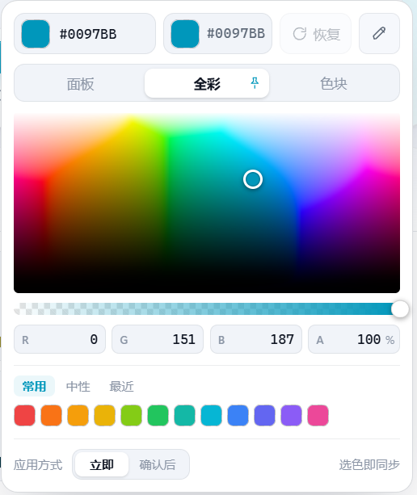
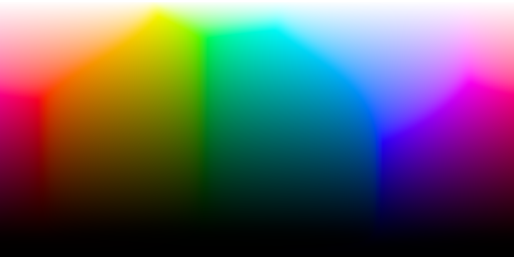

# 取色器设计方案

> 本文是「取色器」的完整设计存档：界面结构、交互规则、状态流转、视觉尺寸、关键决策与验收要点。
> 实现说明见 [全彩取色算法](./全彩取色算法.md) 与 [开发说明](./开发说明.md)；接入方式见 [使用说明](./使用说明.md)。
> 源码入口：[ColorPicker.tsx](../src/components/ColorPicker.tsx)、[color-picker.css](../src/components/color-picker.css)；色彩数学 [color.ts](../src/core/color.ts)；中文色名 [color-names.ts](../src/core/color-names.ts)。



<sub>图为配色工坊原界面截图；独立库保持同一视觉。</sub>

## 1. 项目定位

这套取色器最初是为「配色工坊」（Palette Studio，Electron + React 桌面配色工具）内部所有颜色输入框做的统一控件。因为它有三处值得长期保留的设计，所以从应用中独立出来存档：

1. **把「全彩」做成 OKLCH 色域切片**，而不是常见的 HSV 色带：横向色相、纵向感知明度，每个像素都是该明度下 sRGB 能显示的最鲜艳颜色；
2. **三种取色方式合在同一个浮层**：面板（精细）、全彩（大范围）、色块（快速标准色），不用在多个弹窗之间切换；
3. **一整套少见的交互细节**：tab 上的图钉设默认方式、打开时锁定强调色、恢复初始颜色、颜色小窗中文色名、确认/立即两种应用方式。

独立后的目标是「设计存档 + 可运行参考实现」，而不是先做多框架 SDK：保持与配色工坊一致的视觉与交互，源码可读、可测试、可被其他 React 项目直接复用。框架无关的适配层属于后续计划，见 [开发说明](./开发说明.md) 第 9 节。

## 2. 设计目标与原则

- **全应用唯一取色入口**：所有颜色输入都复用同一个 `ColorPicker`，不出现两套取色交互。
- **不调用系统取色器**：不使用 `<input type="color">`，统一使用自定义浮层；只有在运行环境提供 `EyeDropper` 时，才额外提供屏幕吸管。
- **紧凑浮层**：340px 宽的单面板，浮在触发色块附近；空间不足时自动向上翻转、水平收边。
- **不强迫拖拽**：除面板/全彩的连续取色外，提供「色块模式」——一格一个颜色，单击即选。
- **三种方式合一面板**：面板 / 全彩 / 色块在同一个弹窗内切换，不额外弹出二级窗口。
- **支持透明度**：颜色以 `#RRGGBB` / `#RRGGBBAA` 存储，透明度滑条、A 数值、棋盘格预览齐全。
- **打开期间布局稳定**：恢复按钮、颜色小窗都在固定槽位或浮层中，打开/关闭这些附加内容不改变面板尺寸。
- **取色器是「控件」**：打开时锁定当时界面的强调色，取色器内部的 pin、当前 tab、当前颜色区不会跟着正在编辑的颜色变化。
- **主题自适应**：颜色来自 CSS 变量；宿主已有设计系统时直接复用，没有时使用内置的浅色/深色默认值。
- **零第三方依赖**：取色器、颜色数学、色域图渲染全部自研（React 只作为 UI 运行时）。

### 2.1 参考来源与原创部分

代码注释里记录了参考对象，这里如实区分「借鉴」与「原创」：

| 参考 | 借了什么 | 没借什么 |
| --- | --- | --- |
| [react-colorful](https://github.com/omgovich/react-colorful) | 交互结构：小尺寸浮层、自定义 popover、SV 面板 / 色相条 / 透明度 / HEX 一屏完成 | 它的外观（无样式极简组件） |
| [Figma 取色习惯](https://colorpickerweb.com/figma-color-picker-guide) | 操作习惯：吸管、HEX 输入、常用/最近色板、透明度预设 | 具体视觉 |
| [oklch.com](https://oklch.com/) / [colordx](https://github.com/dkryaklin/colordx-gpu) / [Ottosson OKLab](https://bottosson.github.io/posts/oklab/) | 全彩色域图的算法概念：横向色相 × 纵向明度，每个点取该点 sRGB 最大色度 | 它们的 UI 布局 |
| [CSS Color 4](https://www.w3.org/TR/css-color-4/#ok-lab) / [culori](https://culorijs.org/api/) | OKLCH 定义与色域映射（`clampChroma` 式二分）思路 | 库本身（项目保持零依赖） |

**视觉部分是原创的**：340px 深/浅色浮层、14px 圆角、tab 上的 pin、恢复按钮、应用方式分段控件、强调色锁定、4px 小圆角的取色区域、720×360 + 抖动的色域图、颜色小窗，均按配色工坊的设计变量重新设计，不是现成库皮肤。

## 3. 界面结构

浮层自上而下：

```text
┌────────────────────────────────────────────┐  340px 宽
│ [当前颜色色块] [HEX 输入] [初始颜色色块+值] [恢复] [吸管] │  头部 34px 高
│        ↑ 点击色块可展开「颜色小窗」                        │
├────────────────────────────────────────────┤
│  [面板]  [全彩]  [色块]        ← 每个 tab 上方有 pin（设默认） │
├────────────────────────────────────────────┤
│  取色画布（三选一：SV 面板 / 全彩矩形 / 色块网格）          │
├────────────────────────────────────────────┤
│  透明度滑条（棋盘格 + 渐变 + 圆点）                        │
│  R [ ]  G [ ]  B [ ]  A [ ]%                             │
│  [常用] [中性] [最近]  + 单行色板                          │
│  应用方式  [立即] [确认后]   （提示：选色即同步 / 点应用后同步） │
│  [取消] [应用]   ← 仅确认模式显示，固定最底部                │
└────────────────────────────────────────────┘
```

整体样式：`--cp-bg` 背景、1px `--cp-border-strong` 边框、14px 圆角、10px 内边距、弹出动画 150ms。

### 3.1 头部颜色行

顺序固定：**当前颜色（可编辑）→ 初始颜色（只读）→ 恢复按钮 → 吸管**。

- **当前颜色**：24px 方形色块 + 可编辑 HEX 输入（字号 11.5px），色块带棋盘格底色，颜色绘制在棋盘格之上——只有真正半透明时才会透出网格。
- **初始颜色**：打开取色器时带入的颜色，色块 + 色值（只读），两者规格与当前颜色一致（24px / 11.5px）。
- **恢复**：固定槽位（34px 高），颜色未改动时禁用置灰，改动后点亮并显示强调色；点击后回到初始颜色，立即模式下同时写回外部，确认模式只恢复内部待应用颜色；**全彩光标也会同步回到初始颜色位置**。
- **吸管**：仅当运行环境提供 `window.EyeDropper`（Chromium / WebView2 通常提供）时显示；调用系统吸管取色后写入当前颜色。
- **颜色小窗**：点击当前颜色色块展开，详见 3.5。

### 3.2 取色方式切换与 pin

- 三个 tab：**面板 / 全彩 / 色块**，位于画布上方。
- 每个 tab 上方有一个 pin（图钉）：点击当前 tab 的 pin 可把该方式设为「下次默认」，写入 localStorage，重启/重开仍生效。
- 显示规则：当前 tab 常显 pin；被 pin 的 tab 即使未选中也常显（略降透明度）；其它 tab 仅在悬停当前 tab 时显示 pin。目的是减少常驻视觉噪音。
- 兼容：旧版本保存的 `wheel` 默认方式会映射为 `full`（全彩）。
- 首次使用（没有保存过偏好）默认使用「全彩」；应用方式首次默认「确认后」。用户显式切换后按 localStorage 记忆生效。

### 3.3 取色画布

三种模式共用一块画布区域：

| 模式 | 内容 | 选色方式 |
| --- | --- | --- |
| 面板 | HSV 的 SV 面板 + 色相条 | 拖动面板取饱和度/明度、拖动色相条改色相 |
| 全彩 | OKLCH 最大色度色域图 | 在矩形任意位置单击/拖动取色（详见第 5 节与 [算法文档](./全彩取色算法.md)） |
| 色块 | 12 色相 × 5 档明度 + 12 档灰阶 | 单击格子立即选中 |

拖拽交互统一使用 Pointer Events + `setPointerCapture`：按下即取色，拖动连续更新，松开结束（立即模式下松手时把颜色记入「最近」）。

### 3.4 透明度、RGB/A 与色板

- **透明度条**：0→100% 渐变（透明 → 当前颜色），圆点指示；下方 A 输入框按百分比 0–100。
- **RGB/A 数值**：R/G/B 0–255、A 0–100%，输入即时生效；读数跟随「取色器内部当前颜色」，确认模式下也实时反映预览（独立时修正）。
- **HEX 输入**：支持 6 位与 8 位，失焦或回车时校验；非法值回退到当前值。
- **色板**：单行三个标签——「常用」（12 个高饱和色）、「中性」（10 个灰阶与黑白）、「最近」（最多 12 个，存 localStorage，拖动结束/输入色值/吸管/点选色板/应用确认时记录）；点色块立即选中。

### 3.5 颜色小窗

点击左上角当前颜色色块，展开一块「颜色小窗」：

- 外壳与取色器弹窗同款背景（`--cp-bg`）+ 细边框 + 阴影 + 10px 圆角，内边距 2px，内部是 **132×132 方形大色块**。
- 内容：**中文色名**（如「靛蓝」）+ **HEX 色值**（带透明度时显示 8 位），文字颜色按底色自动取黑/白以保证可读性。
- 位置：浮在取色器**左侧**，外沿距取色器 12px，**顶部与取色器顶部对齐**；左侧空间不足时自动翻到右侧，并夹在视口内。
- 不占布局：使用 `position: fixed` 浮层，打开/关闭**不改变取色器高度**；再点色块收起，关闭取色器时自动收起。
- 色名规则见 6.5。

## 4. 三种取色方式

### 4.1 面板模式（SV + 色相条）

- SV 面板背景 = 当前色相 `hsl(h 100% 50%)`，叠加白色（横向）与黑色（纵向）渐变；圆点光标显示饱和度/明度位置（颜色取当前不透明色）。
- 色相条为标准 0–360° 六段渐变（红→黄→绿→青→蓝→品红→红），圆点显示色相位置。
- 内部仍以 HSV 状态驱动，最终统一转换为 HEX 写回。

### 4.2 色块模式

- 网格：横向 12 个色相（0°/30°/…/330°）× 纵向 5 档明度（`s/v` 组合），最后一行是 12 档中性灰阶（#FFFFFF → #000000），共 72 格。
- 单击任一格立即选中（保留当前透明度），无需拖动；与当前不透明颜色相同的格子高亮。
- 适合快速选标准色；若想让它成为默认打开方式，点该 tab 上方的 pin。

### 4.3 全彩模式

以 OKLCH 色域图取代传统 HSV 色带：横向色相、纵向感知明度，每一个点都是该位置 sRGB 能显示的最鲜艳颜色。首次使用（没有保存过偏好）时，取色器默认进入全彩模式。详见下一节与 [全彩取色算法](./全彩取色算法.md)。

## 5. 全彩模式：OKLCH 最大色度色域图



### 5.1 为什么用 OKLCH 而不是 HSV/HSL 色带

- OKLab/OKLCH 是感知均匀的色彩空间：同样大小的数值变化，在人眼中看起来的变化量接近，明度轴含义稳定（上白 → 中鲜艳 → 下黑）。
- HSV/HSL 的「明度」并不感知均匀，扫过色带时中段会突然变亮/变暗；OKLCH 明度轴更适合作为取色坐标。
- OKLCH 是 CSS Color 4 的标准色彩空间（`oklch()`），与前端导出（CSS/SCSS/Tailwind v4 等）一致。
- 参考：[Björn Ottosson · OKLab/OKLCH](https://bottosson.github.io/posts/oklab/)、[oklch.com](https://oklch.com/)、[CSS Color 4](https://www.w3.org/TR/css-color-4/#ok-lab)。

### 5.2 坐标与颜色定义

- 横轴：色相 `H`，0°→360°（左右两端都是红，环绕闭合）。
- 纵轴：感知明度 `L`，顶部 `L=1`（白）、底部 `L=0`（黑）。
- 图中每个像素取该 `(L, H)` 下 **sRGB 能表示的最大色度 `C`**（即该点的最鲜艳颜色），所以整块图没有「色域外灰区」。

### 5.3 取色公式与光标

- 取色时使用 `oklchToHex({ l, c: 0.4, h })`：内部会做色域映射，把 `0.4` 压到该点允许的最大色度，因此得到的就是该 `(L,H)` 下最鲜艳的 sRGB 颜色。
- 光标位置直接记录指针坐标（`spectrumPos {h, l}`），而不是从选出的颜色反推：接近黑/白时色相不稳定，从颜色反推会让圆环跳动。
- 距上/下边缘 2px 内分别吸附纯白 / 纯黑，避免端点出现 `010000` 之类杂色。

完整算法、伪代码、参数与验证方式见 [全彩取色算法](./全彩取色算法.md)。

## 6. 状态与数据流

### 6.1 受控接口

`ColorPicker` 是受控组件：颜色真值由外部 `value` 决定，内部维护「待应用颜色」的编辑态：

- 外部 `value` 变化 → `syncFromValue`：同步 HSV、透明度、HEX 文本、光标位置；
- 拖动/点选 → `commit`：更新内部状态；**立即模式**同时 `onChange`，**确认模式**只更新内部预览；
- 确认模式点「应用」→ 校验文本并 `onChange`、关闭；
- 确认模式点「取消」/Esc/点外部 → 丢弃内部改动，恢复外部值。

### 6.2 内部状态（要点）

| 状态 | 说明 |
| --- | --- |
| `hsv` | 面板模式与 HEX/RGB 转换的中间状态；饱和度为 0 时保留原色相，避免拖到灰阶后色相丢失 |
| `alpha` / `text` | 透明度与 HEX 输入文本 |
| `initialHex` | 打开取色器时带入的颜色，用于初始颜色块与「恢复」 |
| `lockedAccent` | 打开时锁定的强调色（组件级 CSS 变量） |
| `mode` / `preferredMode` / `applyMode` | 当前方式 / 默认方式 / 应用方式 |
| `spectrumImage` / `spectrumPos` | 全彩图（一次生成）与光标位置 |
| `showColorInfo` / `colorInfoPos` | 颜色小窗开关与定位 |
| `pos` | 浮层位置（基于触发元素与视口计算） |

### 6.3 应用方式

| 模式 | 行为 | 记忆 |
| --- | --- | --- |
| 立即 | 选色即写回外部，拖动过程连续更新 | localStorage |
| 确认后（默认） | 取色器内部先预览，点「应用」才写回；「应用」在无改动时禁用 | localStorage |

首次使用（没有保存过偏好）默认「确认后同步」；用户显式切换到「立即」后会记住该选择。

从「确认后」切回「立即」时，会把当前预览颜色立即同步出去。

### 6.4 恢复与初始颜色

- 打开时记录 `initialHex`；内部当前颜色与它不同则「恢复」点亮。
- 点击恢复：内部状态回到 `initialHex`；立即模式同时写回外部；全彩光标同步回该颜色位置。
- 关闭重开取色器会重新记录新的初始颜色（即下次打开时传入的值）。

### 6.5 颜色规范与中文色名

- 颜色统一存大写 HEX：不透明 `#RRGGBB`、半透明 `#RRGGBBAA`；透明度 100% 时输出 6 位。
- 中文色名由 [color-names.ts](../src/core/color-names.ts) 的 `colorDisplayName` 生成（取色器只用于颜色小窗）：
  - 12 个色系（OKLCH 色相区间）：赤红 / 朱橙 / 橙黄 / 明黄 / 草绿 / 翠绿 / 青碧 / 天蓝 / 靛蓝 / 紫罗兰 / 紫棠 / 玫红；0–8° 归入玫红。
  - 低色度（`C < 0.03`）视为灰阶：`L ≤ 0.03` 为「黑色」、`L ≥ 0.97` 为「白色」、`L < 0.42`「深灰」、`L < 0.75`「中灰」、其余「浅灰」。
- 棋盘格只垫在颜色**下层**：不透明颜色不显示网格，半透明时才透出。

### 6.6 localStorage 键

库默认前缀 `color-picker`，可用 `storagePrefix` 覆盖；接入配色工坊时传 `palette-studio`，即可沿用原键名与旧偏好。

| 键 | 内容 |
| --- | --- |
| `<prefix>:color-picker-default-mode` | 默认取色方式（`panel` / `full` / `grid`） |
| `<prefix>:color-picker-apply-mode` | 应用方式（`live` / `confirm`） |
| `<prefix>:recent-colors` | 最近颜色（最多 12 条） |

localStorage 不可用时静默降级（使用默认值、最近颜色为空），不影响取色。

## 7. 视觉与交互规范（关键尺寸）

| 元素 | 规格 |
| --- | --- |
| 浮层 | 宽 340px，圆角 14px，内边距 10px，z-index 150，`--cp-bg` 背景 |
| 头部颜色块 | 24×24，内边距 5px，高度 34px |
| 恢复按钮 / 吸管 | 高度 34px；恢复固定槽位、未改动禁用 |
| 取色区域 | 全彩高度 150px、SV 面板高度 140px，均为 4px 小圆角；网格为小方块 |
| 全彩光标 | 16×16 圆环，2px 白边，绘制在色域图上层 |
| 颜色小窗 | 外壳 138px（2px 内边距）+ 132×132 色块；距取色器 12px、顶部对齐 |
| 触发色块 | 默认 46×46（可配置）；带吸管角标，可选 HEX 标签 |

其他规范：

- 所有颜色使用 CSS 变量，深浅主题自动适配；库的令牌以 `--cp-*` 命名，并按「宿主变量 → 内置默认值」的顺序取值：
  - `--cp-bg` ← `--bg-elevated` → `#FFFFFF`
  - `--cp-bg-input` ← `--bg-input` → `#F1F4F9`
  - `--cp-bg-panel` ← `--bg-panel-2` → `#F6F8FC`
  - `--cp-bg-hover` ← `--bg-hover` → `rgba(15, 23, 42, 0.04)`
  - `--cp-border` ← `--border` → `rgba(15, 23, 42, 0.08)`
  - `--cp-border-strong` ← `--border-strong` → `rgba(15, 23, 42, 0.16)`
  - `--cp-text-1/2/3` ← `--text-1/2/3`
  - `--cp-accent` ← 打开时锁定的强调色（`accentColor` > `--accent` > `#4F7CFF`）
  - `--cp-accent-text`、`--cp-accent-soft/softer/border` 由强调色派生
  - `--cp-shadow` ← `--shadow-pop`；`--cp-ease` ← `--ease`；`--cp-radius-sm` ← `--r-sm`
- 取色器内部强调色使用打开瞬间的快照，不随编辑颜色变化。
- 不改变面板尺寸：恢复按钮固定槽位、颜色小窗绝对定位、确认模式操作栏只在确认模式出现（切换应用方式属于用户主动改变布局）。
- 宿主变量必须定义在 `:root` / `body`：浮层通过 portal 挂到 `body`，不会继承页面局部的变量。

## 8. 设计取舍记录（决策日志）

项目在取色器上迭代了很多轮，以下记录最终结论与原因，避免后续重复踩坑：

| # | 决策 | 原因 / 备注 |
| --- | --- | --- |
| 1 | 三种取色方式放在同一个面板，顺序为面板 / 全彩 / 色块，**不做色轮** | 用户明确要求「都在一个面板里」；色轮与全彩定位重复，已移除；旧 `wheel` 配置映射为全彩 |
| 2 | 选中方式后 tab 上方显示 pin，可设为下次默认 | 常驻偏好，避免每次重选；显示规则见 3.2 |
| 3 | 应用方式（立即 / 确认后）放在面板内，自动记忆；首次默认「确认后」 | 不同场景：快速调色 vs 先预览再确认，不跳去设置页 |
| 4 | 头部顺序固定为 当前颜色 → 初始颜色 → 恢复 → 吸管；恢复固定槽位 | 避免恢复按钮出现/消失导致面板高度跳动；语义是「回到打开时的颜色」 |
| 5 | 恢复后全彩光标归位 | 只恢复颜色不恢复光标会让状态不一致 |
| 6 | 颜色小窗从左上角色块浮出、132×132、左侧弹出、顶部对齐、同弹窗背景+细边、不占空间 | 用户要求「不占空间、有中文色名和色值」；外壳背景必须与取色器弹窗一致 |
| 7 | 取色区域用 4px 小圆角，颜色输入框保持圆角，网格保持小方块 | 用户纠正：要圆角的是取色区域，不是输入框；不要纯直角 |
| 8 | 全彩光标位置直接记录指针坐标，而不是从颜色反推 | 近黑/近白时色相反推不稳定，会「只会跳」；改为指针坐标后圆环与鼠标完全重合 |
| 9 | 取色面板外圈加 8px 可拖拽命中区，光标 `pointer-events: none` 且不裁剪 | 圆环露在面板外时仍能按住拖动；圆圈完整显示在面板上层 |
| 10 | 全彩分辨率 720×360 + Bayer 抖动 + 半径 8 的色度平滑 | 低分辨率放大后有格子；蓝紫折痕需要柔化，同时保持每个像素在 sRGB 内 |
| 11 | 色域图上下端点强制纯黑/纯白，取色时边缘 2px 吸附 | OKLab 逆变换在 L≈0/1 有矩阵舍入误差，会出现 `010000` 之类杂色 |
| 12 | 中文色名给纯黑/纯白单独命名 | 之前 `#000000` 显示「深灰」不正确 |
| 13 | 棋盘格垫在颜色下层 | 100% 不透明时不应显示透明度网格 |
| 14 | 不为「纯蓝太窄」加纯色快捷行或人为扩宽色域 | 属 sRGB/OKLCH 的真实形状；保持专业，不做特例（曾加后撤销） |
| 15 | 打开取色器时锁定强调色 | 取色器是控件，编辑项目主色时内部控件颜色不应跟着变 |
| 16 | 所有颜色输入统一使用该取色器 | 避免出现系统灰白取色器、交互不一致 |
| 17 | 首次使用默认取色方式为全彩、默认应用方式为确认后 | 新用户先看到完整色域、先预览再写回；显式选择后按记忆生效 |

独立成库时新增的取舍：

| # | 决策 | 原因 / 备注 |
| --- | --- | --- |
| 18 | 保留 React 组件形态，不做框架无关重写 | 参考实现与配色工坊逐像素一致；重写会丢细节。Web Component / Vue 适配列为后续 |
| 19 | localStorage 键加可配置前缀 | 同一页面多个取色器互不干扰；配色工坊用 `palette-studio` 前缀保留旧偏好 |
| 20 | 主题令牌改为 `--cp-*` + 宿主变量回退 | 脱离配色工坊也能直接用；宿主已有设计系统时自动适配 |
| 21 | 修正确认模式 RGB 读数 | 原实现读数取自外部 `value`，确认模式拖动时显示旧值；改为取自内部预览 |
| 22 | 颜色小窗、恢复按钮等细节全部保留 | 这些是「好用」的来源，不因独立而简化 |

## 9. 已知限制

- **仅 sRGB**：色域图是 sRGB 最大色度切片，不支持 Display-P3 / Rec.2020，也没有画出色域边界轮廓线（可作为后续增强）。
- **位图 + 平滑**：720×360 为固定分辨率；图中颜色是平滑后的色度场，取色时按该点精确最大色度计算，两者可能有极细微差异（肉眼不可辨）。
- **首次生成开销**：进入全彩模式时首次生成图像（逐像素二分 + 平滑）在主线程执行，约一次性的可感知延迟；已做模块级缓存，同会话只算一次。
- **交互以指针为主**：HEX/RGB/A 输入、模式按钮、恢复等可用键盘，但全彩/面板/色块画布本身不支持键盘方向键选色，可访问性仍可加强。
- **浮层定位**：打开期间窗口 resize 会重新定位；页面滚动不会重算（应用内以固定布局为主，影响有限）。
- **颜色小窗**：仅中文色名 + HEX；只做左右翻转，不做上下避让。
- **最近颜色**：默认最多 12 条，存 localStorage，清理浏览器数据会丢失。
- **吸管**：依赖 Chromium 的 EyeDropper API，不可用时按钮不显示。
- **无撤销/重做**：取色器内没有历史栈。
- **中文界面**：当前 UI 文案为中文，未做国际化。

## 10. 验收要点

自动化（本仓库）：

```powershell
npm run check
# typecheck 0 错误；12/12 测试通过；dist 构建成功；demo 构建成功；demo 冒烟通过
```

测试覆盖：

| 断言 | 期望 |
| --- | --- |
| 打开/关闭 | 点击触发块打开浮层，默认全彩、默认「确认后」 |
| 三种模式 | 3 个 tab；色块模式 72 格；单击格子更新预览 |
| 确认模式 | 内部预览实时变化，外部 `onChange` 不触发；点「应用」写回并关闭 |
| 立即模式 | 选色立即 `onChange`；色板点击写入「最近」 |
| RGB 读数 | 确认模式下跟随预览（#FF0000 → 255/0/0） |
| 颜色小窗 | 点击色块展开，含中文色名与 HEX，再点收起 |
| 主题 | `theme="dark"` 时触发块与浮层带 `data-cp-theme="dark"` |
| 全彩算法 | 顶行纯白、底行纯黑；蓝色区域最大色度 > 0.2 |
| 颜色规范 | 大小写、8 位透明度、RGB/HSL 输入解析正确 |
| 演示页冒烟 | jsdom 中渲染演示页、切换深色、打开取色器并显示 3 个 tab |

人工验收（需要在有桌面环境时做）：

- 三种模式切换、pin 设默认、重开后默认方式正确；
- 全彩矩形任意位置单击/拖动取色，边缘可拖、光标完整跟随；
- 透明度条与 A 输入生效，输出 8 位 HEX；不透明时无棋盘格；
- 未改动时恢复置灰；改动后恢复可点且光标归位；
- 颜色小窗：方形、左侧、顶部对齐、不改变面板高度；
- 编辑项目主色时取色器控件颜色不变（强调色锁定）。

截图基线：[picker-full.png](./assets/screenshots/picker-full.png)（配色工坊原界面）、[oklch-spectrum.png](./assets/oklch-spectrum.png)（由本仓库算法生成）。

## 11. 修改指引

- 新增/调整取色方式：同步修改 `PickerMode`、`MODE_LABELS`、`loadDefaultMode`（含旧值兼容）、tab 渲染、测试与本文档。
- 调整全彩渲染/交互：`computeSpectrumRgba`、`maxChromaAt`、`smoothChromaField`、`buildSpectrumImage` 互相关联，改完必须跑测试并重新生成 `docs/assets/oklch-spectrum.png`；注意首次生成性能。
- 保持约定：颜色大写 HEX、`normalizeHex` 校验、透明度 8 位输出；不要引入原生 `<input type="color">` 或第三方取色/颜色库。
- 视觉改动：同步 `color-picker.css`、本文档第 7 节与演示页；主题令牌变更要同时检查浅色/深色默认值。
- 文档同步：改交互/视觉后更新本文档；改组件 API 时同步 [使用说明](./使用说明.md) 与 [开发说明](./开发说明.md)。

## 12. 参考资料

- [Björn Ottosson · OKLab/OKLCH](https://bottosson.github.io/posts/oklab/) —— 色彩空间原始说明
- [Björn Ottosson · OKHSL / OKHSV picker spaces](https://bottosson.github.io/posts/colorpicker/) —— 取色空间设计参考
- [CSS Color 4 · OKLab/OKLCH](https://www.w3.org/TR/css-color-4/#ok-lab) 与 [Gamut Mapping](https://www.w3.org/TR/css-color-4/#gamut-mapping)
- [oklch.com](https://oklch.com/) / [evilmartians/oklch-picker](https://github.com/evilmartians/oklch-picker) —— OKLCH 取色器实现
- [colordx / @colordx/gpu](https://github.com/dkryaklin/colordx-gpu) —— gamut slice 渲染参考
- [culori](https://culorijs.org/api/)（`clampChroma` / `toGamut`）、[color.js](https://colorjs.io/) —— 颜色数学与色域映射
- [oklch-picker（Nick Bevers）](https://github.com/nord-forge/oklch-picker)、[eero-lehtinen/oklch-color-picker](https://github.com/eero-lehtinen/oklch-color-picker)
- [react-colorful](https://github.com/omgovich/react-colorful) —— 取色器交互结构参考
