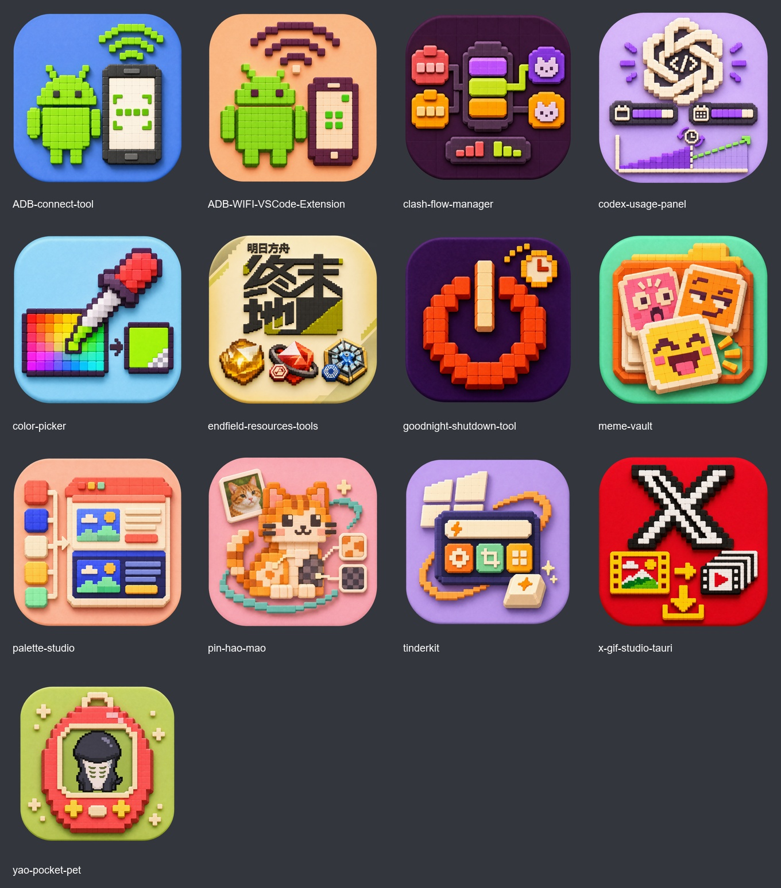

# Tinderbox 项目图标风格

## 当前确认的参考

**确认状态：** 用户明确确认本批 13 项目图标总览是正确方向。此图是 Tinderbox 图标的主要视觉样例；后续评审必须先对照这批图，再结合单个项目自己的图标源。更早生成但未被确认的图稿不得覆盖本批已确认结果。

本批图标延续了用户先前选定的像素积木语言：按网格拼接、逐格转折的轮廓和略微凸起的像素块。它们使用项目各自的主体和配色，放在统一的圆角方形底板中。总览图的深灰色是排版底色，不是单个图标的一部分；每个图标在底板外都应为透明。

图中终末地图标也属于用户确认的本批结果。后续若调整该图标，必须以项目根目录 `endfield-resources-tools/icon.png` 和项目内实际游戏资源图为依据。

## 已确认的风格规则

- **底板：** 使用一枚完整的圆角方形应用图标底板，表面简洁、光线柔和，图标主体集中在中间。
- **像素造型：** 主体必须由一组尺寸相近、对齐网格的独立方块或短矩形块构成，轮廓按方格逐级转折。块与块的边界必须可见；弧形、圆形和斜向语义也要通过方块逐格转折表达，不得改成连续曲线。
- **积木质感：** 每个像素块都有可辨认的厚度、正面与侧面、轻微软化的边角和细微表面纹理；块与块之间保留样图那种逐块拼接的感觉。主体整体使用柔和哑光表面和清楚但不生硬的投影。
- **渲染：** 采用柔和明亮的受光，让每个像素块都略微凸起并投下软影。必须同时看得到“像素格结构”和“软质积木体积”；只把一个光滑、圆润的大物体做成 3D 不符合本规范，扁平线稿也不符合。
- **配色：** 使用明快、容易区分的色块，保留样图的轻快感。浅蓝底、白色十字、绿色植物和棕色土块是这张参考图的配色；每个项目可以采用符合其用途的独立配色，不得把蓝、青、白机械地重复到所有图标，也不得把颜色处理成灰蒙蒙的低对比效果。
- **构图：** 使用一个主要符号，由清楚分隔的像素块拼出完整轮廓；控制块数和层次，让轮廓在小尺寸仍可辨认，并保持与样图相近的视觉重量和留白。
- **项目语义：** 图标主体必须对应项目 README、开发说明中记载的实际用途。方案阶段或待做项目只能表现为概念方向，不得暗示尚未实现的能力已完成。

## 生成时的硬性检查

- 每个图标必须直接参照本规范所对应的用户选定样图，沿用同一套像素阶梯、凸起积木块、软质表面和投影表现；项目差异通过主体形状和配色呈现。
- 生成后必须对照样图检查主体：如果主体变成整块光滑面、只有少数大圆角组件拼装、看不出独立像素块或阶梯轮廓，必须重生成。
- ADB 无线调试及其 VS Code 扩展图标必须同时包含手机、Android 机器人和像素化无线信号；配对码或二维码可以作为次要符号。VS Code 扩展图标不得出现 VS Code 标志、编辑器窗口或其他 VS Code 专属元素。两枚图标均不得出现线缆、USB 插头或两台设备之间的实体连线。
- 生成前必须阅读对应项目 README 和 `docs/开发说明.md`，核对主体含义；有专属角色资产时，应以该项目已经确认的角色资料为准。
- **阿咬例外：** 阿咬本身已是用户认可的像素角色。必须保留原有角色轮廓、脸部标记与口水特征，不得把角色改造成 3D 积木；只允许轻微调整其外框、底板或宠物机边框以适配图标构图。
- 图标主体内不得放项目名称、说明文字、字母、数字、水印或 Mockup 外框。

## 避免的表现

- 整块圆润的立体主物件、连续平滑的弧线、丝带、流线、细连线和抽象圆润造型；需要表达曲线时改用逐格像素台阶。
- 扁平矢量 glyph、照片场景、复杂背景、密集微小装饰、镜面金属、玻璃、珐琅高光或强烈塑料光泽。
- 只换颜色却重复同一主体构图，或为了凑项目数而加入与项目功能无关的符号。

## 适用范围

本规范用于 Tinderbox 仓库内各子项目图标的设计和评审。实际图标应保留共同的积木像素表现，同时按各项目的真实功能选择主体符号和配色。

## 白边问题复盘与处理规则

### 本次问题

- 生成图的圆角底板外出现白色画布或白色边线时，曾把“图像是否为 1:1”“画布是否透明”“底板边缘是否有白色描边”混为一件事处理。
- 后续尝试通过缩放、叠放图层或重复描边遮住白边，结果在圆角底板周围叠出多圈边线，视觉上像一层层套起来的框；这改变了原图外观，也没有解决源图边缘问题。
- 用户确认的正确批次已经在生成记录中存在。应先选用这批原图，不应继续沿用失败的叠层处理中间稿。

### 以后必须遵守

1. **优先使用已确认的原图。** 替换前必须从生成记录和当前项目源图中核对候选；不得把被指出有白边或多层描边的处理中间稿当作基准。
2. **分别检查比例、透明度和描边。** 必须确认画布为 1:1；必须检查 PNG alpha 通道并将圆角底板外设为透明；必须单独确认底板边缘没有额外白色轮廓。仅凭棋盘格预览或缩小后的总览图不得判定透明度和边缘合格。
3. **不得叠层遮边。** 不得通过重复贴图、缩小内层图、扩大底板、添加多圈描边或把另一张圆角方块压在白边上来掩盖问题。边缘不能靠“多画几层”修复。
4. **按白边位置选择处理。** 白色画布在圆角底板外时，只能依据底板轮廓将外部区域设为透明；白线已经画在底板轮廓上时，必须优先换用已确认的干净候选，确实没有干净候选时才精确修掉那一圈，并保留底板本身的颜色、形状、阴影和内容。不得对整张图全局执行“白色变透明”，以免误删图标内部的白色像素。
5. **先检查再同步。** 每张候选必须以 1:1 尺寸分别放在浅色、深色和透明棋盘背景上检查边缘，再查看 32、48、64 像素的缩小效果。确认没有白边、杂色残点、重复外框和比例变形后，才可同步到项目运行时图标。
6. **根图与运行时图标必须一致。** 每个项目根目录的 `icon.png` 是基准；平台图标和应用内部品牌图标必须从该基准更新。替换后必须抽查总览、项目内资源和实际使用的打包图标，不能只看根目录预览。

### 验收清单

- PNG 画布宽高相等，圆角底板外的像素 alpha 为 0。
- 圆角底板只有自身自然的边缘明暗和阴影；不存在额外的白色描边、重复轮廓或用于遮挡边缘的叠层。
- 没有白色画布、伪棋盘格、透明边缘上的白色杂点或被缩放造成的残边。
- 图标主体、底板和留白在 1:1 画布内居中且比例正确；缩小后仍清晰。
- 13 个项目图标总览与项目根图、应用内图标和平台图标保持一致。

## 本批图标生成提示词

### 通用风格提示词

为指定项目制作一枚独立的 1:1 应用图标，主体居中，使用完整的圆角方形底板。整体沿用已选定的像素积木表现：主体由尺寸相近、按网格排列的独立方块和短矩形块拼出；轮廓按像素阶梯逐格转折；各块有明确接缝、正面和侧面、轻微软化的边角与各自的柔和投影。材质哑光并带细微表面肌理，受光明亮柔和；缩小后仍能读出主符号。每个项目使用符合用途的独立配色，颜色清楚、明快、有区分度。只表现一个完整、易读的主构图，不放项目名、说明文字、标签、字母、数字、水印或 Mockup 外框。不得把主体画成少数几个光滑大圆块、扁平线稿、照片场景、复杂背景、玻璃、镜面金属或强塑料高光。

### 各项目主体提示词

以下描述记录本批次的项目语义方向。实际图标必须以对应项目当前 README、开发说明及用户明确纠正为准。

1. **ADB 无线调试：** 手机、清楚可辨的 Android 机器人、阶梯形无线信号；二维码或配对码只作辅助。不得出现电脑、线缆、USB 插头或设备间实体连线。
2. **ADB 无线调试（VS Code 扩展）：** Android 机器人为主，旁边放手机并用阶梯形无线信号连成同一构图；可以出现少量配对方块。不得出现 VS Code 标志、编辑器窗口、电脑或线缆。
3. **Clash 订阅与流量管理：** 多张订阅来源卡片汇入策略组组合器，再由组合器分流到多个代理出口；明确显示至少一条选中路由，并以小型上下行条形表示流量。
4. **Codex 用量预测：** 显示 Codex/编码代理识别符，同时表现 5 小时与周额度、重置时钟以及历史到预测的趋势。Codex 识别符和额度预测都必须清晰可见。
5. **配色工坊：** 以前端网页主题预览为主，展示主题色板如何应用到网页的标题区、按钮和内容卡片。必须让人看出这是前端主题设计工具，不画成游戏方块或单纯调色盘。
6. **表情包仓库：** 多张带不同夸张表情的贴纸卡片，以相册叠放方式整理，并让一张卡片突出，表达浏览和快速取用。
7. **晚安定时关机：** 大型、第一眼可辨的关机电源符号占据主体；小型时钟或倒计时刻度只作次要提示。
8. **终末地资源账本：** 图标主体必须包含游戏中的三项资源：黄色衍质源石、红色嵌晶玉、蓝色武库配额。生成前核对项目内真实资源图 `endfield-resources-tools/assets/resources/originium.png`、`oroberyl.png`、`quota.png`，并按 `lib/resource_calculator.dart` 中的 `originium`、`oroberyl`、`quota` 映射名称。衍质源石与嵌晶玉的中间主体结构相似；黄色衍质源石外壳必须有明显的波纹轮廓，红色嵌晶玉只作为相似主体结构的参照，不把黄色外壳的波纹形状复制过去。保留三种资源各自的轮廓和配色，再转译成已选定的凸起像素积木风；可以用简洁账本底板承托三项资源。不得把深色六边框中的荧光黄绿斜杠当作终末地标志，也不得添加臆造的品牌徽记。
9. **X 媒体工坊：** 明确的 X 平台交叉笔画标志为主，结合图片/视频帧和保存或转换符号。
10. **阿咬宠物机：** 使用项目现有阿咬二维像素角色，保留原轮廓、脸部标记和口水；放进像素宠物机外壳中。角色保持二维像素画，不改成 3D 积木。
11. **TinderKit 工具集（方案概念）：** 以轻量命令面板、热键提示和面板内的插件工具卡为主，表现“常驻宿主 + 插件式工具”。这是未开发方案，只作概念表达；不得画成仓库货架、存储箱或节点拓扑。
12. **拼好猫（待做概念）：** 表现可替换贴图的猫模型、少量颜色/纹理块和作为输入参考的猫照片，明确保持待做概念，不暗示已经实现。
13. **独立取色器组件：** 用像素吸管从二维色域区域取出一个颜色，旁边显示选中色块和透明度棋盘角；与前端主题工坊的网页预览区分。

## 图标文件约定

- 每个项目根目录必须保留一份 `icon.png`，供仓库项目目录、文档和图标评审使用；即使项目本身不需要桌面应用图标，也必须有这份文件。
- 应用图标的圆角方形底板外必须保留透明 alpha；不得用白色或其他实色填充圆角以外的区域。应用内部显示的品牌图标必须引用同一份项目图标源图，替换时必须同步更新这些界面引用。
- 有桌面应用或扩展图标的项目，平台所需的 ICO、SVG、Tauri、Flutter、Android 或 VS Code 图标必须由该项目正在使用的源文件或生成脚本更新。只替换根目录图片而不更新运行时引用的资源，不算完成图标替换。
- 阿咬的 `assets/yao-pixel.png` 是角色素材，不能用宠物机应用图标覆盖；PWA 和 Android 启动图标使用独立图标文件。

