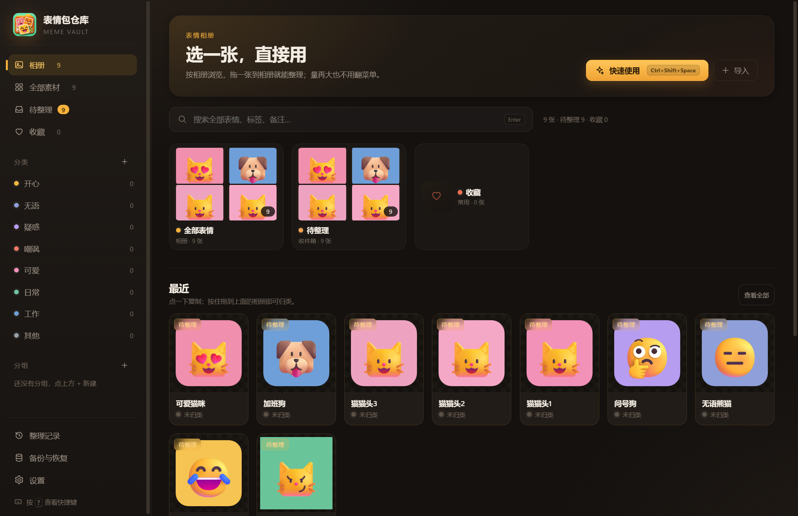

# 表情包仓库（Meme Vault）

> **项目状态：恢复开发（2026-11-24）**。v0.1.0 可继续使用；原生下拉已全部换成跟随应用主题的自绘下拉，AI 整理已暂时移出主项目并归档到 [AI 功能归档](./docs/AI功能归档.md)。最新验证记录和待复验项见[开发说明](./docs/开发说明.md)。

Windows 桌面表情包工具，**先快速用，再慢慢管**：按 `Ctrl+Shift+Space` 呼出相册式挑选窗，点一下就把表情复制走；主界面按相册浏览，拖一张就能归类。新素材先进入**待整理区**，整理建议只做预览，确认后才生效，过程可撤回、有留痕。



## 当前功能

- **快速调用**：`Ctrl+Shift+Space` 在鼠标附近呼出紧凑挑选窗，默认“最近使用”，可按收藏、全部、分类筛选和搜索；单击即复制并自动收起，Esc 关闭。主界面右上角也有“快速使用”按钮。窗口右上角的图钉可切换**置顶/不置顶**，默认不强制置顶，选择会记住。
- **相册首页**：主界面先看相册，不再先看表格。全部、待整理、收藏和分类/分组都是带封面和数量的相册；最近使用的表情放在首屏，点一下就能复制。
- **拖动管理**：把表情拖到相册卡片或左侧分类/分组即可归类，拖到“待整理”移回；支持多选后整批拖动。
- **导入**：文件、整个文件夹、拖入窗口或 `Ctrl + V` 粘贴；按内容哈希自动去重。
- **归类与分组**：8 个内置分类，可新增/改名/换色/删除；分组可自由创建，一张表情可属于多个分组；支持标签、备注、收藏。
- **查找**：名称/标签/备注/分类/分组搜索，按时间、名称、使用次数、大小排序；卡片懒加载 + `content-visibility`，量大时也不一次性渲染全部内容。
- **待整理区**：新素材先停在这里，不会直接影响已有分类。
- **可控整理**：本地规则整理先生成**待确认提案**；可逐条跳过/换分类，应用后可在提示或整理记录中整批撤回。AI 整理已暂时移出并归档，当前版本不提供 AI 配置或外部请求。
- **整理记录**：导入、编辑、删除、分类分组变更、备份、应用与撤回都有时间线记录；撤回时检查后续修改并提示冲突。
- **备份与恢复**：导出包含原图、缩略图、分类分组和整理记录的 zip；恢复时按内容去重合并，恢复动作本身也可撤回。

## 运行环境

- Windows 10 / 11 x64，需要系统已安装 **WebView2 Runtime**（Windows 11 默认自带，Windows 10 可由系统更新自动安装）。
- 从源码构建需要 Node.js 22+、Rust 1.80+（含 MSVC 工具链）。
- 构建后可用 `npm run selftest` 做一次不打开窗口的 release 自检（存储、整理、撤回、备份）。
- 本轮在真实 WebView2 上通过 15 项端到端冒烟（相册首页、导入、详情、待整理、规则建议、应用、撤回、备份、设置、无原生下拉与无 AI 入口），截图见 [docs/assets](./docs/assets/)。

## 快速开始

```powershell
npm install
npm run build
```

### 开发阶段：每次构建必须覆盖桌面版本

本项目仍在开发阶段，**每次编译后都必须把新 exe 覆盖到桌面测试目录，这不是可选项**：

- `npm run build` 生成 `release/MemeVault.exe` 后，会先结束正在运行的 `MemeVault.exe` / `meme-vault.exe`，再覆盖 `.deploy-target`（或 `MEME_VAULT_DEPLOY_DIR`）指定的桌面版本；同级 `userdata/` 保留。
- 不得用 `MEME_VAULT_SKIP_DEPLOY=1` 跳过投放；仅当用户在当次任务中明确要求跳过时才可例外，默认一律必须投放。投放失败按构建失败处理，必须排查。
- 只需重新投放、不重新编译时，运行 `npm run deploy` 或双击 `deploy-to-desktop.cmd`。

构建完成后运行：

```powershell
npm run start
```

或直接双击 `release/MemeVault.exe`。这是**单个便携 exe**：没有安装器、旁加载 DLL 或运行脚本；首次启动会在 exe 同级创建 `userdata/` 保存素材和配置，整个文件夹可以拷贝到其他电脑继续使用。若 exe 所在目录不可写，会自动退回 `%APPDATA%\com.tinderbox.memevault\data`；也可以用环境变量 `MEME_VAULT_DATA` 指定。

本地投放目录写在项目根目录的 `.deploy-target`（本地文件，不纳入版本管理），也可用环境变量 `MEME_VAULT_DEPLOY_DIR` 指定；覆盖前会结束正在运行的实例并保留同级 `userdata/`。未配置投放目录时构建照常完成，只输出 `release/MemeVault.exe`。

开发调试：

```powershell
npm run dev
```

开发模式会启动本地静态服务器（127.0.0.1:7411，**仅 `npm run dev` 使用**；发布 exe 不含该地址）。所有构建都不显示命令行窗口；若启动失败，可查看 `%TEMP%\meme-vault-crash.log`。

## 文档

- [使用说明](./docs/使用说明.md)：导入、整理、复制、备份与常见问题。
- [开发说明](./docs/开发说明.md)：技术栈、目录结构、数据格式、整理与撤回机制、验证方式。
- [AI 功能归档](./docs/AI功能归档.md)：已移出的 AI 整理代码、界面快照与恢复说明（不参与当前构建）。

## 为什么地址栏有 http://tauri.localhost？

这是 Tauri + WebView2 的**内部资源协议**，不是网络请求：HTML/JS/CSS 已经嵌进 exe，WebView2 在进程内拦截并返回这些资源，不监听端口、不访问外网。表情图片的 `http://meme.localhost/...` 同理，由 Rust 端直接读本地文件返回。断网也能正常打开。

发布配置和 exe 中不含 `127.0.0.1:7411`；该地址只在 `npm run dev` 开发调试时由本地静态服务器使用。当前版本不包含 AI 或云端请求，运行时只访问本机资源。

## 使用边界

- 所有数据只保存在本机（默认是 exe 同级 `userdata/`）；没有账号、云同步或跨设备同步功能。备份包需自行保存到合适位置。
- 备份包只包含本机素材库数据，不含账号或密钥；`settings.json` 只保存本机配置。
- 删除素材会从界面隐藏，但原图仍保留在本机，可从“整理记录”撤回；暂未提供独立的回收站清理界面。
- “复制文件”依赖 Windows 剪贴板文件列表；“复制图片”对 GIF / WebP 只保留首帧。
- 单次导入与备份文件大小有上限（导入 2000 个文件、备份包 512 MB），详见开发说明。
