# 配色工坊

Windows 桌面端的前端配色管理工具（Electron + React + TypeScript）：为多个前端项目生成、记录、管理、检查并导出专属配色。当前版本 1.0.0。

## 主要功能

- **多项目管理**：每个项目独立维护品牌主色、色板、语义主题、控件配色与历史记录；项目总览展示配色缩略与统计。
- **配色生成**：从主色按 8 种方式生成配色（互补、相邻、三角、分裂互补、四角、单色明暗、暗调、亮调），一键推荐整套 17 色色板，支持中文色名、锁定、改名、删除。
- **明暗色阶与语义主题**：基于 OKLCH 生成 50–950 明暗色阶；主色生成 18 个语义 Token（浅色/深色两套），支持 5 种主题生成方式，并自动保证正文对比度。
- **控件配色**：内置 24 种前端控件、77 个属性，可绑定到主题 Token、项目色板或自定义颜色，并实时预览。
- **对比度检查**：WCAG AA / AAA 判定、文本示例预览、项目常用配色组合一键体检与改进建议。
- **自研取色器**：面板 / OKLCH 全彩 / 色块三种取色方式，支持透明度（#RRGGBBAA）、中文色名、常用/中性/最近色板与屏幕吸管。完整设计与实现见 [取色器说明](./docs/取色器说明.md)。
- **界面预览**：桌面端/手机端、浅色/深色的迷你界面预览，支持内嵌、右侧停靠面板与独立窗口同步查看。
- **导出**：CSS 变量、SCSS、Tailwind v3、Tailwind v4 `@theme`、W3C Design Tokens、ES Module、Figma 变量表，共 7 种格式。
- **记录与恢复**：一键保存配色快照并随时恢复；数据保存在本机，支持整体导出/导入备份。

## 界面预览

| 项目总览 | 色板生成 |
| --- | --- |
| 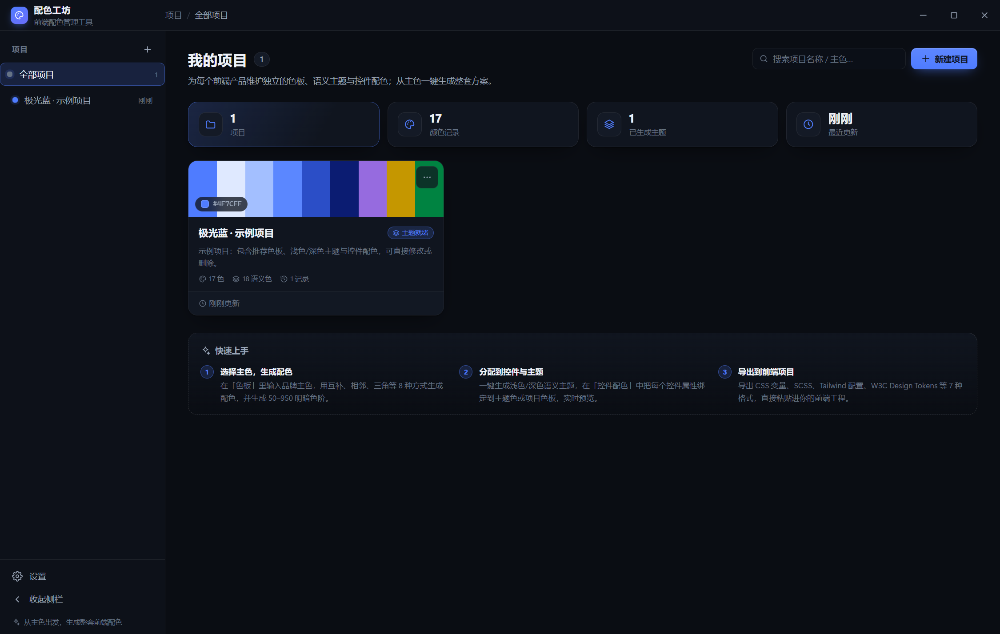 | 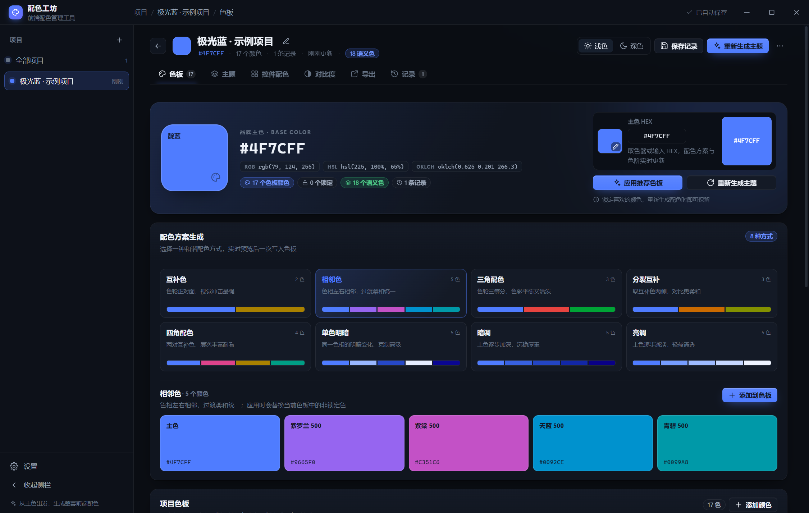 |

| 语义主题 | 控件配色 |
| --- | --- |
| 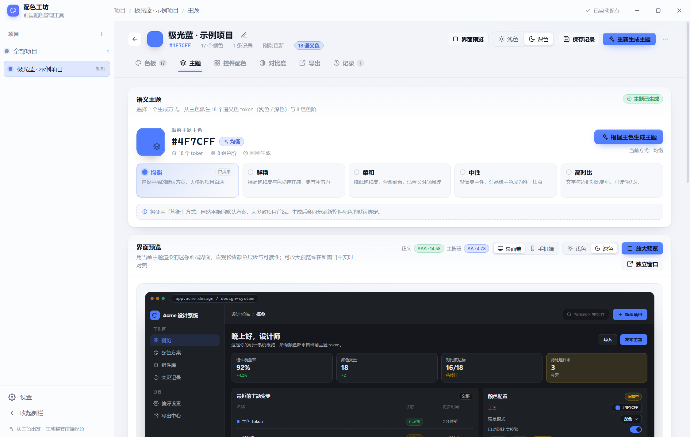 | 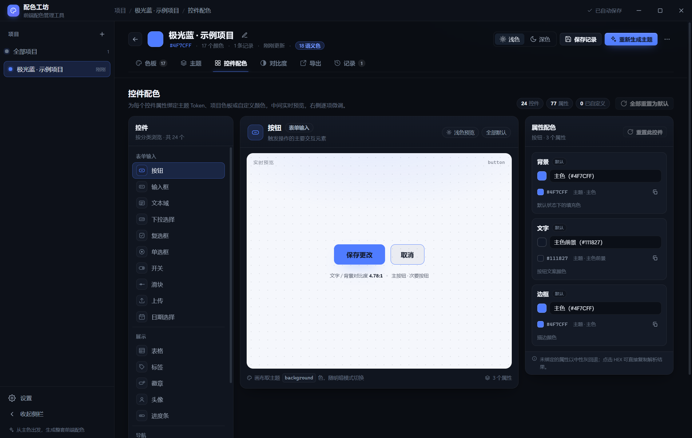 |

| 对比度检查 | 导出到前端工程 |
| --- | --- |
| 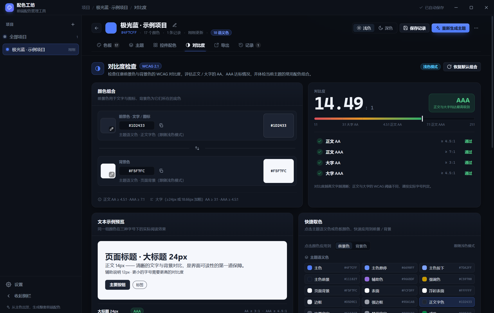 | 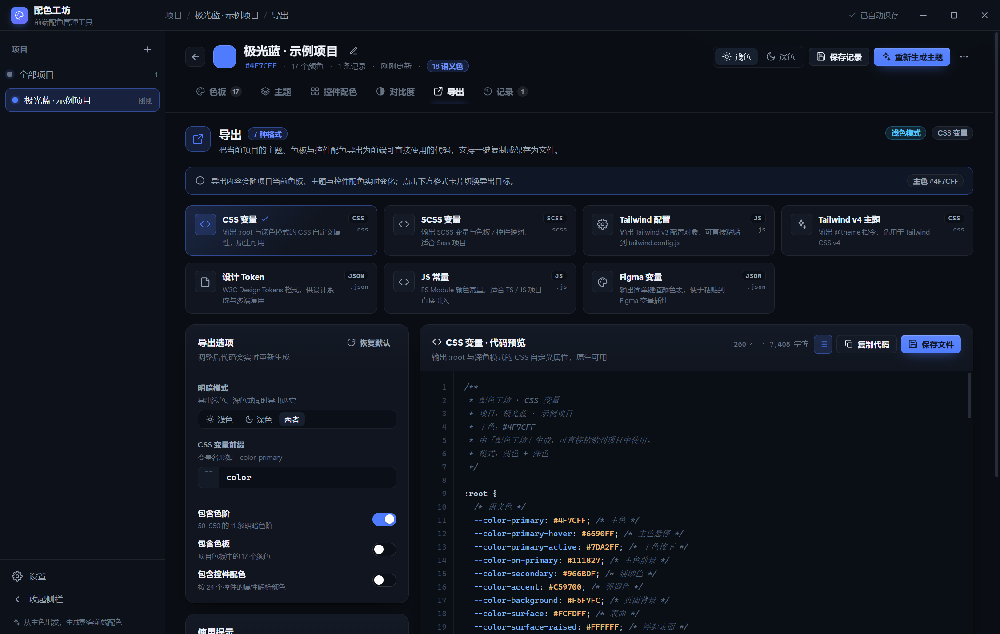 |

| 界面预览（桌面端） | 界面预览（手机端） |
| --- | --- |
| 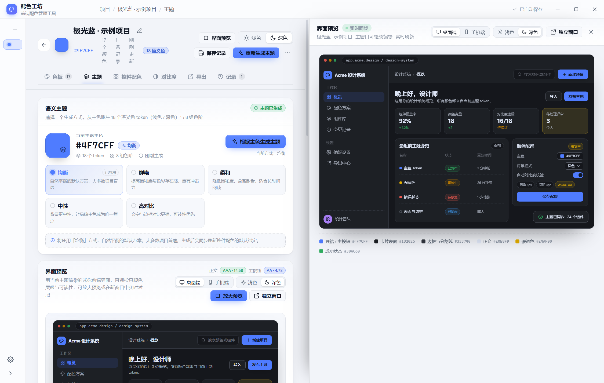 | 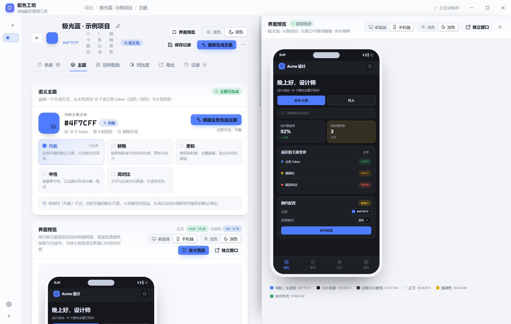 |

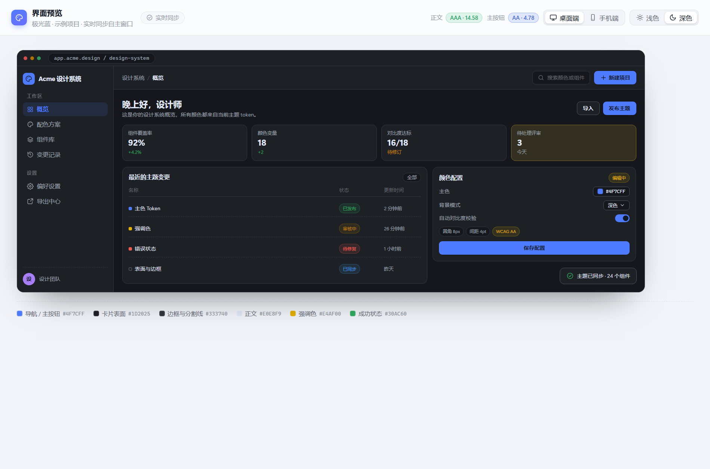

| 取色器（色块模式） | 取色器（全彩模式，首次默认） |
| --- | --- |
| 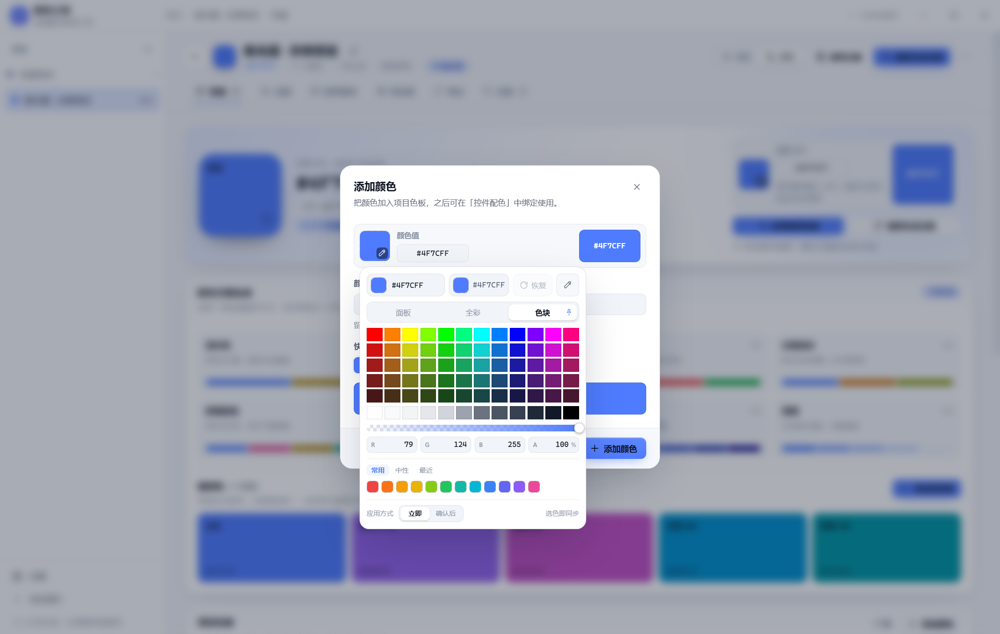 | 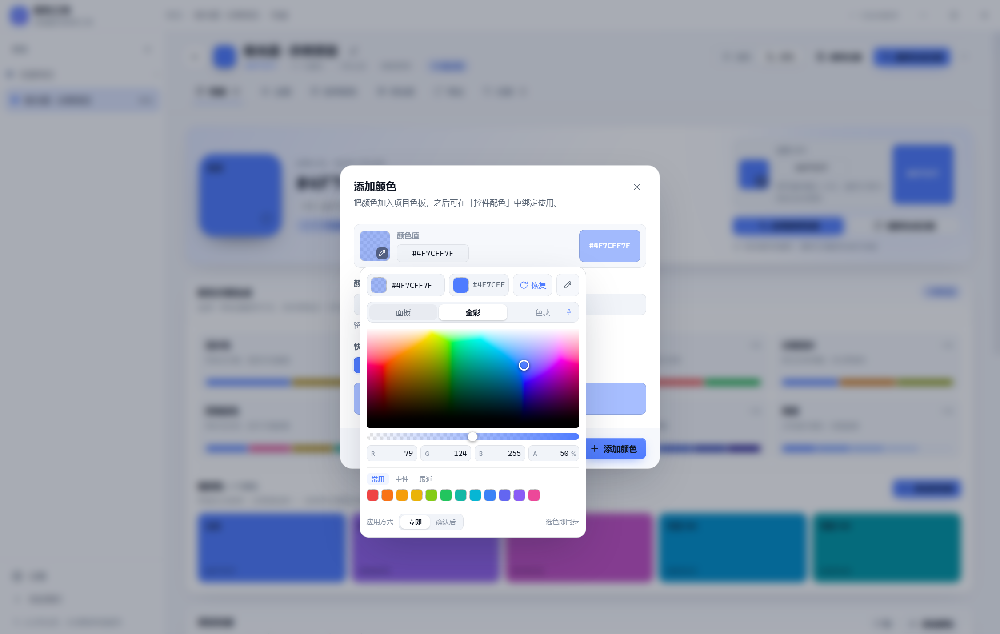 |

| 颜色小窗（点当前颜色块展开） |
| --- |
| 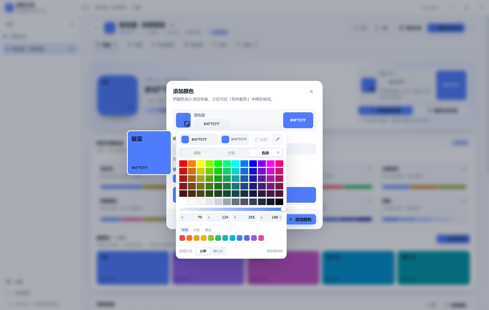 |

| 取色器（确认后同步） | 取色器（回到最初） |
| --- | --- |
| 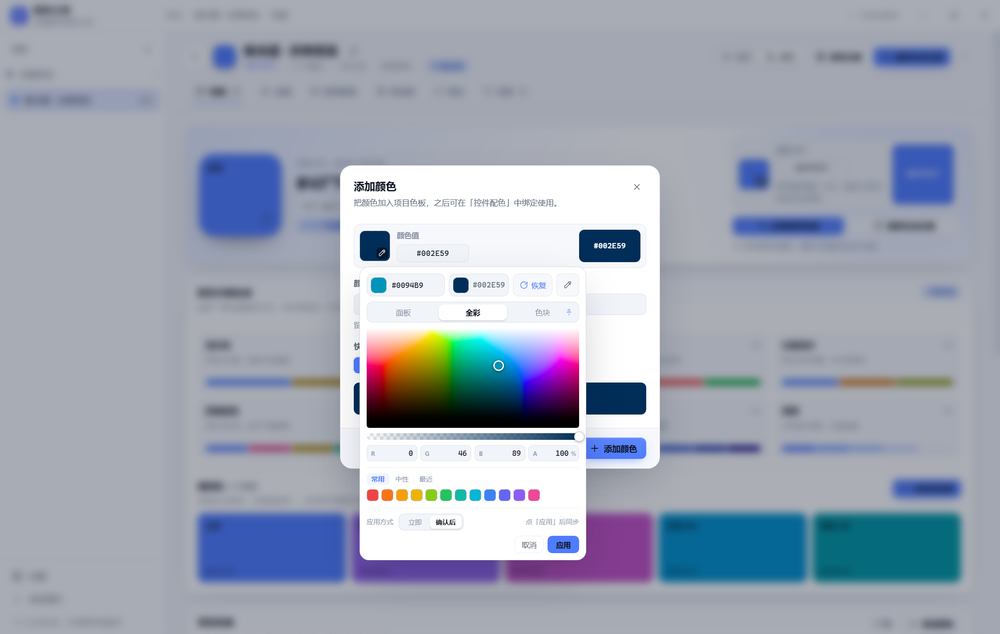 |  |

## 运行环境

- Windows 10/11 x64；
- 从源码运行/打包：Node.js 22+、npm 11+，以及项目根目录下的 Electron 44.x win32-x64 运行时 `runtime/`（**不入库**，需自行准备，见 [项目交接](./docs/项目交接.md) 第 2.2 节）；
- 打包启动器需要系统自带 .NET Framework 4.x 的 `csc.exe`（Windows 10/11 默认具备）；重新生成图标需要 Python 3 + Pillow + numpy（可选）。

本仓库只提交源码与文档：`node_modules/`、`runtime/`、`release/`、`dist/`、`.build/`、`build/` 等均为本地忽略产物，不随 Git 提交。

## 快速开始

在项目目录执行：

```powershell
# 1. 安装依赖（受限环境必须带 --ignore-scripts --cache .npm-cache）
npm install --ignore-scripts --cache .npm-cache

# 2. 类型检查 + 单元测试 + 构建 + 渲染冒烟
npm run check

# 3. 开发运行（构建 + 启动 Electron）
powershell -File scripts/dev.ps1
```

打包为免安装版：

```powershell
powershell -NoProfile -ExecutionPolicy Bypass -File scripts/package.ps1
```

产物在 `release/PaletteStudio/`，双击 `PaletteStudio.exe` 启动。操作细节、取色器用法、数据位置与常见问题见 [使用说明](./docs/使用说明.md)。

## 文档

- [使用说明](./docs/使用说明.md)：运行方式、界面操作、取色器、界面预览、快捷键、数据与备份、常见问题。
- [开发说明](./docs/开发说明.md)：技术栈、环境硬性约束、常用命令、构建/测试/打包流水线、开发约定、验收基线、已知坑与路线图。
- [取色器说明](./docs/取色器说明.md)：自研取色器的设计目标、界面与交互规则、实现原理、OKLCH 全彩方案、设计取舍与验收要点。
- [项目交接](./docs/项目交接.md)：架构、数据模型、核心 API、状态管理、扩展指南、已知限制与验收清单。
- [核心功能契约](./docs/核心功能契约.md)：色彩引擎、控件定义与导出格式的最初功能契约（已实现，可作为行为参考）。
- [界面开发契约](./docs/界面开发契约.md)：视图开发约定与组件 API（已实现，可作为行为参考）。
- [更新日志](./docs/更新日志.md)：版本变更记录。
- 界面截图：[docs/assets/screenshots](./docs/assets/screenshots/)。

## 数据与隐私

所有数据仅保存在本机，不上传任何服务器；保存采用「先备份、再原子写入」，异常时可从备份恢复；设置页支持一键导出/导入全部数据（JSON）。

## 许可

内部工具，未经许可请勿外传。
