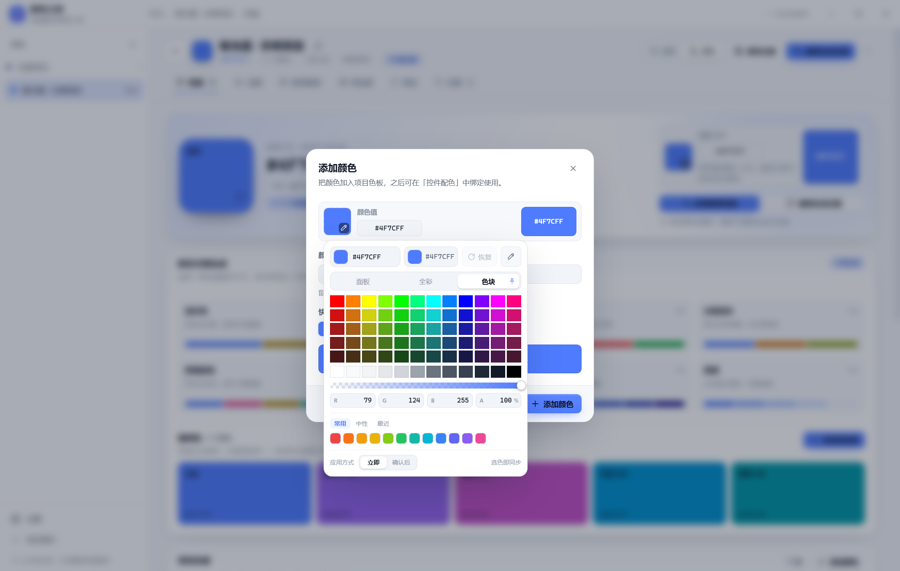

# 取色器说明

「配色工坊」中所有颜色输入框统一使用同一个自研取色器（不使用 Windows 系统原生取色弹窗）。本文说明它的设计目标、界面与交互规则、实现原理、状态与数据流，以及「全彩」模式的 OKLCH 色域图方案；末尾记录历次设计取舍、已知限制与验收要点。

> 相关文档：[开发说明](./开发说明.md)、[界面开发契约](./界面开发契约.md)、[项目交接](./项目交接.md)、[更新日志](./更新日志.md)。
> 源码入口：[ColorPicker.tsx](../src/components/ColorPicker.tsx)、[color-picker.css](../src/components/color-picker.css)；颜色数学 [color.ts](../src/core/color.ts)；中文色名 [palette.ts](../src/core/palette.ts)。

## 1. 设计目标与原则

- **全应用唯一取色入口**：色板、语义主题、控件配色、新建项目等所有颜色输入都复用 `ColorPicker`，不出现两套取色交互。
- **不调用系统取色器**：Windows 原生取色弹窗样式老旧、不可定制，项目内禁止使用 `<input type="color">`，统一使用自定义浮层。
- **紧凑浮层**：340px 宽的单面板，浮在触发色块附近，不打断工作区；空间不足时自动向上翻转、水平收边。
- **不强迫拖拽**：除面板/全彩的连续取色外，还提供「色块模式」——一格一个颜色，单击即选，不必在细滑条上瞄准。
- **三种方式合一面板**：面板 / 全彩 / 色块在同一个弹窗内切换，不额外弹出二级窗口。
- **支持透明度**：颜色以 `#RRGGBB` / `#RRGGBBAA` 存储，透明度滑条、A 数值、棋盘格预览齐全。
- **打开期间布局稳定**：恢复按钮、颜色小窗等都在固定槽位或浮层中，打开/关闭这些附加内容不改变面板尺寸。
- **取色器是「控件」**：打开时锁定当时界面的强调色（`--accent`），取色器内部的 pin、当前 tab、初始颜色区等不会跟着正在编辑的颜色变化。
- **主题自适应**：所有颜色取自设计系统 CSS 变量（`--bg-elevated`、`--border`、`--accent` 等），深浅主题都与外壳一致。
- **零第三方依赖**：取色器、颜色数学、色域图渲染全部自研（React 19 + TypeScript）。

### 1.1 参考来源与原创部分

代码注释里记录了参考对象，这里如实区分「借鉴」与「原创」：

| 参考 | 借了什么 | 没借什么 |
| --- | --- | --- |
| [react-colorful](https://github.com/omgovich/react-colorful) | 交互结构：小尺寸浮层、自定义 popover、SV 面板 / 色相条 / 透明度 / HEX 一屏完成 | 它的外观（无样式极简组件） |
| [Figma 取色习惯](https://colorpickerweb.com/figma-color-picker-guide) | 操作习惯：吸管、HEX 输入、常用/最近色板、透明度预设 | 具体视觉 |
| [oklch.com](https://oklch.com/) / [colordx](https://github.com/dkryaklin/colordx-gpu) / [Ottosson OKLab](https://bottosson.github.io/posts/oklab/) | 全彩色域图的算法概念：横向色相 × 纵向明度，每个点取该点 sRGB 最大色度 | 它们的 UI 布局 |
| [CSS Color 4](https://www.w3.org/TR/css-color-4/#ok-lab) / [culori](https://culorijs.org/api/) | OKLCH 定义与色域映射（`clampChroma` 式二分）思路 | 库本身（项目保持零依赖） |

**视觉部分是原创的**：340px 深/浅色浮层、14px 圆角、tab 上的 pin、恢复按钮、应用方式分段控件、强调色锁定、4px 小圆角的取色区域、720×360 + 抖动的色域图、颜色小窗，均按本项目设计变量重新设计，不是现成库皮肤。

## 2. 组件接口与集成

### 2.1 Props

| 参数 | 类型 | 默认值 | 说明 |
| --- | --- | --- | --- |
| `value` | `string` | — | 当前颜色，`#RRGGBB` 或 `#RRGGBBAA`（大写规范） |
| `onChange` | `(hex: string) => void` | — | 颜色变化回调（立即模式下拖动即触发；确认模式点「应用」时触发） |
| `disabled` | `boolean` | `false` | 禁用触发按钮 |
| `size` | `number` | `46` | 触发色块边长（像素） |
| `className` | `string` | — | 附加到触发按钮的类名 |
| `showTriggerLabel` | `boolean` | `false` | 触发按钮是否在色块右侧显示 HEX 文本 |

### 2.2 触发与浮层

- 触发按钮是一个方形色块（右下角带吸管角标），点击打开浮层；再次点击或点外部、按 `Esc` 关闭。
- 浮层通过 `createPortal` 挂到 `document.body`，用 `position: fixed` 定位（z-index 150），不参与页面布局。
- 打开时：记录当前颜色为 **初始颜色**、定位浮层、锁定强调色、切到「默认取色方式」。
- 关闭时：确认模式丢弃未应用改动；同时收起颜色小窗。

### 2.3 集成位置

- [color-ui.tsx](../src/components/color-ui.tsx)：`ColorField`（通用颜色字段）与 `ColorRefPicker`（控件配色的自定义颜色）内部使用 `ColorPicker`。
- [project-dialogs.tsx](../src/components/project-dialogs.tsx)：新建 / 编辑项目的品牌主色输入。
- 视图中所有颜色输入最终都落到这里；新增颜色输入时不要另写取色器或原生 color input。

## 3. 界面结构

浮层自上而下：

```text
┌────────────────────────────────────────────┐  340px 宽
│ [当前颜色色块] [HEX 输入] [初始颜色色块+值] [恢复] [吸管] │  头部 34px 高
│        ↑ 点击色块可展开「颜色小窗」                        │
├────────────────────────────────────────────┤
│  [面板]  [全彩]  [色块]        ← 每个 tab 上方有 pin（设默认） │
├────────────────────────────────────────────┤
│  取色画布（三选一：SV 面板 / 全彩矩形 / 色块网格）          │
├────────────────────────────────────────────┤
│  透明度滑条（棋盘格 + 渐变 + 圆点）                        │
│  R [ ]  G [ ]  B [ ]  A [ ]%                             │
│  [常用] [中性] [最近]  + 单行色板                          │
│  应用方式  [立即] [确认后]   （提示：选色即同步 / 点应用后同步） │
│  [取消] [应用]   ← 仅确认模式显示，固定最底部                │
└────────────────────────────────────────────┘
```

整体样式：`--bg-elevated` 背景、1px `--border-strong` 边框、14px 圆角、10px 内边距、弹出动画 150ms。

### 3.1 头部颜色行

顺序固定：**当前颜色（可编辑）→ 初始颜色（只读）→ 恢复按钮 → 吸管**。

- **当前颜色**：24px 方形色块 + 可编辑 HEX 输入（字号 11.5px），色块带棋盘格底色，颜色绘制在棋盘格之上——只有真正半透明时才会透出网格。
- **初始颜色**：打开取色器时带入的颜色，色块 + 色值（只读），两者规格与当前颜色一致（24px / 11.5px）。
- **恢复**：固定槽位（34px 高），颜色未改动时禁用置灰，改动后点亮并显示强调色；点击后回到初始颜色，立即模式下同时写回外部，确认模式只恢复内部待应用颜色；**全彩光标也会同步回到初始颜色位置**。
- **吸管**：仅当运行环境提供 `window.EyeDropper`（Chromium）时显示；调用系统吸管取色后写入当前颜色。
- **颜色小窗**：点击当前颜色色块展开，详见 3.5。

### 3.2 取色方式切换与 pin

- 三个 tab：**面板 / 全彩 / 色块**，位于画布上方。
- 每个 tab 上方有一个 pin（图钉）：点击当前 tab 的 pin 可把该方式设为「下次默认」，写入 localStorage，重启/重开仍生效。
- 显示规则：当前 tab 常显 pin；被 pin 的 tab 即使未选中也常显（略降透明度）；其它 tab 仅在悬停当前 tab 时显示 pin。目的是减少常驻视觉噪音。
- 兼容：旧版本保存的 `wheel` 默认方式会映射为 `full`（全彩）。
- 首次使用（没有保存过偏好）默认使用「全彩」；应用方式首次默认「确认后」。用户显式切换后按 localStorage 记忆生效。

### 3.3 取色画布

三种模式共用一块画布区域：

| 模式 | 内容 | 选色方式 |
| --- | --- | --- |
| 面板 | HSV 的 SV 面板 + 色相条 | 拖动面板取饱和度/明度、拖动色相条改色相 |
| 全彩 | OKLCH 最大色度色域图 | 在矩形任意位置单击/拖动取色（详见第 5 节） |
| 色块 | 12 色相 × 5 档明度 + 12 档灰阶 | 单击格子立即选中 |

拖拽交互统一使用 Pointer Events + `setPointerCapture`：按下即取色，拖动连续更新，松开结束（立即模式下松手时把颜色记入「最近」）。

### 3.4 透明度、RGB/A 与色板

- **透明度条**：0→100% 渐变（透明 → 当前颜色），圆点指示；下方 A 输入框按百分比 0–100。
- **RGB/A 数值**：R/G/B 0–255、A 0–100%，输入即时生效。
- **HEX 输入**：支持 6 位与 8 位，失焦或回车时校验；非法值回退到当前值。
- **色板**：单行三个标签——「常用」（12 个高饱和色）、「中性」（10 个灰阶与黑白）、「最近」（最多 12 个，存 localStorage，拖动结束/输入色值/吸管/点选色板/应用确认时记录）；点色块立即选中。

### 3.5 颜色小窗

点击左上角当前颜色色块，展开一块「颜色小窗」：

- 外壳与取色器弹窗同款背景（`--bg-elevated`，浅色主题为白、深色主题为深灰）+ 细边框 + 阴影 + 10px 圆角，内边距 2px，内部是 **132×132 方形大色块**。
- 内容：**中文色名**（如「靛蓝」）+ **HEX 色值**（带透明度时显示 8 位），文字颜色按底色自动取黑/白以保证可读性。
- 位置：浮在取色器**左侧**，外沿距取色器 12px，**顶部与取色器顶部对齐**；左侧空间不足时自动翻到右侧，并夹在视口内。
- 不占布局：使用 `position: fixed` 浮层，打开/关闭**不改变取色器高度**；再点色块收起，关闭取色器时自动收起。
- 色名规则见 6.5。



## 4. 三种取色方式

### 4.1 面板模式（SV + 色相条）

- SV 面板背景 = 当前色相 `hsl(h 100% 50%)`，叠加白色（横向）与黑色（纵向）渐变；圆点光标显示饱和度/明度位置（颜色取当前不透明色）。
- 色相条为标准 0–360° 六段渐变（红→黄→绿→青→蓝→品红→红），圆点显示色相位置。
- 内部仍以 HSV 状态驱动，最终统一转换为 HEX 写回。

### 4.2 色块模式

- 网格：横向 12 个色相（0°/30°/…/330°）× 纵向 5 档明度（`s/v` 组合），最后一行是 12 档中性灰阶（#FFFFFF → #000000）。
- 单击任一格立即选中（保留当前透明度），无需拖动；与当前不透明颜色相同的格子高亮。
- 适合快速选标准色；若想让它成为默认打开方式，点该 tab 上方的 pin。

### 4.3 全彩模式

以 OKLCH 色域图取代传统 HSV 色带：横向色相、纵向感知明度，每一个点都是该位置 sRGB 能显示的最鲜艳颜色。首次使用（没有保存过偏好）时，取色器默认进入全彩模式。详见下一节。

## 5. 全彩模式：OKLCH 最大色度色域图

### 5.1 为什么用 OKLCH 而不是 HSV/HSL 色带

- OKLab/OKLCH 是感知均匀的色彩空间：同样大小的数值变化，在人眼中看起来的变化量接近，明度轴含义稳定（上白 → 中鲜艳 → 下黑）。
- HSV/HSL 的「明度」并不感知均匀，扫过色带时中段会突然变亮/变暗；OKLCH 明度轴更适合作为取色坐标。
- OKLCH 是 CSS Color 4 的标准色彩空间（`oklch()`），与前端导出（CSS/SCSS/Tailwind v4 等）一致。
- 参考：[Björn Ottosson · OKLab/OKLCH](https://bottosson.github.io/posts/oklab/)、[oklch.com](https://oklch.com/)、[CSS Color 4](https://www.w3.org/TR/css-color-4/#ok-lab)。

### 5.2 坐标与颜色定义

- 横轴：色相 `H`，0°→360°（左右两端都是红，环绕闭合）。
- 纵轴：感知明度 `L`，顶部 `L=1`（白）、底部 `L=0`（黑）。
- 图中每个像素取该 `(L, H)` 下 **sRGB 能表示的最大色度 `C`**（即该点的最鲜艳颜色），所以整块图没有「色域外灰区」。

这与「色域切片」取色器的思路一致：不是直接画 HSV 色带，而是渲染 sRGB 色域在 `(L, H)` 平面上的边界内最大色度场。

### 5.3 最大色度求解

对给定 `(L, H)`：

1. 取色度上界 `C=0.4`（远大于 sRGB 实际可达值，作为二分上界）；
2. 用 OKLab → 线性 sRGB 逆变换得到三通道；
3. 判断是否落在 `[0, 1]` 内（允许 `1e-4` 容差）；
4. 若越界，对 `C` 做 18 次二分，找到仍在线性 sRGB 内的最大色度（精度足够，渲染用）。

取色时使用 `oklchToHex({ l, c: 0.4, h })`：内部会再次做色域映射，把 `0.4` 压到该点允许的最大色度，因此得到的就是该 `(L,H)` 下最鲜艳的 sRGB 颜色。

### 5.4 图像生成

全彩图由 [ColorPicker.tsx](../src/components/ColorPicker.tsx) 的 `buildSpectrumImage()` 在首次进入全彩模式时生成（模块级缓存，整个会话只算一次）：

1. 创建 **720×360** 离屏 canvas（远高于约 300×150 的显示尺寸，放大或截图放大时不易看出格子）；
2. 逐像素计算最大色度，得到 `Float32Array` 色度场；
3. 对色度场做轻微平滑：色相方向环绕、明度方向夹取的两遍 box blur，半径 **8**。这一步柔化 sRGB 蓝紫区（约 250–290°）的色域凹口折痕；
4. 逐像素用 OKLCH→sRGB 渲染；顶部/底部极端行强制纯白/纯黑（`L ≤ 0.008` → `#000000`，`L ≥ 0.992` → `#FFFFFF`），避免 OKLab 逆变换在端点附近的矩阵舍入误差产生 `010000` 之类杂色；
5. 叠加 **Bayer 4×4 抖动**（幅度 0.9/255），消除 8 位色深在平滑渐变上的条带；
6. 生成 PNG dataURL 并缓存，作为画布的背景图。

### 5.5 指针交互与光标

- 取色区域外覆盖一圈 **8px 可拖拽命中区**（`padding: 8px; margin: -8px`，视觉不变）；即使光标圆环有一半露在面板外，也能按下并继续拖动。
- 指针位置换算：`h = (x/宽度)×360`，`l = 1 − (y/高度)`；距上边缘 2px 内吸附纯白、距下边缘 2px 内吸附纯黑。
- **光标位置直接记录指针坐标**（`spectrumPos {h, l}`），而不是从选出的颜色反推。原因：接近黑/白时色相不稳定，从颜色反推会让圆环跳动；记录指针后拖动时圆环与鼠标完全重合。
- 圆环：16×16、2px 白色描边、阴影、`translate(-50%,-50%)`、`z-index: 2`、`pointer-events: none`，显示在色域图上层且不被裁剪（画布不设 `overflow: hidden`），在边缘也完整可见。
- 取色区域为 **4px 小圆角**（不是纯直角，也不是大圆角），光标可拖过边缘。
- 光标同步：打开取色器 / 切换到全彩 / 点恢复 / 外部改色时，光标移动到对应颜色的 `(L,H)` 位置；拖动过程中只跟随指针。

### 5.6 为什么有「折痕」、为什么纯蓝只有一条缝

- 蓝紫区（约 250–290°）的折痕是 **sRGB 色域在该区域的自然凹口**：最大色度曲线在这里变化较快，但数学上连续，不是渲染 bug。渲染用高分辨率 + 抖动 + 半径 8 的轻微平滑把折痕柔化。
- 纯蓝（`#0000FF`）在 OKLCH 中是一个「尖点」：只有很窄的 `(L≈0.45, H≈264°)` 附近能达到高色度，色相稍偏最大色度就急剧下降。所以全彩图里高饱和蓝天然只占一条窄缝——任何同类 OKLCH 色域图都是这个形状。
- 我们**没有**为「方便选蓝」加纯色快捷行或人为抹平色域（曾试过，后按"保持专业、不做特例"撤销）。需要快速选标准色时用「常用」色板或直接输入 HEX。

### 5.7 与同类实现的对比

| 方式 | 代表 | 优缺点 |
| --- | --- | --- |
| CPU + Canvas 逐像素（本项目） | 本项目 | 零依赖、实现直接；首次生成有一次性开销，分辨率有限 |
| max-chroma LUT + 插值 | [colordx](https://github.com/dkryaklin/colordx-gpu) 文档中的 `chromaLUT` | 更快、便于画色域边界线 |
| GPU 着色器 | [@colordx/gpu](https://github.com/dkryaklin/colordx-gpu) | 实时刷新、多色域叠加；引入 WebGL 依赖 |
| SVG 轮廓 + 渐变 | [evilmartians/oklch-picker](https://github.com/evilmartians/oklch-picker)（[oklch.com](https://oklch.com/) 实现） | 可画色域边界，依赖颜色库 |

同生态可参考的取色器与颜色库：[oklch-picker（Nick Bevers）](https://github.com/nord-forge/oklch-picker)、[eero-lehtinen/oklch-color-picker](https://github.com/eero-lehtinen/oklch-color-picker)、[culori](https://culorijs.org/api/)（`clampChroma` / `toGamut`）、[color.js](https://colorjs.io/)。

## 6. 状态与数据流

### 6.1 受控接口

`ColorPicker` 是受控组件：颜色真值由外部 `value` 决定，内部维护「待应用颜色」的编辑态：

- 外部 `value` 变化 → `syncFromValue`：同步 HSV、透明度、HEX 文本、光标位置；
- 拖动/点选 → `commit`：更新内部状态；**立即模式**同时 `onChange`，**确认模式**只更新内部预览；
- 确认模式点「应用」→ 校验文本并 `onChange`、关闭；
- 确认模式点「取消」/Esc/点外部 → 丢弃内部改动，恢复外部值。

### 6.2 内部状态（要点）

| 状态 | 说明 |
| --- | --- |
| `hsv` | 面板模式与 HEX/RGB 转换的中间状态；饱和度为 0 时保留原色相，避免拖到灰阶后色相丢失 |
| `alpha` / `text` | 透明度与 HEX 输入文本 |
| `initialHex` | 打开取色器时带入的颜色，用于初始颜色块与「恢复」 |
| `lockedAccent` | 打开时锁定的强调色（组件级 CSS 变量） |
| `mode` / `defaultMode` / `applyMode` | 当前方式 / 默认方式 / 应用方式 |
| `spectrumImage` / `spectrumPos` | 全彩图（一次生成）与光标位置 |
| `showColorInfo` / `colorInfoPos` | 颜色小窗开关与定位 |
| `pos` | 浮层位置（基于触发元素与视口计算） |

### 6.3 应用方式

| 模式 | 行为 | 记忆 |
| --- | --- | --- |
| 立即 | 选色即写回外部，拖动过程连续更新 | localStorage |
| 确认后（默认） | 取色器内部先预览，点「应用」才写回；「应用」在无改动时禁用 | localStorage |

首次使用（没有保存过偏好）默认「确认后同步」；用户显式切换到「立即」后会记住该选择。

从「确认后」切回「立即」时，会把当前预览颜色立即同步出去。

### 6.4 恢复与初始颜色

- 打开时记录 `initialHex`；内部当前颜色与它不同则「恢复」点亮。
- 点击恢复：内部状态回到 `initialHex`；立即模式同时写回外部；全彩光标同步回该颜色位置。
- 关闭重开取色器会重新记录新的初始颜色（即下次打开时传入的值）。

### 6.5 颜色规范与中文色名

- 颜色统一存大写 HEX：不透明 `#RRGGBB`、半透明 `#RRGGBBAA`；透明度 100% 时输出 6 位。
- 中文色名由 [palette.ts](../src/core/palette.ts) 的 `colorDisplayName` 生成（取色器只用于颜色小窗）：
  - 12 个色系（OKLCH 色相区间）：赤红 / 朱橙 / 橙黄 / 明黄 / 草绿 / 翠绿 / 青碧 / 天蓝 / 靛蓝 / 紫罗兰 / 紫棠 / 玫红；0–8° 归入玫红。
  - 低色度（`C < 0.03`）视为灰阶：`L ≤ 0.03` 为「黑色」、`L ≥ 0.97` 为「白色」、`L < 0.42`「深灰」、`L < 0.75`「中灰」、其余「浅灰」。
- 棋盘格只垫在颜色**下层**：不透明颜色不显示网格，半透明时才透出。

### 6.6 localStorage 键

| 键 | 内容 |
| --- | --- |
| `palette-studio:color-picker-default-mode` | 默认取色方式（`panel` / `full` / `grid`） |
| `palette-studio:color-picker-apply-mode` | 应用方式（`live` / `confirm`） |
| `palette-studio:recent-colors` | 最近颜色（最多 12 条） |

localStorage 不可用时静默降级（使用默认值、最近颜色为空），不影响取色。

## 7. 视觉与交互规范（关键尺寸）

| 元素 | 规格 |
| --- | --- |
| 浮层 | 宽 340px，圆角 14px，内边距 10px，z-index 150，`--bg-elevated` 背景 |
| 头部颜色块 | 24×24，内边距 5px，高度 34px |
| 恢复按钮 / 吸管 | 高度 34px；恢复固定槽位、未改动禁用 |
| 取色区域 | 全彩高度 150px，圆角 4px；SV 面板同规格；网格为小方块 |
| 全彩光标 | 16×16 圆环，2px 白边，绘制在色域图上层 |
| 颜色小窗 | 外壳 138px（2px 内边距）+ 132×132 色块；距取色器 12px、顶部对齐 |
| 触发色块 | 默认 46×46（可配置）；带吸管角标，可选 HEX 标签 |

其他规范：

- 所有颜色使用 CSS 变量，深浅主题自动适配；
- 取色器内部强调色使用打开瞬间的快照（`--accent`、`--accent-text`、`--accent-soft`、`--accent-softer`、`--accent-border`），不随编辑颜色变化；
- 不改变面板尺寸：恢复按钮固定槽位、颜色小窗绝对定位、确认模式操作栏只在确认模式出现（切换应用方式属于用户主动改变布局）。

## 8. 设计取舍记录（决策日志）

项目在取色器上迭代了很多轮，以下记录最终结论与原因，避免后续重复踩坑：

| # | 决策 | 原因 / 备注 |
| --- | --- | --- |
| 1 | 三种取色方式放在同一个面板，顺序为面板 / 全彩 / 色块，**不做色轮** | 用户明确要求「都在一个面板里」；色轮与全彩定位重复，已移除；旧 `wheel` 配置映射为全彩 |
| 2 | 选中方式后 tab 上方显示 pin，可设为下次默认 | 常驻偏好，避免每次重选；显示规则见 3.2 |
| 3 | 应用方式（立即 / 确认后）放在面板内，自动记忆；首次默认「确认后」 | 不同场景：快速调色 vs 先预览再确认，不跳去设置页 |
| 4 | 头部顺序固定为 当前颜色 → 初始颜色 → 恢复 → 吸管；恢复固定槽位 | 避免恢复按钮出现/消失导致面板高度跳动；语义是「回到打开时的颜色」 |
| 5 | 恢复后全彩光标归位 | 只恢复颜色不恢复光标会让状态不一致 |
| 6 | 颜色小窗从左上角色块浮出、132×132、左侧弹出、顶部对齐、同弹窗背景+细边、不占空间 | 用户要求「不占空间、有中文色名和色值」；外壳背景必须与取色器弹窗一致（浅色白/深色深灰） |
| 7 | 取色区域用 4px 小圆角，颜色输入框保持圆角，网格保持小方块 | 用户纠正：要圆角的是取色区域，不是输入框；不要纯直角 |
| 8 | 全彩光标位置直接记录指针坐标，而不是从颜色反推 | 近黑/近白时色相反推不稳定，会「只会跳」；改为指针坐标后圆环与鼠标完全重合 |
| 9 | 取色面板外圈加 8px 可拖拽命中区，光标 `pointer-events: none` 且不裁剪 | 圆环露在面板外时仍能按住拖动；圆圈完整显示在面板上层 |
| 10 | 全彩分辨率 720×360 + Bayer 抖动 + 半径 8 的色度平滑 | 180×104 放大后有格子；蓝紫折痕需要柔化，同时保持每个像素在 sRGB 内 |
| 11 | 色域图上下端点强制纯黑/纯白，取色时边缘 2px 吸附 | OKLab 逆变换在 L≈0/1 有矩阵舍入误差，会出现 `010000` 之类杂色 |
| 12 | 中文色名给纯黑/纯白单独命名 | 之前 `#000000` 显示「深灰」不正确 |
| 13 | 棋盘格垫在颜色下层 | 100% 不透明时不应显示透明度网格 |
| 14 | 不为「纯蓝太窄」加纯色快捷行或人为扩宽色域 | 属 sRGB/OKLCH 的真实形状；保持专业，不做特例（曾加后撤销） |
| 15 | 打开取色器时锁定强调色 | 取色器是控件，编辑项目主色时内部控件颜色不应跟着变 |
| 16 | 所有颜色输入统一使用该取色器 | 避免出现系统灰白取色器、交互不一致 |
| 17 | 首次使用默认取色方式为全彩、默认应用方式为确认后 | 新用户先看到完整色域、先预览再写回；显式选择后按记忆生效 |

## 9. 已知限制与可改进

- **仅 sRGB**：色域图是 sRGB 最大色度切片，不支持 Display-P3 / Rec.2020，也没有画出色域边界轮廓线（可作为后续增强）。
- **位图 + 平滑**：720×360 为固定分辨率；图中颜色是平滑后的色度场，取色时按该点精确最大色度计算，两者可能有极细微差异（肉眼不可辨）。
- **首次生成开销**：进入全彩模式时首次生成图像（逐像素二分 + 平滑）在主线程执行，约一次性的可感知延迟；已做模块级缓存，同会话只算一次。进一步优化可改为 per-hue LUT 或 GPU。
- **交互以指针为主**：HEX/RGB/A 输入、模式按钮、恢复等可用键盘，但全彩/面板/色块画布本身不支持键盘方向键选色，可访问性仍可加强。
- **浮层定位**：打开期间窗口 resize 会重新定位；页面滚动不会重算（应用内以固定布局为主，影响有限）。
- **颜色小窗**：仅中文色名 + HEX；只做左右翻转，不做上下避让。
- **最近颜色**：最多 12 条，存 localStorage，清理浏览器数据会丢失。
- **吸管**：依赖 Chromium 的 EyeDropper API，不可用时按钮不显示。
- **无撤销/重做**：取色器内没有历史栈（全局快照功能是另一套机制）。

## 10. 验收与回归

### 10.1 自动化

基础检查：

```powershell
node scripts/typecheck.mjs   # 0 错误
node scripts/test.mjs        # 131/131
node scripts/build.mjs       # 构建成功
node scripts/dom-smoke.mjs   # 10/10 页面
```

真实 Electron 截图验收（`electron/main.cjs` 的 `--shots-dir` 内置取色器回归）会检查并输出这些断言：

| 断言 | 期望 |
| --- | --- |
| `[color-picker]` | 3 个模式 tab、透明度条存在、取色器可打开 |
| `[color-picker-defaults]` | 首次打开默认「全彩」、pin 为「全彩」、应用方式「确认后」 |
| `[color-picker-color-info]` | 小窗宽高约 138、内部色块 132×132、在取色器左侧、间距 12px、顶部对齐、背景一致 |
| `[color-picker-color-info-toggle]` | 再点色块可收起 |
| 颜色小窗高度 | `heightBefore === heightAfter`（不改变面板高度） |
| `[color-picker-accent-lock]` | 全局 `--accent` 改变后，取色器内 pin / tab 颜色不变 |
| `[color-picker-restore]` | 未改动时恢复禁用；改动后点亮；点击恢复回初始颜色并再次禁用 |
| `[color-picker-alpha]` | 透明度条拖动后 HEX 为 8 位、A 数值同步 |
| `[color-picker-panel] / [color-picker-grid-click] / [color-picker-full-click]` | 三种模式可用、色块网格 72 格、单击/点选生效 |
| `[color-picker-pin-hover] / [color-picker-default-mode]` | pin 显示规则与「默认方式」重开生效 |
| `[color-picker-extremes]` | 全彩最底行全纯黑、最顶行全纯白 |
| `[color-picker-extreme-names]` | 最上端色名「白色」、最下端「黑色」 |
| `[color-picker-spectrum-drag]` | `maxDevPx ≈ 0`、光标 `allInside`、`overflow=visible`、`radius=4px` |
| `[color-picker-spectrum-edge-drag]` | 面板外按下可拖、`movedDevPx ≈ 0` |
| `[color-picker-spectrum-restore]` | 恢复后光标 `backToInitial=true` |
| `[color-picker-apply-mode] / [color-picker-confirm-*]` | 确认模式内部预览实时变化、外部不变；应用后写回；取消丢弃；应用方式记忆 |

截图基线：`docs/assets/screenshots/13-color-picker.png`（色块）、`14-color-picker-full.png`（全彩）、`15-color-picker-confirm.png`（确认模式）、`16-color-picker-revert.png`（恢复）、`17-color-picker-info.png`（颜色小窗）。UI 改动后重新运行验收并人工对比。

### 10.2 手工验收清单

- 首次使用（清空 localStorage / 新用户数据）打开：默认全彩、应用方式「确认后」；显式切换后重开按记忆生效；
- 打开/关闭（色块、Esc、点外部），浮层不超出视口；
- 三种模式切换、pin 设默认、重开后默认方式正确；
- 色块单击即选；全彩矩形任意位置单击/拖动取色，边缘可拖、光标完整跟随；
- 透明度条与 A 输入生效，输出 8 位 HEX；不透明时无棋盘格；
- 未改动时恢复置灰；改动后恢复可点且光标归位；
- 颜色小窗：方形、左侧、顶部对齐、不改变面板高度、中文色名与色值正确；
- 确认模式：内部预览实时变化、外部不变；「应用」写回并关闭；「取消」/Esc 丢弃；
- 编辑项目主色时取色器内控件颜色不变（强调色锁定）。

## 11. 修改指引

- 新增/调整取色方式：同步修改 `PickerMode`、`MODE_LABELS`、`loadDefaultMode`（含旧值兼容）、tab 渲染、验收脚本与本文档。
- 调整全彩渲染/交互：`buildSpectrumImage`、`maxChromaAt`、`smoothChromaField`、`applySpectrum` 互相关联，改完必须跑 Electron 截图验收并人工看截图；注意首次生成性能。
- 保持约定：颜色大写 HEX、`normalizeHex` 校验、透明度 8 位输出；不要引入原生 `<input type="color">` 或第三方取色/颜色库；渲染层继续走 `useApp().actions`。
- 文档同步：改交互/视觉后更新本文档与 [更新日志](./更新日志.md)；改组件 API 时同步 [界面开发契约](./界面开发契约.md)。

## 12. 参考资料

- [Björn Ottosson · OKLab/OKLCH](https://bottosson.github.io/posts/oklab/) —— 色彩空间原始说明
- [Björn Ottosson · OKHSL / OKHSV picker spaces](https://bottosson.github.io/posts/colorpicker/) —— 取色空间设计参考
- [CSS Color 4 · OKLab/OKLCH](https://www.w3.org/TR/css-color-4/#ok-lab) 与 [Gamut Mapping](https://www.w3.org/TR/css-color-4/#gamut-mapping)
- [oklch.com](https://oklch.com/) / [evilmartians/oklch-picker](https://github.com/evilmartians/oklch-picker) —— OKLCH 取色器实现
- [colordx / @colordx/gpu](https://github.com/dkryaklin/colordx-gpu) —— gamut slice 渲染参考
- [culori](https://culorijs.org/api/)（`clampChroma` / `toGamut`）、[color.js](https://colorjs.io/) —— 颜色数学与色域映射
- [oklch-picker（Nick Bevers）](https://github.com/nord-forge/oklch-picker)、[eero-lehtinen/oklch-color-picker](https://github.com/eero-lehtinen/oklch-color-picker)
- [react-colorful](https://github.com/omgovich/react-colorful) —— 取色器交互结构参考
