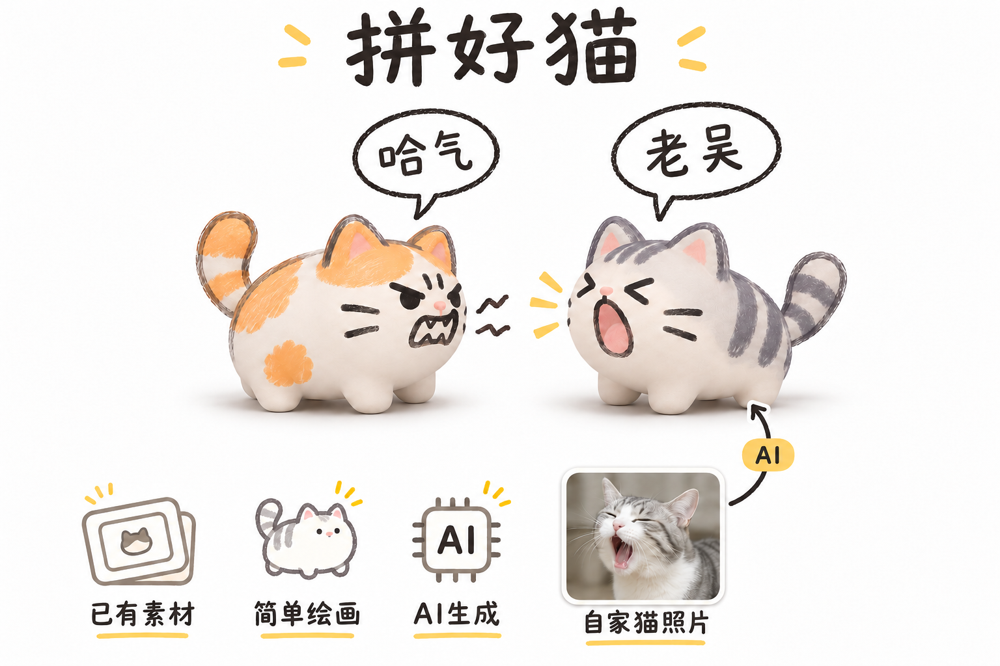

# 拼好猫：想法记录

> 记录一个待做项目，项目名称“拼好猫”  （拼豪耄，拼毫猫等等） 初期规划最好是3d的 用户可以自定义猫的贴图，但是难度不能太高，最好能让一般人手搓 可以“哈气”，可以“老吴” 两只猫对着老吴。 具体玩法没想好。 以后可能会做，先记录下来想法，可以建个文件夹先记录下。 用户可以用已有素材，或者自己简单绘画，或者用ai生成。比如用户用自己的猫的照片来生成对应的猫猫模型。

