# X 媒体工坊 · Tauri 版

> 状态：**真实功能版**。桌面后端已由 Rust 重写并完成真实链路验证：真实解析 X 推文、真实下载/保存媒体、真实转出 GIF / WebP、真实下载外部工具。
> 本项目已自包含 React 前端源码与构建脚本，不再依赖 Electron 目录。

## 这个版本做了什么

- **真实推文解析**：按 fxtwitter v2 → fxtwitter v1 → syndication → vxtwitter 顺序请求公开接口，归一化为现有 TweetInfo；
- **真实媒体列表与缩略图**：解析出的媒体缩略图由 WebView2 加载（跟随 Windows 系统代理），视频缩略图由 ffmpeg 抽帧生成；
- **真实保存原文件**：GIF/视频保存为 mp4、图片保存为 jpg/png/webp/gif 到输出目录，自动写历史记录；
- **真实 GIF / WebP 转换**：
  - GIF：ffmpeg 抽全部帧（fps=source 时 `-fps_mode passthrough`，不重采样）→ gifski 编码 → 按源 MP4 的 stts 逐帧时长写回 GIF 延时（厘秒、最小 2cs）→ 可选 gifsicle 压缩；
  - WebP：ffmpeg concat + `libwebp_anim` 编码 → 改写 WebP ANMF 逐帧时长；
  - 体积预估：转换抽屉里对已保存的源媒体按当前尺寸/帧率/gifski 质量真实采样编码（约 1/3 帧、最多 12 帧）后外推，替代固定 bpp 公式（WebP/ffmpeg 编码仍显示公式估算）；大文件用分段 `-ss` seek + A/B 并发 + 进程内缓存；高分辨率（目标 >900px）再用两档代理分辨率（800/1120）按 `size = k·pixels^α` 幂律拟合外推（异常自动回退全分辨率）。实测 1080p/60s 约 1.2 秒、4K/20s 约 1.5 秒、缓存命中 <10ms；
  - 体积预估模式：设置页可选快速（公式）/ 平衡（默认，采样 + 代理拟合）/ 精确（全分辨率采样）/ 关闭，`AppSettings.estimateMode` 持久化；抽屉按模式显示或隐藏预估；
  - 参数、输出目录命名、历史结果与既有数据契约一致；
- **外部工具状态与一键下载**：真实检测 ffmpeg / gifski / gifsicle，可从官方/推荐源下载 ZIP、解压、校验并安装到 exe 同级 tools/；
- **设置与历史**：真实读写 userdata/settings.json 与 history.json（原子写入 + .bak 备份）；
- **文件操作**：打开、在资源管理器定位、另存为（系统保存对话框）、删除；剪贴板复制路径；
- **网络代理**：系统代理（读取 Windows Internet 选项）/ 自定义 HTTP·HTTPS·SOCKS5（支持认证）/ 直连，解析、下载、工具下载统一走该配置；
- **任务进度与取消**：前端轮询 jobs_poll，外部工具下载进度轮询 tools_poll；取消会终止 ffmpeg/gifski 进程树；
- **界面**：复用原 React 构建产物，无边框窗口、深/浅色主题、窗口最小化/最大化/关闭/标题栏拖动。

## 前端与本地后端

- 前端源码与样式位于本项目的 `src/`，`scripts/build.mjs` 直接编译打包到 `dist/`；
- `scripts/tauri-shim.js` 用 `window.desktop` 实现 DesktopApi，所有调用通过 Tauri invoke 进入 Rust 命令；
- 项目已自包含，不依赖任何外部桌面工程或产物。

## 体积与依赖

项目不打包 Chromium 或 Electron 运行时，exe 本体保持轻量；主要的磁盘占用来自转换用的外部工具（ffmpeg、gifski、gifsicle），首次使用时才下载到 `tools/`，之后可按需更新或替换。

## 真实功能验证（2026-11-16）

自动验证脚本 `npm run capture` 启动 release exe，通过 WebView2 远程调试协议驱动真实界面，**15/15 项通过**：

- 真实解析公开推文 [@CaptainAmerica/status/719944021058060289](https://x.com/CaptainAmerica/status/719944021058060289)（真实作者、正文、缩略图、1 个视频媒体）；
- 真实下载并保存原始媒体：`userdata/media/CaptainAmerica/719944021058060289/CaptainAmerica_719944021058060289_1_1280x720.mp4`（537,709 B）；
- 转换抽屉显示真实采样体积预估（≈ 14 MB / 14,637,104 B），与实际 GIF 误差 +12.1%（WebP 仍为经验公式）；
- 体积预估模式：设置页四模式可选中/保存持久化；balanced 1080p 1.5s/4K 2.1s（+1.2%/+2.5%），precise 禁用代理 1080p 2.7s/4K 7.4s（−2.4%/−0.2%）；抽屉 fast 显示公式值、off 不显示 ≈ 体积；
- 真实转出 GIF：1280×720、76 帧、3.2 秒、12.45 MiB（ffmpeg 校验为真实 gif 视频流）；
- 真实转出 WebP：1280×720、动画 webp_anim、3.84 MiB（ffmpeg 校验通过）；
- 真实保存推文图片：NASA 推文图片 `NASA_2121280846183137564_1_1280x1058.jpg`（91,634 B）；
- 真实工具一键下载：删除本地 gifski.exe 后，从官方源重新下载、解压、运行校验并恢复；
- 窗口最大化/还原、关闭命令正常；页面无脚本异常。

截图（运行 release exe 实拍，公开推文示例内容）：

| 解析首页 | 设置页 |
| --- | --- |
| 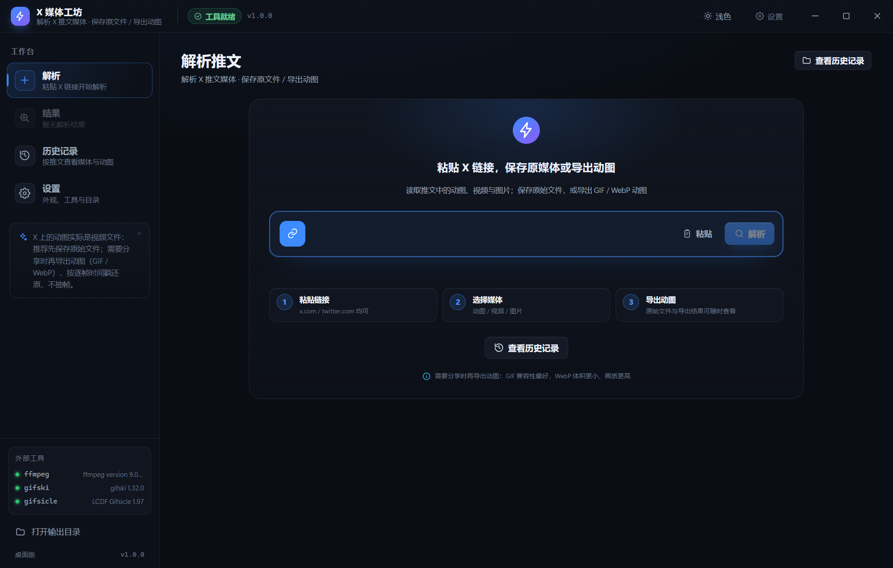 | 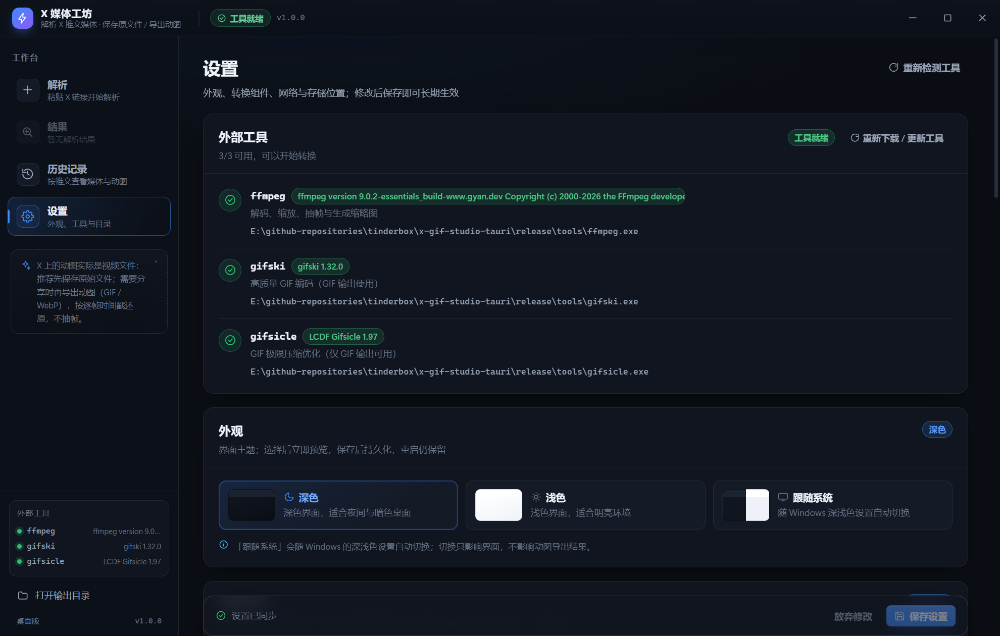 |

| 真实解析结果 | 保存原始媒体 |
| --- | --- |
| 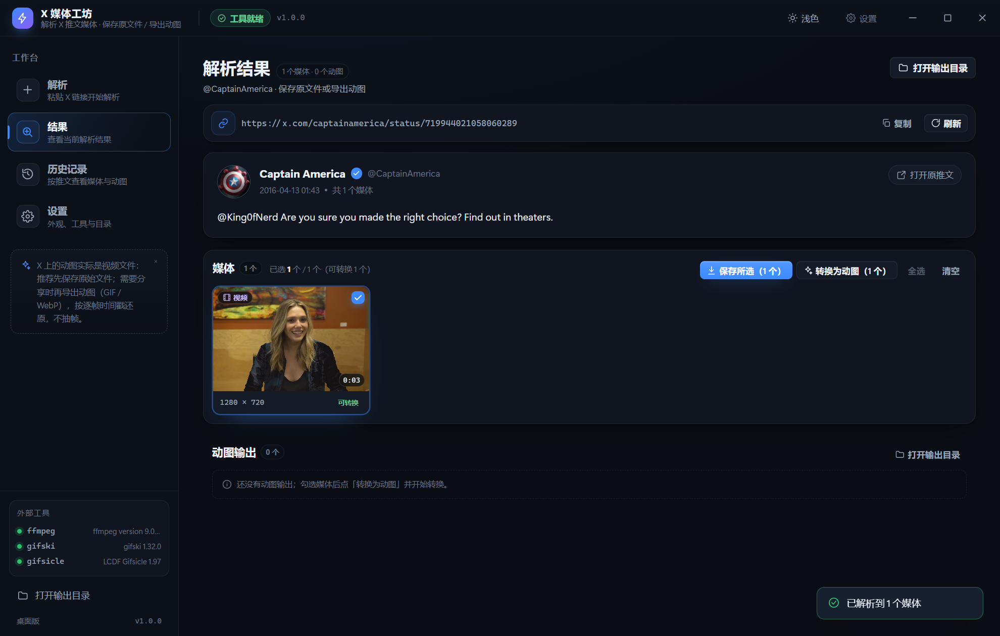 | 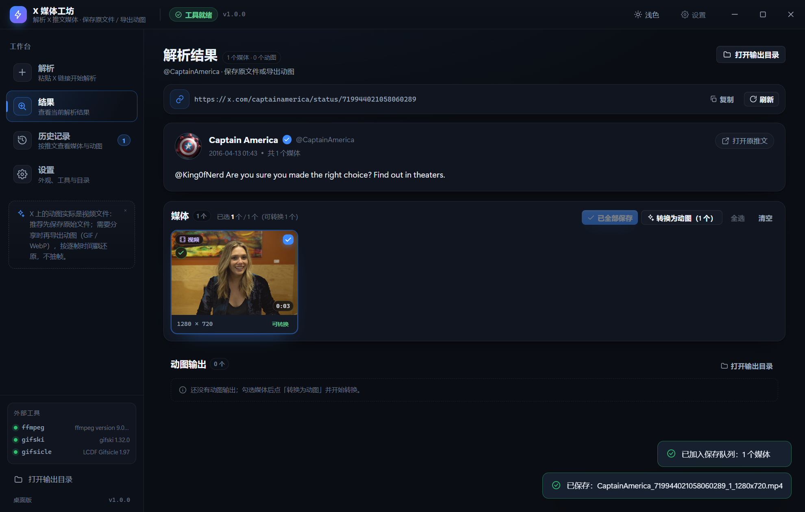 |

| 转换抽屉 | GIF 真实转换结果 |
| --- | --- |
| 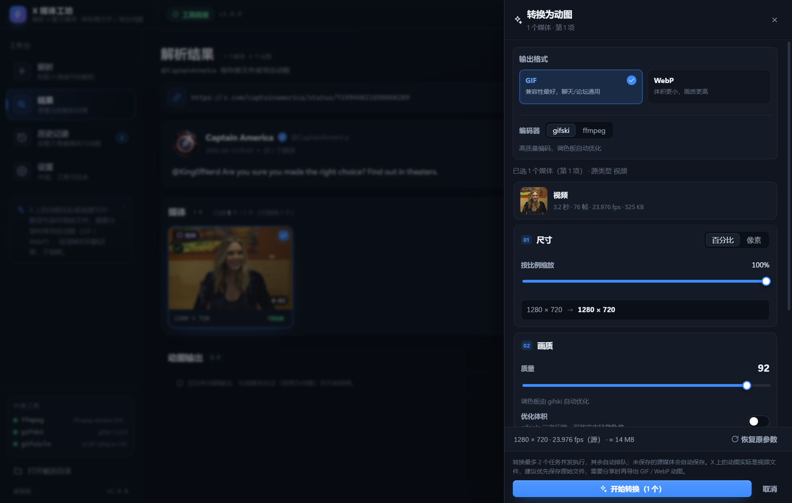 | 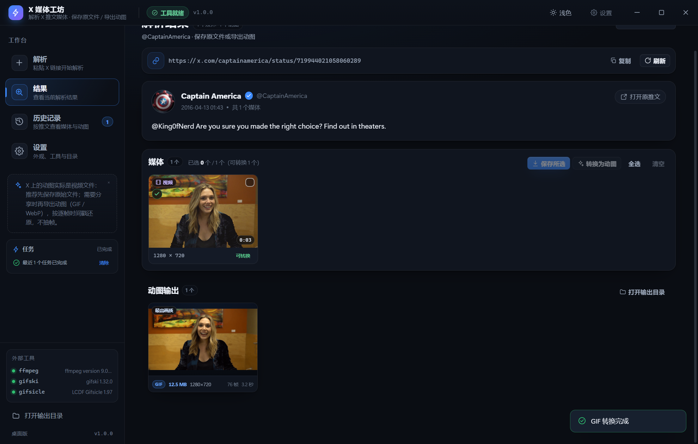 |

| WebP 真实转换结果 | 历史记录 |
| --- | --- |
| 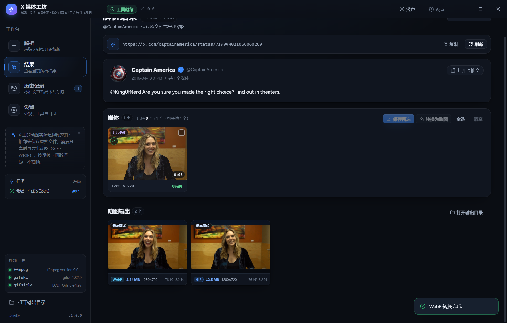 | 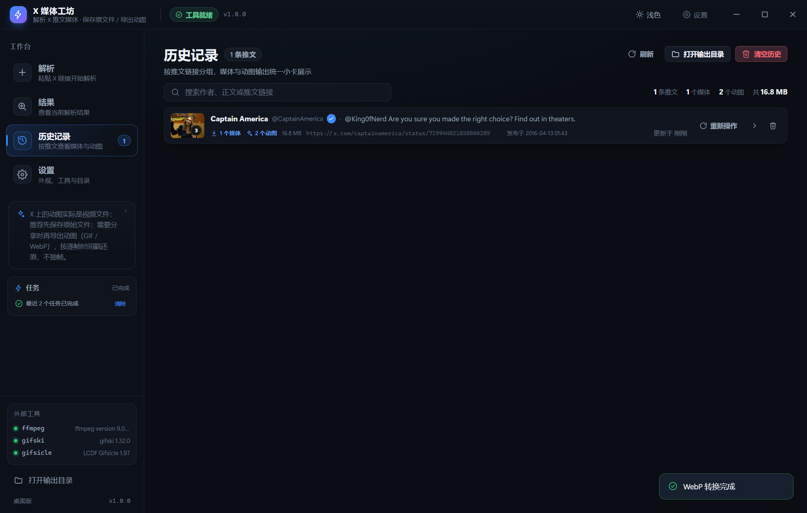 |

| 图片推文保存 | 外部工具下载 |
| --- | --- |
| 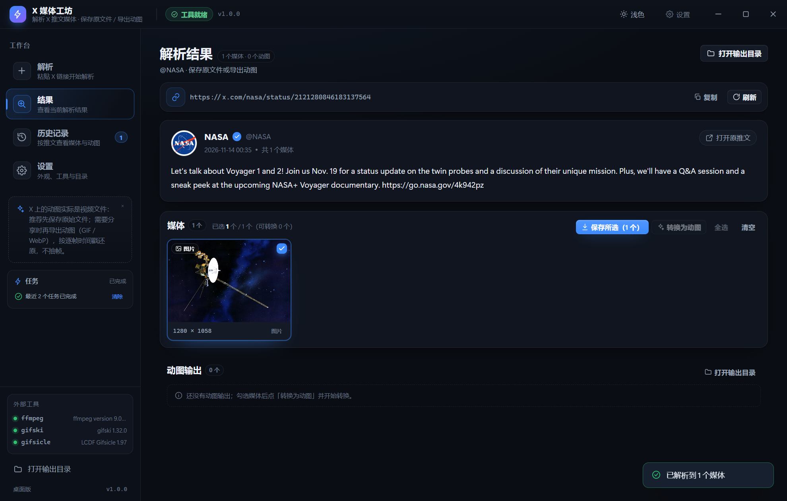 | 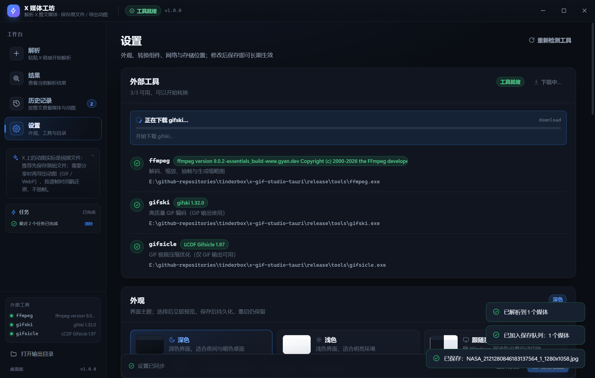 |

体积预估模式（fast / balanced / off；balanced 即转换抽屉截图）：

| 设置页 · 体积预估模式 | 转换抽屉 · 快速模式 |
| --- | --- |
| 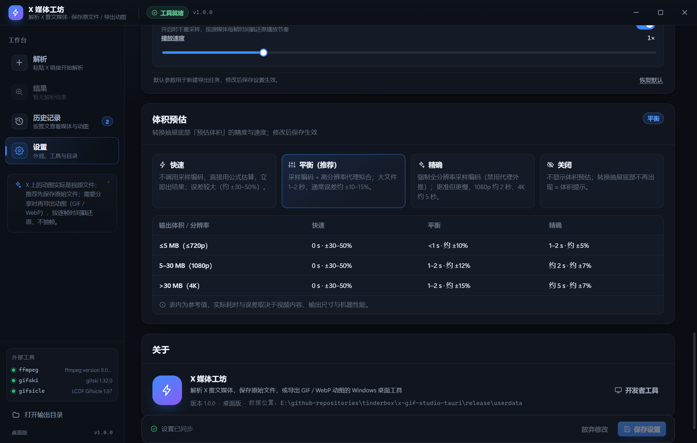 |  |

| 转换抽屉 · 关闭预估 | |
| --- | --- |
| 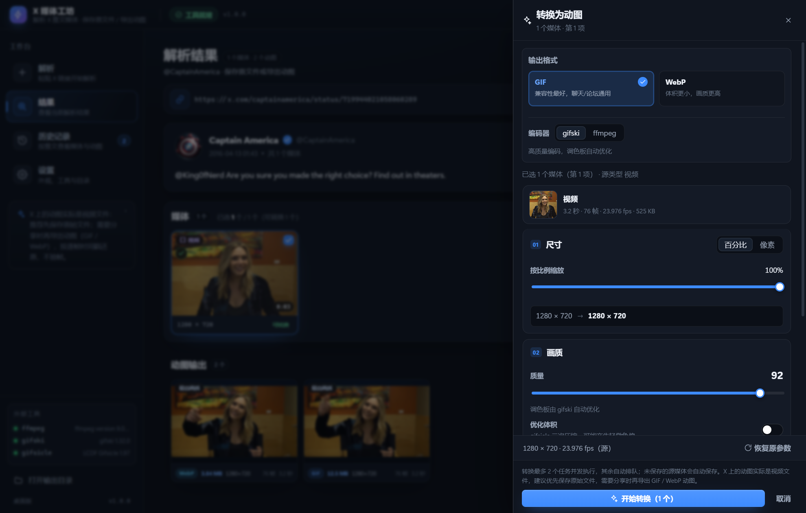 | |

## 运行环境

- Windows 10/11 x64；
- WebView2 Runtime（Windows 11 自带，Windows 10 通常随 Edge 安装）；
- 使用者无需 Node.js/Rust；首次使用需下载转换工具（或在设置页指定已有 tools 目录）；
- 构建者需要 Node.js 22+、npm 11+、Rust 1.77.2+（实测 1.94.0）、本项目的 `@tauri-apps/cli`。

## 快速开始

### 运行

1. 复制 `release/XMediaStudioTauri.exe` 到**可写目录**并双击运行（首次会在同级创建 `userdata/`）；
2. 打开「设置 → 外部工具」，若显示缺失，点击「下载所需工具」（自动下载到 exe 同级 `tools/`）；
3. 回到「解析」页粘贴 X 推文链接 → 解析 → 勾选媒体保存或转换为 GIF/WebP。

### 从源码构建

前置：Windows 10/11 x64、Node.js 22+、Rust 1.77.2+、WebView2；npm 依赖安装完成后可直接构建。

```powershell
cd x-gif-studio-tauri
npm install
npm run prepare:dist      # 编译本项目 React 前端 + 注入 Tauri 桥接层
npm run build             # tauri build --no-bundle + 复制 exe 到 release/
npm run capture           # 真实功能验证与截图（需要 tools/ 中的三个工具）
```

产物：`release/XMediaStudioTauri.exe`。构建中间产物 `dist/`、`src-tauri/target/`、`release/` 均不入版本管理；外部工具也不入库（首次运行下载）。

## 目录结构

| 路径 | 说明 |
| --- | --- |
| `scripts/prepare-dist.mjs` | 编译本项目前端、注入 tauri-shim.js、放行 Tauri IPC / asset 协议的 CSP |
| `scripts/tauri-shim.js` | 真实桥接层：window.desktop → Tauri invoke（含进度轮询、本地文件 asset 地址） |
| `scripts/capture-screenshots.mjs` | 真实功能验证 + 截图脚本（解析/保存/转换/工具下载/窗口命令） |
| `scripts/copy-release.mjs` | 复制构建产物到 release/ |
| `src-tauri/src/*.rs` | Rust 后端：tweet（解析）、media（下载/保存/缩略图）、convert（GIF/WebP）、probe_mp4/gif/webp（探测与延时修补）、tools（下载）、settings/history、commands |
| `src-tauri/tauri.conf.json` | 窗口、asset 协议、便携数据目录、capabilities 等配置 |

## 文档

- [使用说明](docs/使用说明.md)：从解析到保存/GIF/WebP 的完整操作、设置项、工具下载、常见问题。
- [开发说明](docs/开发说明.md)：技术栈、Rust 模块与数据流、DesktopApi 实现矩阵、构建与真实验证记录、已知问题。
- [PORT-tweet.md](docs/PORT-tweet.md)：独立推文解析 Rust 库（POC）实现说明与接入参考（主后端当前使用 src-tauri/src/tweet.rs）。
- [PORT-convert.md](docs/PORT-convert.md)：独立 GIF/WebP 转换 Rust 库（POC）实现说明与交叉校验记录。

## 数据与隐私

- 数据只保存在 exe 同级 `userdata/`（settings.json、history.json、cache/、media/）与 `tools/`（外部工具）；删除 exe + 这两个目录即卸载；
- 不登录 X、不读取 Cookie；只访问公开接口（fxtwitter / syndication / vxtwitter）与媒体 CDN，工具下载访问 ffmpeg/gifski/gifsicle 官方或推荐下载源；
- 不写注册表应用项、不上传任何内容；
- 本仓库内的截图使用公开推文示例内容，仅用于展示真实功能与界面。

## 已知限制

- 当前只验证 Windows 10/11 x64；Linux/macOS 未验证；
- 解析接口按 fxtwitter v2 → v1 → syndication → vxtwitter 回退，实测网络下 fxtwitter v2 成功，其余回退未逐一验证；
- 转换 4K/长视频时会把全部帧解为 PNG 写入 cache/frames，磁盘与内存占用较大（默认帧率/分辨率可在转换抽屉调整）；
- 系统代理读取 Windows Internet 选项，代理认证使用设置页填写的用户名密码；未做 PAC 脚本解析；
- 另存为/打开/定位依赖系统对话框与资源管理器，未纳入自动验证；
- 任务取消会终止 ffmpeg/gifski 进程树，取消路径未纳入自动验证；
- 外部工具一键下载只验证了 gifski 的真实下载链路，ffmpeg/gifsicle 使用相同的下载/解压/校验代码但未重新下载验证（本机已有工具）；
- GIF 体积预估需要源媒体已保存到本地且使用 gifski 编码；WebP/ffmpeg 编码、没有本地源时仍显示经验公式，采样预估本身也有约 10% 量级误差；
- exe 未签名，SmartScreen 可能提示未知发布者。