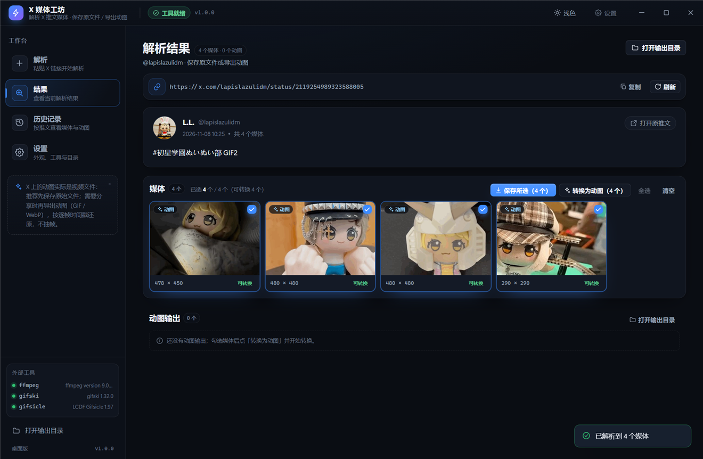
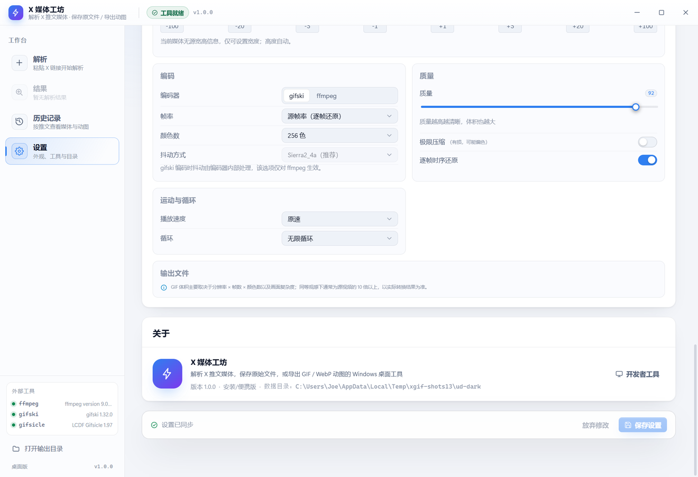

# X 媒体工坊

Windows 桌面工具：粘贴一条公开的 X（Twitter）推文链接，解析并**保存推文里的原始媒体**（GIF/视频为 mp4、图片为 jpg/png/webp），并可对已保存的媒体用「保留逐帧时序的专用还原流水线」**导出高质量 GIF**。支持查看尺寸/体积、快速改参数重导出、按 X 链接整理下载历史；**不需要登录 X，不启动任何本地 Web 服务，双击 exe 直接使用。**

## 主要功能

- **链接解析**：支持 `x.com` / `twitter.com` 的推文链接（含 `/i/status/`、带追踪参数的分享链接），回调公开接口，无需登录；
- **保存原始媒体**：媒体列表中的 GIF（X 内部为 `animated_gif`，实际是 mp4）、视频、图片都可勾选保存到输出目录；支持「保存所选」与媒体卡右键菜单；同一媒体重复保存自动去重；
- **网络代理**：设置页可配置系统代理 / 自定义 HTTP·HTTPS·SOCKS5 代理（支持用户名密码认证与不走代理白名单），解析、视频下载与界面缩略图全部走代理，并提供「测试连接」逐项检查；保存后立即生效，无需重启；
- **主题与布局**：深色 / 浅色 / 跟随系统三种主题，标题栏一键切换；解析页采用「左侧内容（推文/媒体/结果）+ 右侧紧凑操作栏（保存/转换/预设））」两栏布局，媒体与结果卡片缩小、历史页统一小卡，信息密度更高；
- **媒体选择**：列出推文中的 GIF、普通视频、图片；所有类型都可勾选保存，GIF/视频可转 GIF；
- **可选 GIF 导出**：对任意已保存的 mp4/动图媒体（或未保存时右键直接转换，自动先保存）导出 GIF；读取源 mp4 的逐帧时间戳，抽取**全部帧**、不做帧率重采样，用 gifski 逐帧局部调色板编码后按原始节奏写回 GIF 每帧延时；可选 gifsicle 有损体积优化；
- **参数与预设**：最高画质 / 均衡压缩 / 轻量体积 / 极小体积 四档预设，另可调宽度、帧率、颜色数、质量、lossy、速度、循环；导出后立即显示尺寸、体积、帧数、时长、帧率；
- **快速导出**：生成结果可打开、定位、另存为、复制路径；改参数可立即重新导出；
- **下载历史**：以 X 推文链接为分组（按推文条数统计），展开后同时展示已保存媒体与 GIF 导出结果（含参数与体积）；点「重新操作」会带入链接并自动解析；支持搜索、删除与清空；所有文件保存在本机；
- **免安装交付**：Electron 便携目录 + 启动器 exe，不写注册表，删除目录即卸载。

## 界面预览

| 解析首页 | 解析结果页 |
| --- | --- |
|  |  |

| 下载历史（媒体 + GIF） | 网络代理设置 |
| --- | --- |
|  |  |

> 截图中的推文与媒体均为公开示例内容，仅用于演示界面。

## 运行环境

- Windows 10/11 x64；
- 使用者：无需安装任何依赖，运行打包产物即可（内置 ffmpeg / gifski / gifsicle）；
- 开发者：Node.js 22+、npm 11+、PowerShell 7 或 Windows PowerShell 5.1；项目根目录需准备 Electron 运行时 `runtime/`（不入库，见 [开发说明](./docs/开发说明.md)）；
- 打包启动器需要系统自带 .NET Framework 4.x 的 `csc.exe`（Windows 10/11 默认具备）；生成图标需要 Python 3 + Pillow + numpy（可选）。

本仓库只提交源码与文档：`node_modules/`、`runtime/`、`tools/bin/`、`dist/`、`.build/`、`release/`、`build/` 都是本地忽略产物。

## 快速开始（开发）

```powershell
cd x-gif-studio

# 1. 准备依赖（受限环境可加 --ignore-scripts --cache .npm-cache）
npm install

# 2. 准备外部工具（ffmpeg / gifski / gifsicle → tools/bin）
npm run fetch-tools

# 3. 类型检查 + 单元测试 + 构建 + 冒烟
npm run check

# 4. 开发运行（构建后启动 Electron）
npm start
```

打包为免安装 exe：

```powershell
powershell -NoProfile -ExecutionPolicy Bypass -File scripts/package.ps1
```

产物在 `release/XMediaStudio/`，双击 `XMediaStudio.exe` 启动。详细操作见 [使用说明](./docs/使用说明.md)。

## 文档

- [使用说明](./docs/使用说明.md)：从链接到保存媒体/导出 GIF 的完整操作、参数含义、历史与设置、常见问题。
- [开发说明](./docs/开发说明.md)：技术栈、目录与源码入口、环境约束、构建/测试/打包、验证方法与已知问题。
- [架构与接口契约](./docs/架构与接口契约.md)：主进程与渲染进程的 IPC、数据模型、并行开发约定。
- [GIF 转换技术方案](./docs/GIF转换技术方案.md)：X GIF 的格式事实、专用还原流水线、编码器基准与预设依据。
- [网络与代理](./docs/网络与代理.md)：代理模式、协议与地址示例、认证与密码存储、生效范围、本地验证与排障。

## 数据与隐私

- 所有数据只保存在本机：历史记录与设置在用户数据目录（`%APPDATA%\XMediaStudio`），保存的媒体、GIF 与缓存媒体在同一目录下；旧版 `XGifStudio` 的配置与历史会自动迁移；
- 不登录、不读取 Cookie、不上传任何内容；只访问公开的推文接口与 X 媒体 CDN；
- 受限环境下启动器会把数据目录回退到程序目录下的 `userdata/`。

## 许可与第三方组件

本项目仅用于个人工具用途。打包产物内包含并按许可证分发第三方命令行工具：ffmpeg（GPL/LGPL，https://ffmpeg.org）、gifski（AGPL-3.0，https://gif.ski）、gifsicle（GPL-2.0，https://www.lcdf.org/gifsicle/）。详见打包目录 `THIRD-PARTY-LICENSES.txt`。