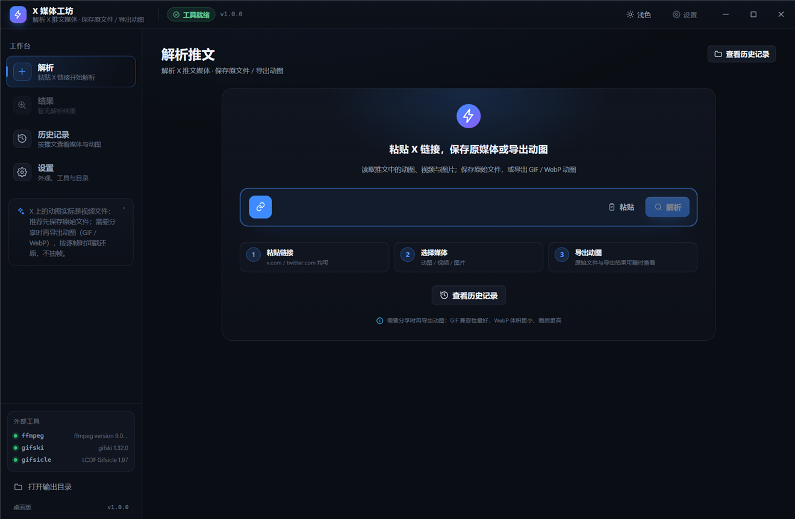
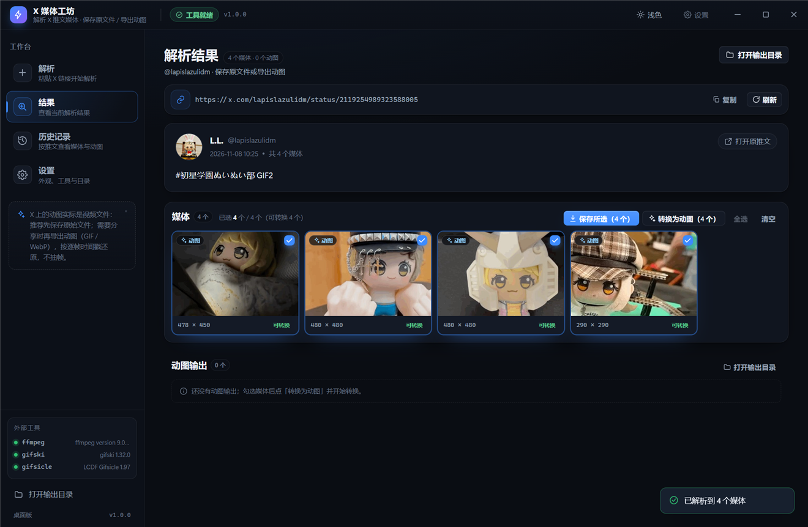
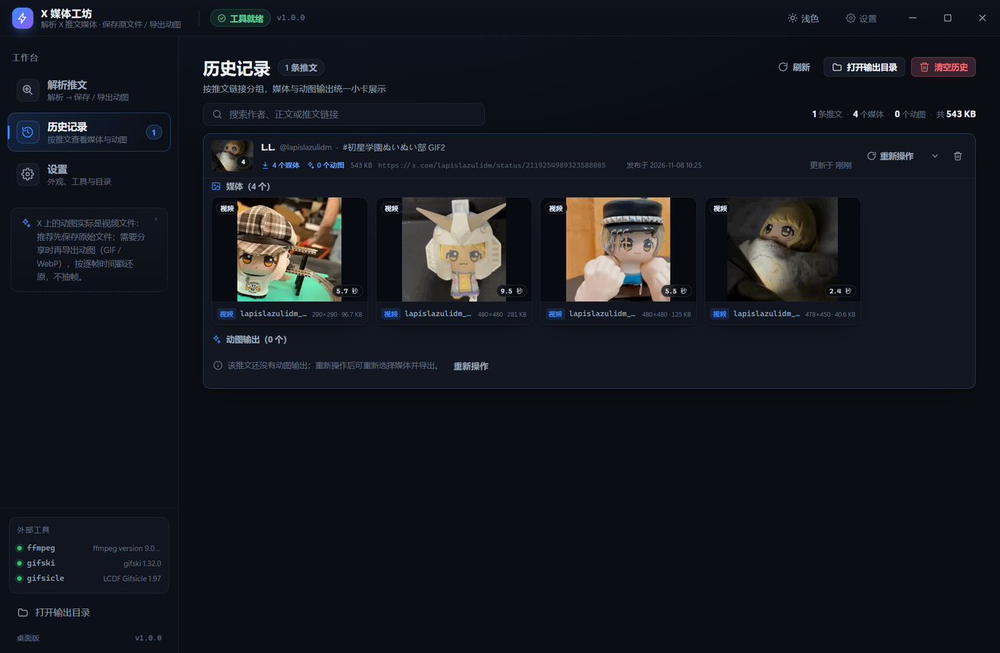
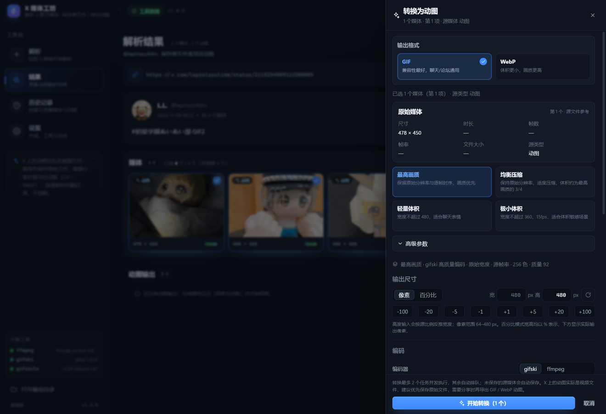
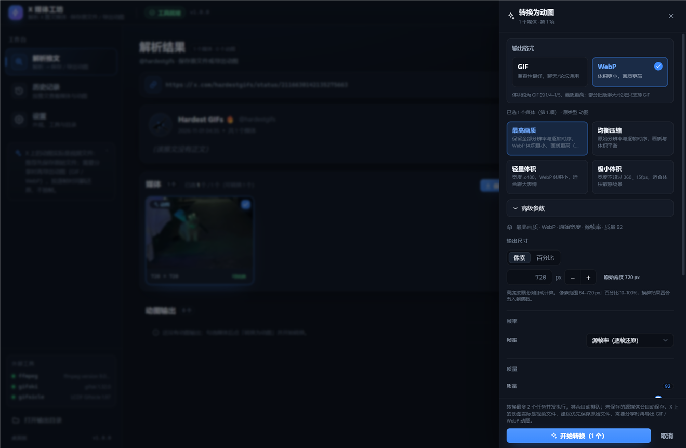
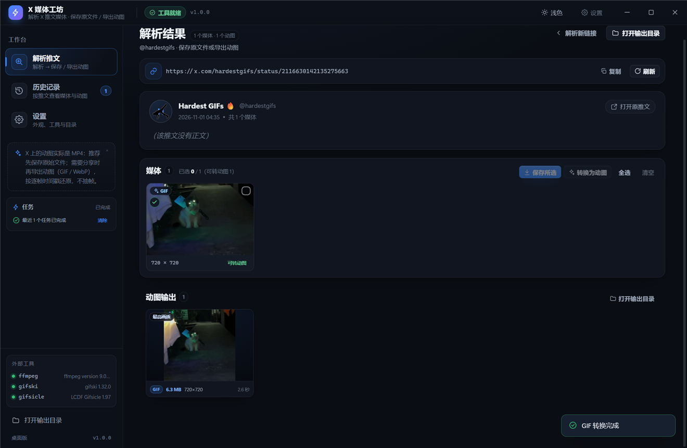
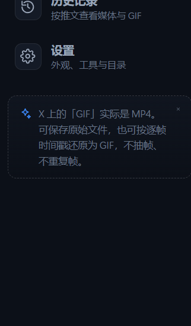
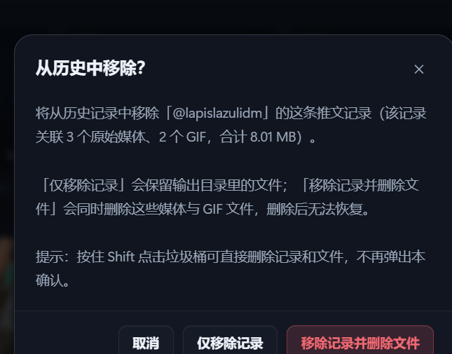
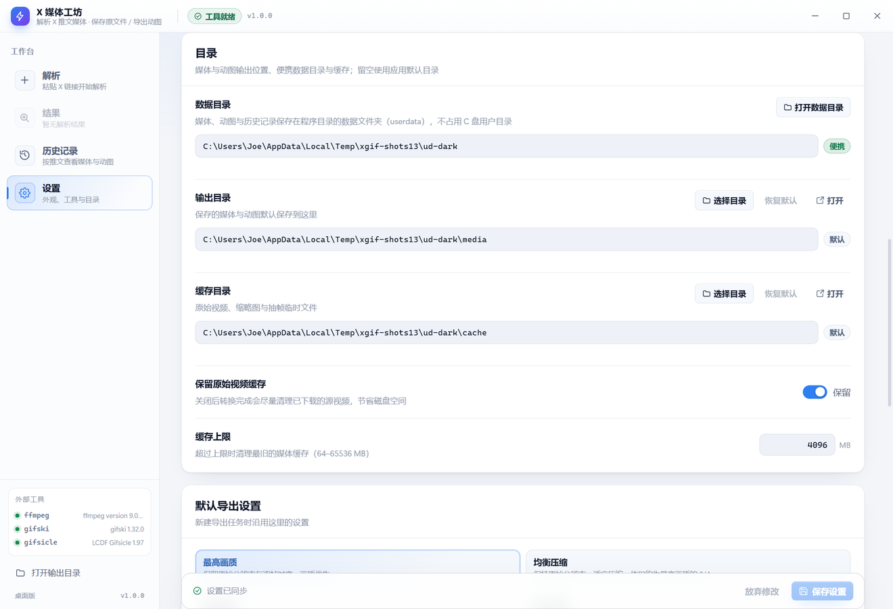
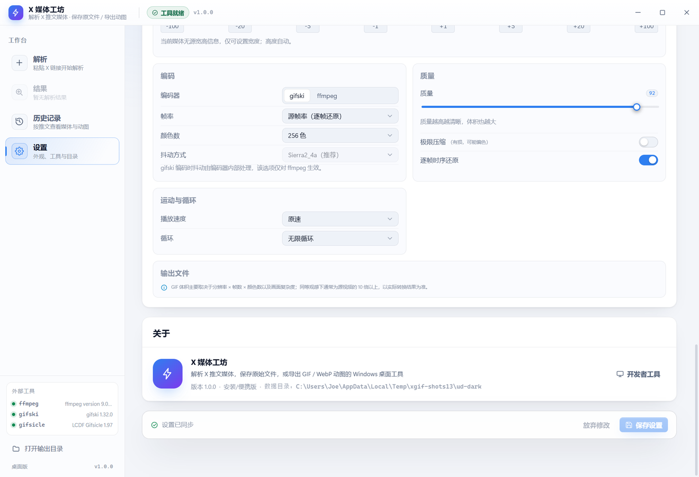

# X 媒体工坊 · 使用说明

Windows 桌面工具：粘贴一条公开的 X（Twitter）推文链接，解析其中的媒体并**保存原始文件**（X 的「GIF」实际是无声 mp4；图片为 jpg/png/webp 等），还可对已保存的媒体用「保留逐帧时序」的流水线**导出高质量 GIF**。支持查看尺寸/体积、随时改参数重新导出、按 X 链接整理下载历史。**无需登录 X，不启动本地 Web 服务，双击 exe 即可使用。**

| 界面 | 说明 |
| --- | --- |
|  | 解析首页：粘贴链接、三步引导，不显示媒体 |
|  | 解析结果页：推文 + 媒体列表 + GIF 结果（全宽） |
|  | 以 X 推文链接分组的历史（媒体 + GIF 双区块） |

## 1. 安装与启动

1. 解压 `XMediaStudio-1.0.0-win64.zip`（或把 `release/XMediaStudio/` 整个文件夹）放到本地磁盘任意目录（建议路径不含空格和特殊字符）；
2. 双击 `XMediaStudio.exe`（启动器）即可启动；不要单独双击 `XMediaStudioCore.exe`；
3. 如果双击无反应：查看同目录下的 `启动日志.log`，或运行「启动（兼容模式）.cmd」；
4. 可选：运行「创建桌面快捷方式.cmd」在桌面创建快捷方式。

程序是免安装便携版：不写注册表、不装服务，删除整个文件夹即卸载。数据保存在用户数据目录（见第 10 节）。从旧版「X 动图工坊」升级时，旧数据目录（`%APPDATA%\XGifStudio`）里的设置与历史会在首次启动时自动迁移到 `%APPDATA%\XMediaStudio`。

## 2. 解析推文（两个页面）

**解析首页**：启动后默认进入首页，粘贴链接（支持 `x.com` / `twitter.com`、`/i/status/`、带 `?s=20` 等分享参数）后点「解析」；首页只放输入与引导，不显示媒体。

**解析结果页**：解析成功后自动进入，包含：
   - **推文信息**：作者、正文、发布时间、打开原推文；
   - **媒体列表**：推文里的 GIF / 视频 / 图片，可多选；右上角有「保存所选」「转换为 GIF」等批量操作；
   - **GIF 结果**：已导出的 GIF（与媒体卡同尺寸），任务进度在页面顶部窄条。

左侧「工作台」固定有「解析 / 结果 / 历史记录 / 设置」四项（同款平级）：「解析」回到初始解析页（输入框为空，当前结果保留）；「结果」回到当前解析结果，没有结果时该项置灰不可点；两项切换不会丢失已保存 / 已导出的内容；结果页里的链接只读展示（可复制，或点「刷新」按原链接重新拉取），避免误改。历史记录里点「重新操作」会直接进入结果页并自动解析该链接（已保存/已转换过的推文也可以再次进入操作）。

## 3. 保存原始媒体（主流程）

1. 在媒体列表中勾选要保存的媒体（GIF、视频、图片都可以保存；点击卡片上的勾选圈即可选择）；
2. 点操作区的 **「保存所选（N）」**，或点媒体卡上的快捷「保存」按钮；
3. 保存过程中「保存所选」按钮会显示「保存中…（x/y）」；保存完成后媒体卡角落显示绿色已保存图标（悬停可看文件名与格式），原文件在输出目录中；
4. 已保存的媒体不再显示「保存/重新保存」按钮：鼠标悬停卡片显示「打开文件位置」，右键菜单为「打开文件位置 / 转换为 GIF（使用已保存文件）/ 复制源链接」；所选媒体全部已保存时，媒体列表右上角按钮变为「已全部保存」（禁用）；
5. 右侧栏的任务区只显示 GIF 转换任务，不显示保存任务；
4. 也可以在媒体卡上**右键**，选择「保存媒体」；右键菜单里还有「转换为 GIF」（未保存时会自动先保存）与「复制源链接」。

保存的文件放在「设置 → 目录 → 输出目录」下，按作者与推文分文件夹：

```
<输出目录>/<作者>/<推文 id>/<作者>_<推文 id>_<媒体序号>_<宽>x<高>.mp4    ← GIF/视频
<输出目录>/<作者>/<推文 id>/<作者>_<推文 id>_<媒体序号>_<宽>x<高>.jpg    ← 图片
```

说明：

- X 的「GIF」服务端保存为无声 mp4，因此保存下来的原文件是 **.mp4**（这是 X 提供的原始格式；如需 GIF 请用第 4 节转换）；
- 保存是**幂等**的：同一条媒体重复保存不会产生重复文件，只会更新记录；
- 保存过程中可在任务区取消；网络错误、图片过大（单张上限 50MB）等情况会给出中文提示；
- 图片会按实际格式保存为 jpg / png / webp / gif。

## 4. 可选：把媒体转换为 GIF（右侧抽屉）

GIF 转换参数不再常驻页面右侧，只有点「转换」时才从右侧弹出抽屉：

- **批量**：勾选媒体后，点媒体列表右上角的「转换为 GIF（N）」；
- **单个**：鼠标悬停媒体卡点「转换」，或右键媒体卡 →「转换为 GIF」；
- 抽屉里先选**输出格式**：**GIF** 或 **WebP（推荐）**。WebP 是动画格式，24 位全彩、保留全部帧与逐帧时序，体积通常只有 GIF 的 1/3–1/5、画质更高；缺点是个别聊天/论坛只支持 GIF；
- 再选择预设（最高画质 / 均衡压缩 / 轻量体积 / 极小体积），或展开「高级参数」微调：参数按「输出尺寸 / 编码 / 质量 / 运动与循环 / 输出文件」分组；尺寸支持**像素**或**百分比**两种编辑方式（百分比按源宽度实时换算，例如 596 的 50% = 298 px，结果取偶数且不超过源宽）；宽/高默认锁定比例联动，可直接在数字上**滚动滚轮**或按 ↑/↓（Shift 加大步长）调整；下方平铺的快捷按钮可直接点击：像素 -100/-20/-5/-1/+1/+5/+20/+100，百分比 -20/-10/-5/-1/+1/+5/+10/+20；并提供「恢复原始尺寸」；分好参数后点「开始转换（N）」；遮罩、Esc 或关闭按钮可取消；
- 若所选媒体尚未保存，会**先自动保存**到输出目录再转换；
- 图片（photo）没有可转的动画，不参与 GIF 转换；
- 转换任务显示在**左侧边栏的「任务」区**（最多 2 个并发，其余排队）：进行中可取消、完成后可移除，切到历史/设置页也一直可见；结果页顶部不再放任务条；
- GIF 结果卡上的「调整参数」也使用同一套分组参数面板，可直接按新参数重新导出；
- 宽度/百分比等数字输入不再使用系统自带的小箭头，旁边改为大号「− / +」步进按钮（宽度每次 ±2px、百分比每次 ±5%），点按更稳定。











### 4.1 预设

| 预设 | 适用场景 | 做法（实测参考：720×720/72 帧/2.57s 的推文 GIF） |
| --- | --- | --- |
| 最高画质 | 画质优先 | 原始分辨率、保留全部帧与原始时序、gifski q92 → 约 6.3MB |
| 均衡压缩 | 体积与画质折中 | 原分辨率、保留全部帧、gifski q82 → 约 4.7MB |
| 轻量体积 | 网页/聊天 | 最长边不超过 720px、20fps、128 色、gifski q82 |
| 极小体积 | 表情包/体积敏感 | 最长边不超过 480px、15fps、64 色、gifski q75（体积最小） |

> 体积主要取决于 **分辨率 × 帧数 × 颜色/内容复杂度**；GIF 是老式 256 色格式，同等观感下体积通常是 H.264 mp4 的 10 倍以上。想更小请用更小的预设，或手动降低宽度/帧率。

### 4.2 高级参数

| 参数 | 说明 |
| --- | --- |
| 宽度 | 输出宽度上限（px），留空/自动表示保持源宽度；只会缩小不会放大 |
| 帧率 | 「原始」= 保留全部帧并还原逐帧时序（不抽帧、不重复帧）；数字 = 重采样到指定帧率 |
| 颜色数 | 调色板颜色数（gifski 编码时仅在高级有损优化时作为 gifsicle 参数生效） |
| 质量 | gifski 质量 1–100，越高越清晰、体积越大 |
| 还原原始时序 | 按源 mp4 每帧时间戳写回 GIF 帧延时（推荐开启） |
| 极限压缩（有损，可能偏色） | 开启 gifsicle `--lossy` + 全局色量化，体积可再降约一半，但高光/浅色毛发会出现明显偏色，非推荐 |
| lossy | 极限压缩强度 0–200 |
| 速度 | 0.25–4 倍播放速度（不改变帧数与画面） |
| 循环 | 默认无限循环；可设 0 次=无限、-1=不循环、N 次 |

### 4.3 转换结果

结果卡片显示：

- **体积**与**尺寸（宽×高）**（大号突出显示），并给出「约为源 mp4 的 X 倍」参考；
- 帧数、时长、帧率、所选预设与参数摘要（可折叠）；
- GIF 动图预览（点击可放大查看）。

> 个别媒体在轻量体积预设下，编码器（gifski）可能合并少量重复帧。此时工具会自动按源时间比例还原时长并在进度里提示，保证总时长基本一致；若需要严格逐帧一一对应，请用「最高画质」预设。

## 5. 结果产出区与文件操作

「结果产出区」只展示**GIF 结果**（无 GIF 时整区不显示），每张 GIF 卡片与媒体卡**同尺寸**：

- 卡片预览下方一行显示：体积 · 尺寸 · 时长 · 帧率；
- 悬停卡片（或键盘聚焦）显示图标操作：打开 / 定位 / 另存为 / 复制路径 / 调整参数 / 删除；
- 点「调整参数」会从右侧弹出参数抽屉（内嵌完整参数与「按新参数重新导出」），不挤占结果网格。

> 已保存的原始媒体不再单独列卡片：媒体列表的媒体卡上用绿色图标表示已保存状态，文件本身在「设置 → 目录 → 输出目录」中，可用「打开输出目录」查看。

| 图标 | 作用 |
| --- | --- |
| ▶ 打开 | 用系统默认程序打开 GIF |
| 定位 | 在资源管理器中选中该 GIF 文件 |
| 另存为 | 复制到你指定的位置（原文件保留） |
| 复制路径 | 复制 GIF 的完整路径 |
| 调整参数 | 弹出参数抽屉，改完可立即重新导出 |
| 删除 | 删除 GIF 文件与对应记录（有确认提示） |

「打开输出目录」按钮可直达保存目录。

## 6. 下载历史

- 「历史记录」页以 **X 推文链接** 分组：作者、正文摘要、最近打开时间、**推文条数**统计；
- 顶部统计显示「N 条推文 · M 个媒体 · K 个 GIF」；侧栏「历史记录」徽标显示推文条数（按链接去重）；
- 同一推文链接再次解析/保存/转换只更新同一条记录，不会新增重复分组；
- 展开分组后同时显示 **「媒体（N）」** 与 **「GIF 输出（M）」** 两个区块，卡片尺寸一致（207×169）：媒体区块展示已保存的原始媒体（图片直接预览、mp4 显示格式与时长），GIF 区块展示导出结果；两者都能直接打开/定位/另存为/删除/调参重导出；
- 删除整条推文记录时（分组右侧垃圾桶），确认框会显示该记录关联的媒体/GIF 数量与总体积，并提供两个选择：
  - **仅移除记录**：文件保留在输出目录；
  - **移除记录并删除文件**：同时删除该记录下的原始媒体与 GIF 文件（不可恢复）。
  - **按住 Shift 点击垃圾桶**：跳过确认，直接删除记录和文件（适合清理大量测试数据）。
- 顶部支持按作者、正文、链接搜索；
- 「移除记录」只删除历史记录、保留磁盘文件；「清空历史」同理；要删文件请用结果卡片上的「删除」；
- 删除/清空均有二次确认。

## 7. 设置

- **网络代理**：如果访问 X 需要代理，在这里配置（详见第 9 节）；
- **外部工具**：显示 ffmpeg / gifski / gifsicle 的路径与版本，缺失时会标红并给出解决方式；可「重新检测工具」；
- **目录**：输出目录（保存的媒体与 GIF）、缓存目录，可修改或恢复默认，并可一键打开；
- **默认导出参数**：设置新任务默认使用的预设与参数；
- **缓存**：是否保留原始 mp4、缓存上限（MB），超过上限会清理最旧的缓存；
- **外观**：主题选择（见第 8 节）；
- **关于/开发者工具**：版本信息与开发者工具开关。

## 8. 显示主题

- 标题栏右上角有主题切换按钮（太阳/月亮），点击可在深色 / 浅色之间快速切换；
- 更完整的选项在「设置 → 外观」：深色、浅色、跟随系统；「跟随系统」会随 Windows 的亮/暗模式自动切换；
- 主题选择会立即生效并保存，重启后保持不变。

## 9. 网络代理

> 设置页的「目录」区（数据目录 / 输出目录 / 缓存目录 / 缓存相关）已统一排版；路径框整行显示，右侧操作按钮水平对齐。

（访问 X 需要时）



X 的接口与视频/图片 CDN 在部分网络下需要代理。打开「设置 → 网络代理」，三种模式：

| 模式 | 说明 | 适用场景 |
| --- | --- | --- |
| 系统代理（默认） | 自动跟随 Windows 系统代理设置 | 代理软件（Clash / V2Ray / Shadowsocks 等）已开启「系统代理」时，直接选它，无需填地址 |
| 自定义代理 | 手动填写代理地址，支持 HTTP / HTTPS / SOCKS5 | 系统代理未开启，或只想让本工具走代理 |
| 直连 | 不使用代理 | 本机可直连 X，或做网络排障对照 |

自定义代理按「协议 / 主机（IP）/ 端口」分段填写，不需要自己输入 `http://` 之类的前缀：

- **协议**：下拉选择 HTTP / HTTPS / SOCKS5；
- **主机 / IP**：例如 `127.0.0.1` 或 `proxy.example.com`（也支持直接粘贴完整地址 `http://127.0.0.1:7890`，会自动拆分）；
- **端口**：例如 `7890`（Clash / Mihomo 常见 HTTP 端口）或 `1080`（常见 SOCKS5 端口）。

填写完整后会显示「实际代理：`socks5://127.0.0.1:1080`」供核对；端口必须是 1-65535 的数字。

如果代理需要认证，填写「用户名」「密码」（密码在本机加密保存，不会明文写入设置文件）。「不走代理的主机」默认是 `localhost;127.0.0.1;<local>`，一般不需要改。

填写后点 **「测试连接」**：工具会临时应用当前填写配置，分别请求 X 解析接口与 X 媒体 CDN，并显示每项的 HTTP 状态、耗时与错误；测试结束会自动恢复为已保存的设置，不影响正在用的配置。

点「保存设置」后代理立即生效，**无需重启**：推文解析、媒体保存下载、GIF 转换所需的 mp4 下载、界面缩略图/头像都会走同一代理。

常见问题：

- **测试失败、提示超时/连接被拒**：确认代理软件已启动、端口填写正确（在代理软件里查看 HTTP/SOCKS 端口），或改用「系统代理」模式；
- **代理软件是 SOCKS5，但填 http 失败**：把地址改成 `socks5://host:port`；
- **公司/校园代理需要账号密码**：填写用户名和密码后再测试；
- **切换网络后失效**：系统代理模式会跟随系统；自定义代理不受影响，可重新点「测试连接」确认。

## 10. 数据位置与备份

- 用户数据根目录：`%APPDATA%\XMediaStudio\`（受限环境下启动器会自动改用程序目录下的 `userdata\`）；旧版目录 `%APPDATA%\XGifStudio\` 的设置与历史会在首次启动时迁移；
- `history.json`：下载历史（含已保存媒体与 GIF 结果，写入时自动保留 `.bak` 备份）；
- `settings.json`：设置（包含代理配置；代理密码使用 Windows 凭据加密能力（safeStorage）加密存储，不保存明文）；
- `media\`：默认输出目录（保存的媒体与 GIF，按作者/推文分目录）；
- `cache\`：原始媒体、缩略图与抽帧缓存（可随时清理）；
- `logs\main.log`：主进程日志（排查启动/转换问题时使用）。

## 11. 常见问题

| 问题 | 说明 |
| --- | --- |
| 提示「推文不存在或已被删除」 | 推文可能已删除、受保护或包含敏感内容；本工具不登录 X，只能读取公开内容 |
| 解析失败/超时 | 公开接口偶尔不可用或网络受限，稍后重试；可先用浏览器确认链接可公开访问 |
| 为什么保存下来的「GIF」是 mp4 | X 把 GIF 转成无声 mp4 存储，且不对外提供原始 GIF；保存原文件即 mp4，需要 GIF 请用「转换为 GIF」 |
| 保存/转换很慢 | 保存需要下载 mp4/图片，转换需要「抽全部帧 → gifski 编码」；720p/70 帧约 3–8 秒，大视频更久，进度条会显示阶段 |
| 为什么 GIF 比 mp4 大很多 | GIF 无帧间预测且最多 256 色，同等分辨率/帧率下体积通常是 H.264 的 10 倍以上；用「小体积/超小体积」预设或降低宽度/帧率 |
| 转换时提示「编码器帧数不一致，已按时间比例还原时长」 | gifski 在轻量体积预设下合并了少量重复帧，工具已自动按源总时长重新分配延时，属正常回退；需要严格逐帧请用「原样还原」 |
| 删除后文件还在吗 | 结果卡片的「删除」会删文件并清理记录；历史页的「移除记录/清空历史」只删记录、保留文件 |
| 启动后窗口空白/闪退 | 查看 `启动日志.log`；尝试「启动（兼容模式）.cmd」；确认整个文件夹已完整解压，不要只拷 exe |
| 工具状态显示缺失 | 打包版重新解压完整压缩包（`resources/tools/` 应包含三个 exe）；源码运行执行 `npm run fetch-tools` |
| 缩略图/头像不显示 | 需要访问 X 的图片 CDN；离线时显示占位图标，不影响保存/转换 |
| 复制/粘贴按钮无效 | 受限环境中剪贴板 API 可能被拒绝，可用 Ctrl+C / Ctrl+V 手动操作 |
| 访问 X 失败/解析超时 | 检查「设置 → 网络代理」：需要代理时请按第 9 节配置并测试；某代理节点被 X 限制时可更换节点或模式 |


## 附录：为什么 X 的「GIF」保存下来是 MP4？

X 不对外提供原始 GIF 文件：上传 GIF 后，X 服务端会把它转成无声 MP4（H.264，逐帧延时保留），时间线里的「GIF」播放的其实就是这个 MP4。

- **原始 MP4 是画质最高、体积最小的形态**（实测同一媒体 MP4 约 221 KB，而转回真 GIF 约 11.9 MB，约 50 倍）；
- 所以想「保存 X 上的 GIF」时，**优先保存原始 MP4**；只有在必须使用 GIF 文件（例如某些聊天/论坛只收 GIF）时再转换；
- 本工具的 GIF 转换已经采用「按 MP4 逐帧时间戳还原节奏 + gifski 高质量编码」的专用流水线，在真 GIF 格式下属于体积/画质最优的一档；
- 如果需要更小的 GIF：选择「轻量体积 / 极小体积」预设，或在高级参数里提高有损压缩强度（极限压缩有偏色风险）。
