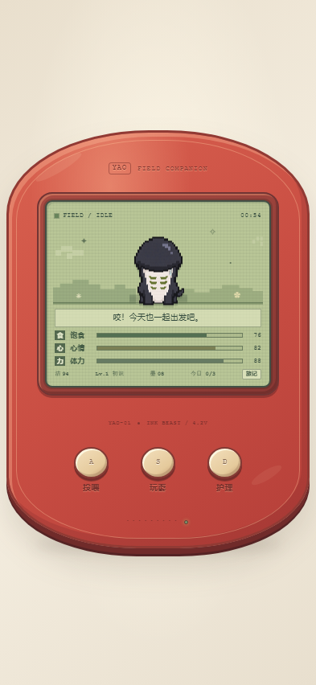

# 设计核对

## 参考与实现

- 视觉基准为用户提供的红色椭圆宠物机界面和用户确认的终末地阿咬正面像素形象；原始参考图未复制进仓库。
- 页面机壳沿用参考图的 722 × 997 比例，在手机窄屏按视口宽度缩放。
- 阿咬素材包含深色拱形外壳、白色长脸、六道绿纹、短粗近乎平足，以及黑白交界处生物左侧两股稍加宽、低透明度的口水。
- 主要入口为 `index.html`、`styles.css`、`app.js` 和 `assets/yao-pixel.png`；Android WebView 加载同一套页面与素材。
- 当前构建版本为 1.7（versionCode 8）。

## 画面核对

- Chrome 157 DevTools 手机视口为 393 × 852 CSS px、devicePixelRatio 1；页面报告 `innerWidth=393`、`innerHeight=852`。
- 机壳容器范围为 x=7.875 至 x=385.141 px，完整位于 393 px 画布内。
- 主页截图为 393 × 852 px，红色机壳、LCD、状态数值和三枚按键均完整可见。
- 手机视口预览：

## 交互核对

v1.4 的隔离 Chrome 手机视口中实际操作结果：

- A 键打开三种食物菜单；免费莓果将饱食度从 76 提高到 94。
- D 键可以梳理、擦拭、睡眠和唤醒；梳理将洁净度从 94 提高到 100。
- S 键启动 12 秒抓墨点小游戏；抓到 5 枚后记录最佳成绩，并按规则增加墨点。
- 每日照料达到 3 次时发放额外墨点；本次流程的墨点从 8 增至 12。
- 摸摸可以唤醒阿咬；旅记保存了本次喂食、护理、游戏和睡眠事件。

v1.5 已实现以下交互，v1.6 为阿咬增加了真实逐帧动作，v1.7 修复 Android WebView 加载动画帧的路径；新增交互尚未做专项核验：

- 触摸头部、脸部、短脚或口水边分别显示对应回应和动作。
- 点 LCD 空处会让阿咬走到该处；待机会随机眨眼、闻闻、伸展和散步。
- S 键打开追叶子、躲猫猫、贴贴、听阿咬说话和可选的追墨点挑战菜单。
- 喂食、梳理、擦拭、睡眠和叫醒各有动作效果；场景按本地时间显示晨、昼、昏、夜。
- 新增 4 × 4 透明帧表，按行提供待机眨眼、行走、进食和睡眠动画，每种 4 帧。

## 构建与设备核对

- `node --check app.js`：通过。
- `python -m json.tool manifest.webmanifest`：通过。
- Android APK 1.7 已构建；包信息为 versionCode 8、versionName 1.7，签名验证通过 v1、v2、v3 scheme。
- 1440 × 3168 px 真机截图和隔离浏览器交互记录来自 v1.4，不作为 v1.6/v1.7 动画和互动的验收证据。
- v1.5-v1.7 新增交互尚未运行专项测试；v1.7 尚无新的真机画面记录。
- 原始手机截图未纳入仓库，以免公开系统状态栏信息；文档中的视觉示例使用不含设备状态栏的 393 × 852 px 页面截图。
